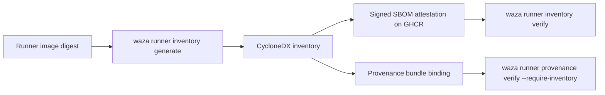

# Runner image and plugin component inventories

A component inventory lists the software inside one runner image or plugin and
is bound to that artifact's immutable sha256 digest. Waza publishes an
inventory for every reference runner image, binds it into execution provenance
bundles on request, and verifies offline that an inventory describes exactly the
image or plugin you consumed.

Inventories are evidence, not a policy decision: Waza does not scan for or
decide on vulnerabilities or licenses. Feed a verified inventory to the scanner
or policy engine you already use.

## Format

Inventories are CycloneDX 1.6 JSON (media type `application/vnd.cyclonedx+json`)
restricted to the closed profile `waza.component-inventory/1.0`
([schema](../schemas/component-inventory-1.0.schema.json)):

- `metadata.component` is the subject: `type` `container` (runner image) or
  `application` (plugin), a single `SHA-256` hash equal to the subject digest,
  and `bom-ref` `image:sha256:<hex>` or `plugin:sha256:<hex>`. Image subjects
  also carry `pkg:oci/<name>@sha256%3A<hex>?repository_url=<repository>`.
- `metadata.properties` names the profile (`waza:inventory.profile`) and subject
  kind (`waza:subject.kind`).
- `components` lists every component once, sorted by `bom-ref`, which is the
  package URL when one exists (`pkg:golang/...`, `pkg:deb/debian/...`) and
  `type/name@version#sha256:<hex>` otherwise. At most 20,000 components and
  16 MiB per inventory.

Generation is deterministic: the same image or plugin yields the same bytes.



## Generate

Runner image (inputs copied out of the image by digest):

```bash
image=ghcr.io/microsoft/waza-runner-reference@sha256:<hex>
container=$(docker create --platform linux/amd64 "$image")
docker cp -L "$container:/waza" ./waza-bin
docker cp -L "$container:/var/lib/dpkg/status" ./dpkg-status
docker cp -L "$container:/etc/os-release" ./os-release
docker rm "$container"
waza runner inventory generate --name ghcr.io/microsoft/waza-runner-reference \
  --digest sha256:<hex> --go-binary ./waza-bin --embedded-dir internal/embedded \
  --dpkg-status ./dpkg-status \
  --os-release ./os-release --out runner.cdx.json
```

Plugin artifact (the artifact's own sha256 becomes the subject digest):

```bash
waza runner inventory generate --subject plugin --name example-plugin \
  --subject-file example-plugin.tgz --from-cyclonedx plugin-deps.cdx.json \
  --out example-plugin.cdx.json
```

Sources: `--go-binary` (Go build information and file digest), `--embedded-dir`
(the bundled Copilot CLI and runtime payloads from `internal/embedded`, each
recorded with its version and sha256 only when found byte-for-byte inside a
`--go-binary`; generation fails if no Copilot CLI payload is embedded),
`--dpkg-status` (installed Debian packages), `--os-release`, `--file` (sha256 of a file), and
`--from-cyclonedx` (components imported from another CycloneDX JSON document,
for example a Syft or BuildKit SBOM). `--out` is never overwritten. Generation
fails rather than emit an inventory without an immutable digest.

## Verify

Verification is offline and requires the digest you consumed; tags are refused.

```bash
# Runner image
waza runner inventory verify --inventory runner.cdx.json \
  --image-digest sha256:<hex> --image-reference ghcr.io/microsoft/waza-runner-reference

# Plugin (hashes the artifact you are about to load)
waza runner inventory verify --inventory example-plugin.cdx.json \
  --plugin example-plugin.tgz --plugin-name example-plugin
```

The command prints a [`waza.inventory-verification`](../schemas/inventory-verification-1.0.schema.json)
report with five checks (`inventory`, `profile`, `subject`, `binding`,
`components`), the bound subject and a component summary by type and
ecosystem. Exit 0 means verified, 1 failed, 2 invalid flags.

The inventory's own integrity comes from the signature that delivered it:
either the GitHub SBOM attestation on the published image or the signed
provenance bundle that binds it by digest. Standalone verification proves the
inventory is internally consistent and bound to your digest.

### Published reference images

Every reference image publication (`publish-runner-reference.yml`) generates the
inventory from the pushed digest, verifies it, attests it with
`actions/attest` (predicate type `https://cyclonedx.org/bom`) to the same
digest on GHCR, and uploads it as a workflow artifact. To verify one yourself:

```bash
digest=sha256:<hex>
gh attestation verify "oci://ghcr.io/microsoft/waza-runner-reference@$digest" \
  --repo microsoft/waza --predicate-type https://cyclonedx.org/bom \
  --signer-workflow microsoft/waza/.github/workflows/publish-runner-reference.yml \
  --format json | jq '.[0].verificationResult.statement.predicate' > runner.cdx.json
waza runner inventory verify --inventory runner.cdx.json --image-digest "$digest"
```

`verify-runner-reference.yml` runs the same check before accepting a digest, and
the publisher's `Attest runner image component inventory` step must succeed.

### Provenance bundles

Bind the runner image inventory into a provenance bundle and require it:

```bash
waza runner provenance generate ... --image-digest sha256:<hex> \
  --bind component-inventory=runner.cdx.json
waza runner provenance verify --bundle bundle --public-key signing.pub.pem \
  --require-inventory
```

The `component-inventory` binding verifier checks that the inventory's subject
is the signed `runner.image.digest` and repository; generation refuses to sign
a mismatched inventory.

### Failure codes

| Code | Meaning | Action |
| --- | --- | --- |
| `inventory_missing` | No inventory supplied or file absent | Obtain the inventory published for the digest |
| `inventory_too_large` | Larger than 16 MiB | Not supported |
| `inventory_malformed` | Not JSON, duplicate keys, or outside the profile schema | Regenerate with `waza runner inventory generate` |
| `profile_unsupported` | Other profile version | Upgrade Waza |
| `subject_kind_invalid`, `subject_unbound`, `subject_purl_mismatch`, `subject_ref_mismatch` | Subject not bound to one digest, or altered | Treat as tampered |
| `expected_digest_missing`, `expected_digest_invalid` | No consumed digest, or a tag was given | Pass the `sha256:` digest you pulled or loaded |
| `subject_kind_mismatch` | Image inventory used for a plugin, or the reverse | Use the inventory for the artifact you consumed |
| `expected_kind_invalid` | The verifier was asked for a kind other than image or plugin | Request `image` or `plugin` |
| `subject_digest_mismatch` | Inventory describes another image or plugin | Treat as unverified; do not use |
| `subject_name_mismatch` | Pinned repository or plugin name differs | Confirm what you consumed |
| `components_empty`, `component_duplicate`, `component_ref_mismatch` | Component list altered | Treat as tampered |
| `component_purl_mismatch` | A component's name or version contradicts its package URL | Treat as tampered |
| `binding_required_missing` | `--require-inventory` and the bundle binds none | Regenerate the bundle with `--bind component-inventory=PATH` |

## Requirements for consumed images and plugins

- **Runner images:** consume by digest, and accept an image only when its
  inventory verifies against that digest (`verify-runner-reference.yml` does
  this for reference images). Require it in provenance with
  `--require-inventory`.
- **Plugins:** the runner does not load plugins today (plugin discovery is
  disabled in the runner contract). Deployments that add plugin artifacts must
  ship a `--subject plugin` inventory bound to the artifact sha256 and verify it
  with `--plugin` before loading.

## Maintainers

- The inventory is regenerated on every publication; no checked-in inventory
  needs updating. When the `native-reference` Dockerfile stage changes its
  binary path, package manager or OS, update the `Generate runner image
  component inventory` step.
- Profile changes need a new profile version and schema; never widen
  `waza.component-inventory/1.0`.

## Lab

The Lab runner page includes **Component inventory**: choose an inventory file,
select image or plugin, enter the consumed digest, and select **Verify
inventory**. The browser posts the inventory to `POST /api/v1/inventory/verify`
and shows the bound subject, verification state, component summary and
mismatch diagnostics, with a report download. It is unavailable in the
synthetic demo.

## Migration

Additive. Existing provenance bundles, images and runs are unchanged, and
inventory binding is optional unless the verifier passes `--require-inventory`.
Images published before this change have no inventory attestation; republish
them to obtain one.
