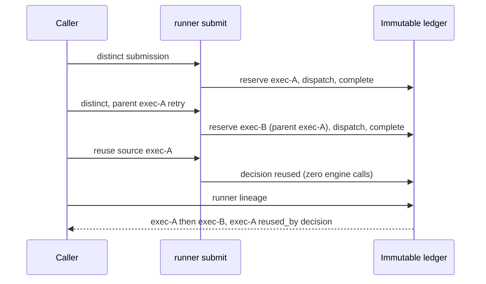

# Logical work and immutable execution attempts

This is an unreleased v0.41 **embedding API** preview for #764. It is not a
released CLI command, dashboard operation, checkpoint contract, or scheduler.
The public CLI/API/Lab integration remains pending. Ordinary `runner run` and
mutable result files keep their existing behavior.

## Identity and duplicate decisions

`executionattempt.Logical` uses the admitted runner identity's `Run` and `Trial`
as logical run and work. `Selection.Attempt` remains the declared native
ordinal. It is not the storage reservation identifier.

`runnerunit.Service.Submit` accepts the
`execution-submission-1.0.schema.json` wrapper around a complete runner request.
Omitting `policy`, or specifying `{"mode":"distinct"}`, creates a fresh opaque
256-bit `exec-` identifier before constructing a runtime. Repeated or concurrent
submissions retain one logical work identity but create independent reservations
and decisions. They do not claim a global order or exactly-once execution.

An optional distinct policy parent is
`{"execution_id":"exec-<64 lowercase hex characters>","relationship":"retry"}`.
`branch` is also supported. The original parent must exist and belong to the
same logical work. Parent traversal rejects cycles and more than 1,024 records.
Parents define a partial order; independent roots and sibling retries are not
silently collapsed into one attempt.

Explicit reuse uses
`{"mode":"reuse","source":{"execution_id":"exec-<64 lowercase hex characters>","manifest_digest":"<64 lowercase hex characters>"}}`.
The original canonical reservation, completion, manifest, every declared
artifact, terminal binding, and final marker must verify. A digest or an
unfinished reservation alone is insufficient. Reuse creates a separate immutable
decision, invokes no engine or publication observer, and returns the original
terminal without changing its ordinal, failure, cancellation, or exit code.
Historical usage is not new invocation billing; missing usage is unavailable.

When declared, `execution-attempt.json` must match the original reservation's
digest, byte length and JSON media type during completion and reuse admission.
Legacy manifests without that optional artifact remain readable. Reused receipts
check caller/source context while allowing the documented ordinal difference;
captured and historical reports preserve dynamic numeric tokens in grader details
and nested transcript arguments exactly. This uses explicit evidence decoding;
ordinary JSON readers retain their intentional legacy float64 representation.
Reuse also pins the original reservation and completion bytes through the final
source read used to publish its decision, including for legacy manifests without
the optional reservation artifact. A coherent sidecar replacement is not the
same admitted source.

Submission and checkpoint result writers validate the original typed terminal
before marshaling, so invalid UTF-8 cannot become an admitted replacement
character. A genuine valid replacement character remains valid diagnostic text.
Original submission diagnostic strings are checked before marshaling as well,
including submissions nested in checkpoint results.

Fresh before-dispatch publication holds the invocation's shared creator gate
through original-reservation and completion-absence checks, immutable writes,
and final checks. Dispatch and completion attempts take the same gate and
permanently disallow later before-dispatch publication, even after a failed or
unknown provider response. Creator copies share that state; it is not serialized
or reconstructed from evidence. Gate waits and blocked providers are not made
cancellable by the gate. This is not a worker lease or proof of recoverability:
recovery still requires complete bounded discovery and a stopped original worker.
Original reservation and decision values are also checked by their strict
encoders before wrapper marshaling. Partial receipts without a decision must
retain the complete original caller identity. Historical reports must declare
valid exact-unit admission, compatible status, no adjacent work, and both the
requested and resolved original selection. Alternate-ordinal reuse still
returns the original selection unchanged.

The terminal-only submission path does not serialize the private rich report.
Existing publication/artifact hooks that consume it still receive detached
original snapshots; no public output or capture-policy fallback is introduced.

```mermaid
sequenceDiagram
    participant Caller
    participant Submit
    participant Ledger
    participant Store
    Caller->>Submit: Distinct captured request
    Submit->>Ledger: Exclusive fresh reservation
    Ledger-->>Submit: Invocation-retained creator
    Submit->>Submit: Execute admitted work once
    Submit->>Store: Publish terminal and exact reservation
    Submit->>Store: Verify and finalize manifest
    Submit->>Ledger: Append completion using creator
    Caller->>Submit: Explicit original-source reuse
    Submit->>Store: Reread all content and final marker
    Submit->>Ledger: Append reuse decision
    Submit-->>Caller: Unchanged original outcome; zero new engine calls
```

## Storage, ownership, and uncertainty

The implementation reuses #763's local/Azure conditional namespace and immutable
manifest format. A `Creator` is an invocation-local capability, issued only after
exclusive reservation creation and exact readback. Reading a reservation,
knowing its ID, an occupied record, or an ambiguous create response cannot
reconstruct ownership. Same-creator completion retries accept only identical
canonical bytes; conflicting completion cannot replace existing evidence.

Each new submission includes `execution-attempt.json` containing its exact
canonical reservation. Consequently separate executions with identical terminal
bytes still have distinct manifest digests. A capture callback may return that
same artifact but cannot substitute another reservation. Raw `report.json`
publication is rejected; category-scoped capture belongs to the evidence layer.

Service-level regressions publish an original execution before exercising
reserved-name collisions with invalid bytes, another execution's valid
reservation, and incorrect media types. They reread the original reservation,
completion, manifest, and artifact bytes to prove none were overwritten. An
identical original reservation duplicate remains valid without adding a second
manifest entry. These are direct embedding-service controls, not public CLI,
API, or Lab delivery evidence.

The immutable distinct decision is recorded before runtime construction.
`Ledger.HasDistinctDecision` distinguishes reservation-only state from an
execution that may already have run, even if a crash prevented completion.
Truncated or invalid decision discovery cannot establish absence. This is not
a lock: recovery must separately establish that the original worker has stopped.

No reservation/completion/publication transaction, lease, crash durability,
worker liveness, authenticated execution provenance, or exactly-once guarantee
is implied. A storage error can leave immutable partial objects. Preserve
execution and manifest references; inspect before retrying. An unknown
finalization outcome or unreadable marker does not establish marker absence,
authorize a completion, or permit source reuse. A failed operation does not
erase terminal facts already observed.

## Embedding and disclosure

`Service.Submit(ctx, bytes, backend, hooks)` returns a typed submission result
and a separate operation error. An original evaluation failure can be a
successfully published operation with exit 1; publication errors are
`submission_error`, exit 2, without a completion claim. Callers must inspect both.
`EncodeSubmissionResult` and `ParseSubmissionResult` validate original wire
types, source/caller distinctions, and cross-field context without provider I/O.

The backend is operator-selected, never provided by request JSON.
`SubmissionHooks` are trusted embedding callbacks, not caller configuration.
Admission/reuse disclosure checks and first-publication preparation/validation
are separate. They receive detached original snapshots. Publication projection
may redact free-text diagnostics but cannot change the observed native outcome,
selection, identity, counters, or grader verdicts. The core is not itself a
disclosure authorization mechanism; do not expose unapproved reports or source
text through an HTTP endpoint.

Owned native execution rejects ambient custom providers and
`COPILOT_CLI_PATH` overrides before reservation and again before runtime
construction. Mock execution and source-only verified reuse do not construct a
native runtime. Native inference remains explicitly paid and opt-in through the
existing runner request.

## Public submission and lineage

`waza runner submit` and protected `POST /api/v1/submissions` are the public
callers of `Service.Submit`. Both read one `waza.execution-submission` wrapper
and emit one capture-approved `waza.execution-submission-result`. Policy
`distinct` (the default) always reserves a fresh execution ID, so a duplicate
submission is a new attempt, never an overwrite. Name a retry or branch parent
with `policy.parent`. Policy `reuse` admits only a verified finalized source and
makes zero engine calls; the reused record keeps its original terminal.

`waza runner lineage --run RUN --work WORK` and loopback-only
`GET /api/v1/lineage?run=RUN&work=WORK` emit one read-only
`waza.execution-lineage` 1.0 document for one logical work item. Attempts are
ordered by parent relationships (roots first, siblings by execution ID); this
is not wall-clock or global order. Each attempt shows its status (`reserved`,
`dispatched`, `completed`, `completion_unverified`), its retry/branch parent,
its verified terminal outcome, and the reuse decisions that cite it.



Lineage diagnostics never block reading the remaining records:

| Code | Meaning |
|------|---------|
| `concurrent_distinct_attempts` | More than one parentless attempt; concurrent or duplicate writers each received their own record |
| `sibling_attempts` | One parent has several children |
| `dispatched_without_completion` | Execution may have started; inspect before retrying |
| `completion_unverified` / `completion_verification_interrupted` | Completion marker exists but its terminal could not be verified |
| `parent_unavailable`, `reuse_source_unavailable`, `decision_reservation_unavailable`, `duplicate_dispatch_decision` | Referenced records are missing or contradictory |

Discovery follows provider pagination across the whole ledger (all logical
work) up to 262,144 records. The reader validates every completion, including
those for other work, and fails closed instead of returning a partial view when
that bound is exceeded or a record is unreadable, non-canonical or orphaned.
Reuse decisions with outcome `unfinished` or `conflict` are listed but never
linked as `reused_by`; successful reuse decisions must match the source's
logical work and execution context.

## Migration and remaining release gates

All sidecars have independent `1.0` schemas. Manifest v1, runner identity v1,
native ordinal semantics, and legacy result-reader defaults are unchanged.
Do not synthesize attempt/completion records for historical results, retag
original terminal bytes, or infer a creator from a checkpoint.

Existing manifest-only publications remain inspectable. Reuse requires actual
original ledger records, not an automatically migrated legacy result.
Public submission and lineage transport are available from source. Lab
lineage inspection, lifecycle controls, native-platform checks, and independent
review remain separate release gates.
