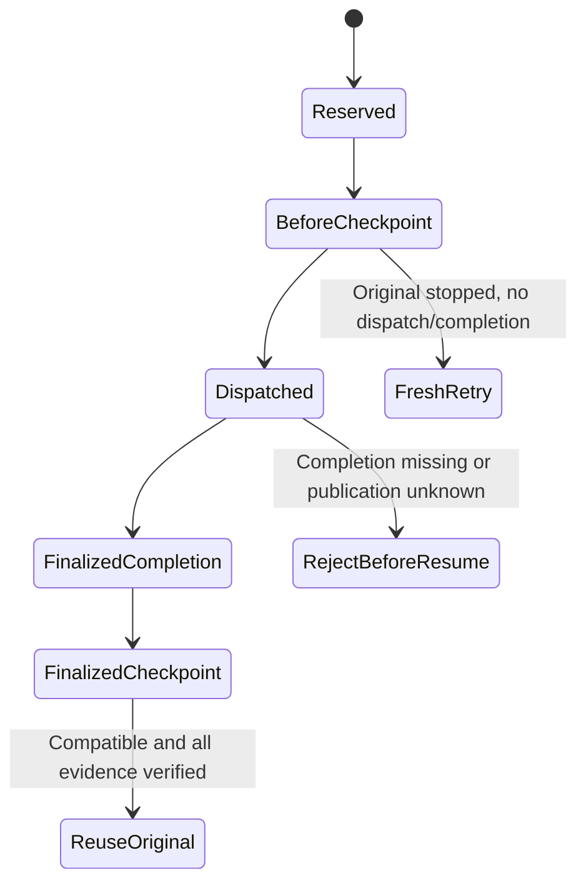

# Exact-unit checkpoint embedding API

This #765 layer, released in v0.41.0, builds on the
[logical-attempt core](EXECUTION_ATTEMPTS.md) and immutable manifest v1. It
provides an embedding service and the commands
`runner checkpoint create`, `runner checkpoint availability` and
`runner checkpoint resume`. Protected HTTP create/resume operations
are registered and consumed by the Lab. It admits whole-unit boundaries only;
broader native-platform evidence is not claimed.

## Supported boundaries

| Boundary | Stored evidence | Resume behavior |
|---|---|---|
| `before-unit` | Original reservation, compatibility, creation time | After stopping the original worker, create a fresh retry child only if no original completion **or dispatch decision** exists |
| `finalized-unit` | Original reservation/completion hashes and finalized manifest reference | Verify and reuse the exact original terminal, with zero new engine calls |

These are whole exact-unit boundaries. No SDK session, open process, workspace,
in-flight tool call, partial grader, or unobserved work is checkpointed.
`before-unit` is published in the retained creator's reservation hook before
dispatch/runtime construction. `finalized-unit` is published only after joined
execution and verified immutable completion.



The dispatch decision closes a recovery ambiguity: a worker may execute and die
before recording completion. Missing completion alone must never silently
authorize a rerun. Such a source's old `before-unit` checkpoint is stale even
when no terminal can be recovered. Preserve its evidence and explicitly start
separate work only after operator investigation. This is intentionally more
conservative than automatically retrying uncertain execution.

Checkpoint existence is not worker death or a lease. Operators/external
schedulers must stop and join the original worker before recovery. Concurrent
live-worker exclusion is not implemented. Decision discovery must be complete;
truncation, malformed records, mixed missing/I/O errors, or unknown publication
fail closed rather than proving absence.

Fresh before-unit publication uses the invocation-retained creator gate rather
than global discovery. Copies of that creator share the gate; dispatch and
completion attempts take it and permanently disallow later before publication,
even when the provider fails or its outcome is unknown. The gate remains held
through exact completion-absence and original-creator checks, immutable storage,
and final checks. It is not serialized or reconstructed from a checkpoint.
Provider operations receive the caller's context, but mutex waits and blocked
providers are not made cancellable by the gate.

Publishing a fresh checkpoint beyond the provider's 1,000-record discovery bound
does **not** establish recoverability. Before-unit recovery still rejects
truncated global discovery, even for an original that never dispatched. Preserve
the source and investigate rather than treating successful publication as
permission to retry. No provider lookup or worker lease was added.

## Compatibility and restore

`executioncheckpoint.ForRequest` binds the actual runner revision, request,
identity, terminal, manifest, attempt and completion schema versions, logical
work digest, and negotiation/paid-consent policy digest. Captured model,
tool/configuration and policy values flow through the shared logical identity.
Only the later caller's declared native attempt ordinal may change.

`runnercheckpoint.Service.Resume` checks compatibility before constructing a
runtime or creating another reservation. Diagnostics expose changed field names,
not captured input. Invalid/corrupt blobs, incompatible revisions or configuration,
noncanonical wire encodings, invalid source context, present-but-unverified
completion, and stale before checkpoints are rejected without repairing source
bytes.

Finalized restore pins the original reservation and completion through the
actual source read used to publish the reuse decision, then checks the returned
sidecars before reporting restored progress. Result codecs also bind source work
to the actual reused reservation or fresh retry child. These checks do not make
the provider reads or cross-object writes a transaction.

A finalized restore returns the original terminal outcome and ordinal, including
failure or cancellation. `restored_units: 1` and `remaining_work: 0` describe the
one supported exact unit, not an entire evaluation or fleet. Failed or unavailable
observations remain unavailable, not zero. Before-boundary recovery creates a new
execution ID with an explicit `retry` parent; it cannot rehydrate the dead
process's creator capability.

## Resume availability and troubleshooting

Before resuming, check whether a checkpoint can be resumed without executing,
reserving or repairing anything:

```bash
waza runner checkpoint availability CHECKPOINT_SHA256 --store .waza-artifacts \
  < submission.json > availability.json
```

Stdout is one [`waza.runner-checkpoint-availability`](../schemas/runner-checkpoint-availability-1.0.schema.json)
1.0 record. `available` (exit 0) reports the source boundary, `created_at`,
original execution ID, the resume action (`fresh_retry_child` or
`reuse_original_terminal`) and the restored/remaining units that resume would
report. `unavailable` (exit 6) explains why with a stable code and fixed
guidance; `rejected` (exit 6) means the request itself was invalid; and
`operation_error` (exit 2) means the store or build could not be checked. Source
metadata is disclosed only when the result is `available`, and diagnostics never
include captured input or provider causes. Availability can change before resume,
for example when an original before-unit attempt dispatches, so resume repeats
every check. The dashboard server accepts the same submission at
`POST /api/v1/checkpoints/{digest}/availability` (200 available, 409
unavailable, 400 rejected, 503 operation error).

Per-boundary resume workflows. A before-unit checkpoint is only resumable while
the original never dispatched, so it comes from an interrupted worker, which
never writes final JSON; take its digest from the stderr progress line
`checkpoint before-unit <digest>` after the worker has stopped:

```bash
waza runner checkpoint create --store .waza-artifacts < submission.json \
  > checkpoint-result.json 2> checkpoint-progress.log &
WORKER=$!
# ... the worker is interrupted before execution starts ...
kill "$WORKER"; wait "$WORKER"  # stop and join it before checking
BEFORE="$(awk '$1 == "checkpoint" && $2 == "before-unit" { print $3 }' checkpoint-progress.log)"
waza runner checkpoint availability "$BEFORE" --store .waza-artifacts < submission.json \
  && waza runner checkpoint resume "$BEFORE" --store .waza-artifacts < submission.json  # fresh retry child
```

A completed `create` leaves its before-unit checkpoint stale; recover from its
finalized-unit checkpoint, which reuses the original terminal with zero new
engine calls:

```bash
waza runner checkpoint create --store .waza-artifacts < submission.json \
  > checkpoint-result.json
FINAL="$(jq -er '.finalized_checkpoint_sha256' checkpoint-result.json)"
waza runner checkpoint availability "$FINAL" --store .waza-artifacts < submission.json \
  && waza runner checkpoint resume "$FINAL" --store .waza-artifacts < submission.json
```

| Code | Meaning | Action |
| --- | --- | --- |
| `checkpoint_not_found` | No blob with this digest in the selected store. | Check `--store`/`--azure-container-url` and copy the digest from the create result or stderr progress. |
| `checkpoint_corrupt` | Stored bytes differ from the digest or are not canonical. | Preserve the blob for investigation; never edit or resume it. |
| `checkpoint_incompatible` | Build revision, work, policy or consent differs (`compatibility_differences` names fields). | Use the original clean build or rerun as new work; there is no cross-version resume. |
| `checkpoint_policy_conflict` | The submission policy contradicts the boundary. | Omit the policy, or use a distinct retry for before-unit and reuse of the exact source for finalized-unit. |
| `checkpoint_stale` | The original before-unit attempt already dispatched or completed. | Use the finalized checkpoint, or inspect `waza runner lineage` before starting separate work. |
| `checkpoint_before_source_rejected` | The original reservation, its dispatch state or the retry ancestry that resume would admit could not be verified. | Preserve records and inspect operator logs before any retry. |
| `checkpoint_finalized_source_rejected` | The original completion, manifest, terminal or captured `report.json` could not be verified, or the source's execution mode or graders differ from the caller (the same source admission resume performs). | Preserve records; the original terminal cannot be reused. |
| `checkpoint_runtime_rejected` | This environment would not admit the owned runtime that a before-unit retry needs (for example `COPILOT_CLI_PATH` or an ambient custom provider is set). | Clear those settings and check again, or use the legacy runner. Finalized reuse does not depend on runtime configuration. |
| `checkpoint_capture_policy_rejected` | The source holds restricted identifiers or diagnostic text. | Capture policy will not reuse or disclose it; rerun as new work. |
| `checkpoint_digest_invalid`, `checkpoint_input_invalid`, `checkpoint_request_invalid` | The digest or captured submission is malformed, or the request is not admissible (for example `selection.attempt` exceeds `max_attempts`); resume rejects it the same way. | Pass 64 lowercase hex characters and a recaptured `waza.execution-submission`. |
| `checkpoint_storage_unavailable`, `checkpoint_storage_close_failed`, `checkpoint_build_unavailable` | The store or clean build could not be used, including a permission, provider or truncated-transfer failure while reading the checkpoint or its original source. | Fix storage access or rebuild from a clean VCS-stamped tree, then retry the check. |

Not resumable by design: partial work inside a unit (resume restarts the whole
unit), a before-unit checkpoint once its original dispatched, any checkpoint
created by a different build revision, and historical runs that have no
checkpoint (none are synthesized).

## Embedding API and publication failures

Use `runnercheckpoint.NewService(runner, revision)` with the actual owning build
revision. `Submit` wraps an explicit distinct submission; `Resume` additionally
accepts the immutable checkpoint digest. Both accept the existing operator-owned
backend and trusted submission hooks. `Published` reports exact blob references,
not a mutable "latest" pointer or publication transaction.

The owning public CLI must obtain its revision from `CurrentRunnerRevision`,
which requires a clean VCS-stamped Waza CLI build. Test-provided revision strings
are integration controls, not evidence that a clean production CLI was run.
Working-directory Git, caller JSON and version-shaped fallback strings are not
accepted sources of build identity.

The shared CLI input reader accepts an explicit bound for submission wrappers
(`runnerunit.MaxSubmissionBytes`), including inherited stdin. It retains one
extra byte so the strict parser can reject oversized input rather than accepting
a truncated document. Legacy `runner run` and `runner validate` retain their
original `runnercontract.MaxRequestBytes` bound and stdin cancellation behavior.
Public commands use this wrapper bound, not the bare runner-request bound.

The CLI accepts the existing private store through `--store` or an explicit Azure
container through `--azure-container-url`; those flags are mutually exclusive.
It writes one capture-approved `waza.runner-checkpoint-result` record to stdout
and boundary/digest progress to stderr. Ordinary success, rejection, and
checkpoint results retain strict schema version `1.0`. Store-open/close
operational failures use schema version `1.1`, top-level `operation_error`,
exit code `2`, and an allowlisted sanitized `error_code`; no submission or
source is fabricated before admission. Save stdout even when the exit is
nonzero: a close failure after execution preserves the capture-approved
submission, source and checkpoint references when their linkage is valid,
including the submission's original status and exit. If an admitted source
cannot be linked to the retained submission, it is withheld and
`source_withheld` is true. The CLI writes underlying causes to operator stderr;
server operational logs may include causes, but submission-parser failures log
only the failure stage, action and guidance, not the parser error or request.
Consumers must treat the levels separately: top-level exit `2` can coexist with
a preserved completed or reused submission whose nested exit is `0`.
The Lab reader performs schema and cross-field checks locally and re-encodes a
retained 1.0 runner-unit report the way the native canonical writer does:
field order, omitted empty fields, integer ranges, sorted dynamic map keys and
Go string escaping must match, while whitespace differences are accepted. A
report that contradicts the native writer is rejected. When the report contains
evidence with custom native encodings (transcript events, judge evidence,
evidence manifests, tool-call results or failure-artifact timestamps), the Lab
cannot finish the comparison and labels statuses and exit codes as unverified
claims. Numeric tokens beyond exact float64 integers inside dynamic evidence are
rejected by the browser parser even where the native reader keeps them. Pasted
results stay in the browser.
An output failure exits 2 and is not successful delivery.
See the [operator workflow](../site/src/content/docs/guides/immutable-artifacts.mdx#checkpoint-public-source-preview).

The dashboard server registers `POST /api/v1/checkpoints` and
`POST /api/v1/checkpoints/{digest}/resume`. Both accept the same submission JSON
and return the protected checkpoint-result record with `X-Waza-Exit-Code`.
They require a loopback peer, literal loopback Host, same-origin browser metadata,
JSON content type, and bounded request/response transport. The server selects
the existing `RESULTS_DIR/.waza-artifacts` store or its configured Azure provider;
request JSON cannot select host paths or provider locations. Unsupported active
providers fail closed. No raw checkpoint GET endpoint is exposed.

The Lab's **Runner contract** page explicitly creates or resumes one unit,
shows compatibility, source withholding, original terminal outcome/ordinal, retry
parent or reuse source, and separate new/original engine-call counts. Unknown
progress stays unavailable; recorded zero stays zero. It downloads the exact
protected response, not a reconstruction or raw report. Edits, new requests and
reload failures clear old results; demo mode has no operation inputs.
Contradictory original terminal exits or new engine-call counts are rejected,
not displayed or exported as successful results.
Error observations may retain partial or empty grader verdicts; they are not
reclassified as successfully graded work.
Completion declarations must match the original execution ID and canonical
reservation digest before display or download. This checks declaration linkage,
not storage integrity or execution authority.
Resume source declarations must also hash to the requested checkpoint digest,
independent of response object-key order, before display or download.
Compatible resumes also require the native request-policy digest for the current
versions, required/optional capabilities and explicit paid-execution consent.
Native-valid reordered policy arrays remain equivalent; consent-only changes
do not. The decision's full selection must match the admitted current attempt,
while the reused original reservation and terminal retain their older attempt.
A completed resume, including a partial publication failure, without a source is
rejected unless the failure explicitly withholds it. Source-withheld failures remain
available with their recorded unavailable progress.
Create results cannot contain resume-only source or reuse state.
Retained submissions must match the captured submission schema and requested
distinct/reuse mode, explicit parent, and reuse source; rejections before
metadata admission remain visible. Distinct resumes require a retry parent
even when the source is withheld; its identity cannot then be checked against
that source.
Stopping a browser request is not proof of worker termination. This panel is
not an ordered evaluation-wide attempt history or a whole-evaluation resume UI.

`Put` can return a digest **and an error** if a blob may remain after failure.
Preserve that reference and inspect it; never treat it as verified publication.
Finalized checkpoint publication can fail after the original execution completed.
The operation then has `checkpoint_error`, exit 2, while retaining the original
submission's terminal facts. There is no cross-object transaction, automatic
rollback, inferred crash durability, or deletion of partial evidence.

Finalized publication retains its separate 10-second budget after the runner
joins, independent of the original request timeout and cancellation. Compatibility,
native selection and full identity checks share one original-wire declaration;
creator validation and immutable persistence still use that bounded publication
context. A large accepted prompt must not trigger redundant identity derivation
inside this budget. Deadline failures retain the underlying context error; they
do not imply that submission admission or execution failed.

Negotiation uses `runnercontract.NegotiateValidatedRequest` only after `Parse`
validates the original full-request wire. This helper performs capability/version
selection without reparsing, serializing captured input, or imposing the narrower
negotiation-only schema's offer limits. It does not validate arbitrary typed
requests or admit execution; unknown required capabilities still fail negotiation.

Raw core results can contain original source metadata. They are not approved
public disclosure responses. `SubmitCaptured` and `ResumeCaptured` compose the
evidence owner's shared `ownedsubmission.CaptureHooks` before projection and
encoding. An incompatible resume can return a source before submission hooks run;
the wrapper withholds that unapproved source rather than encoding the raw result.
Capture-denied finalized reuse returns a protected submission error (HTTP 500,
exit 2) without new engine calls. The HTTP regression checks withheld source and
terminal data and unchanged original artifact, manifest, sidecar and checkpoint bytes.
The checkpoint result writer validates the original nested submission, including
its reservation, decision and terminal, before marshaling. Invalid UTF-8 is
rejected rather than normalized into apparently valid text. Original
checkpoint-level diagnostic strings are checked before marshaling as well.

Submission and both recovery adapters avoid HTML escaping of admitted request
JSON. Literal `<`, `>` and `&` in captured inputs do not expand solely because
the adapter wraps the request; original request-size bounds still apply.

Creator-validation failures retain phase timings, context states and the
original error cause. `request_declaration` reports the earlier compatibility
derivation and its operation-context snapshots; `creator_publication` separately
reports retained-reservation, selection, identity and provider-validation
phases and the publication context. Finalized publication uses a separate
10-second context without the operation's cancellation. Its
`creator_declaration_elapsed` excludes the earlier derivation and intervening
execution; it is not the former combined `declaration_elapsed`. Callers using
`DeclareRequest` without a context receive `unavailable` for request-context
observations. Timings are diagnostics, not execution or recovery evidence.
Publication budgets are unchanged. A timeout remains a publication failure:
preserve the original completion and any reported unverified blob rather than
retrying.
The CLI sends underlying input, build, operation and flag-parsing errors to bounded operator stderr while
keeping the public JSON diagnostic sanitized. Conflicting store flags also use
the single-record JSON rejection path. Build-revision admission failures retain
their actionable cause and rebuild guidance on operator stderr as well.

## Migration and validation limits

Checkpoint and checkpoint-result sidecars have independent `1.0` versions.
Legacy result files, manifest v1, identity v1 and ordinary `runner run` remain
unchanged. No historical checkpoint or ownership metadata is synthesized.
There is no implicit cross-revision resume. The availability record is a new,
independent `1.0` schema; it adds no field to existing checkpoint or result
documents, so no migration is needed.

The retained process controls kill an actual Go test subprocess at each
supported boundary and recover through a fresh production service owner. They
verify that finalized work is not rerun and missing/corrupt original evidence
fails closed. They use authored revision metadata and injected mock engines;
they are not production CLI/clean-build, live-inference, native Windows, or Lab
evidence. The root test process skips two Unix permission-denial cases; those
same compiled cases are separately executed under a non-root identity.

The additional Linux production-process fixture discovers the current native
build inputs with `go list`, including modified/new source and ignored embedded
assets, verifies their copied bytes, and commits only that snapshot in a private
test-owned repository. The caller's checkout need not be clean. One ordinary CLI
build carries the genuine fixture-local revision and is reused across recovery
controls. A Linux syscall tracer
stops the unchanged binary when the actual immutable boundary blob becomes visible,
kills and reaps it, and joins its output-copy goroutines before starting a fresh
CLI. It does not use a bounded diagnostic write or a wall-clock pause as a barrier.
Before restore creates a fresh retry child; finalized success and failed-check
restore preserve original terminal bytes with zero new calls. A separate actual
service producer leaves a dispatch without completion; the compiled consumer
refuses it without new records. That control does not kill a CLI mid-dispatch.
These are offline mock-execution controls, not native runtime, LFS installation,
live inference, dashboard delivery, or Windows execution evidence.

Ordered evaluation-level lineage, generic protected submissions, full current-head
broad/platform gates and independent review remain release blockers. Broad test
failures and timed-out lint runs are not passing checks even when focused recovery
controls pass.
