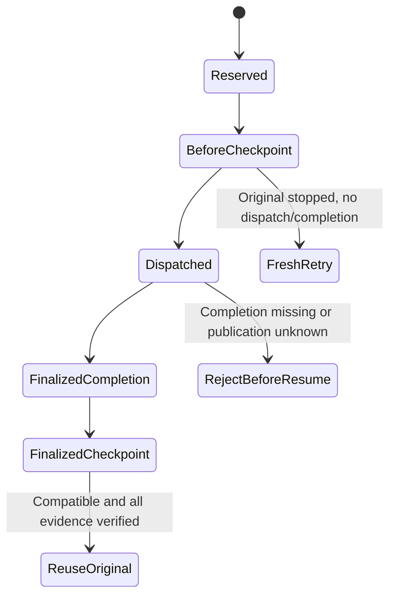

# Exact-unit checkpoint embedding preview

This unreleased, partial #765 layer builds on the
[logical-attempt core](EXECUTION_ATTEMPTS.md) and immutable manifest v1. It
provides an embedding service, not released CLI commands, protected HTTP
operations, or a Lab checkpoint view. Those public surfaces and full #755
acceptance remain pending.

## Supported boundaries

| Boundary | Stored evidence | Resume behavior |
|---|---|---|
| `before-unit` | Original reservation, compatibility, creation time | After stopping the original worker, create a fresh retry child only if no original completion **or dispatch decision** exists |
| `finalized-unit` | Original reservation/completion hashes and finalized manifest reference | Verify and reuse the exact original terminal, with zero new engine calls |

These are whole exact-unit boundaries. No SDK session, open process, workspace,
in-flight tool call, partial grader, or unobserved work is checkpointed.
`before-unit` is published in the retained creator's reservation hook before
dispatch/runtime construction. `finalized-unit` is published only after joined
execution and verified immutable completion.

The dispatch decision closes a recovery ambiguity: a worker may execute and die
before recording completion. Missing completion alone must never silently
authorize a rerun. Such a source's old `before-unit` checkpoint is stale even
when no terminal can be recovered. Preserve its evidence and explicitly start
separate work only after operator investigation. This is intentionally more
conservative than automatically retrying uncertain execution.

Checkpoint existence is not worker death or a lease. Operators/external
schedulers must stop and join the original worker before recovery. Concurrent
live-worker exclusion is not implemented. Decision discovery must be complete;
truncation, malformed records, mixed missing/I/O errors, or unknown publication
fail closed rather than proving absence.

## Compatibility and restore

`executioncheckpoint.ForRequest` binds the actual runner revision, request,
identity, terminal, manifest, attempt and completion schema versions, logical
work digest, and negotiation/paid-consent policy digest. Captured model,
tool/configuration and policy values flow through the shared logical identity.
Only the later caller's declared native attempt ordinal may change.

`runnercheckpoint.Service.Resume` checks compatibility before constructing a
runtime or creating another reservation. Diagnostics expose changed field names,
not captured input. Invalid/corrupt blobs, incompatible revisions or configuration,
noncanonical wire encodings, invalid source context, present-but-unverified
completion, and stale before checkpoints are rejected without repairing source
bytes.

A finalized restore returns the original terminal outcome and ordinal, including
failure or cancellation. `restored_units: 1` and `remaining_work: 0` describe the
one supported exact unit, not an entire evaluation or fleet. Failed or unavailable
observations remain unavailable, not zero. Before-boundary recovery creates a new
execution ID with an explicit `retry` parent; it cannot rehydrate the dead
process's creator capability.

## Embedding API and publication failures

Use `runnercheckpoint.NewService(runner, revision)` with the actual owning build
revision. `Submit` wraps an explicit distinct submission; `Resume` additionally
accepts the immutable checkpoint digest. Both accept the existing operator-owned
backend and trusted submission hooks. `Published` reports exact blob references,
not a mutable "latest" pointer or publication transaction.

The owning public CLI must obtain its revision from `CurrentRunnerRevision`,
which requires a clean VCS-stamped Waza CLI build. Test-provided revision strings
are integration controls, not evidence that a clean production CLI was run.
Working-directory Git, caller JSON and version-shaped fallback strings are not
accepted sources of build identity.

`Put` can return a digest **and an error** if a blob may remain after failure.
Preserve that reference and inspect it; never treat it as verified publication.
Finalized checkpoint publication can fail after the original execution completed.
The operation then has `checkpoint_error`, exit 2, while retaining the original
submission's terminal facts. There is no cross-object transaction, automatic
rollback, inferred crash durability, or deletion of partial evidence.

Raw core results can contain original source metadata. They are not approved
public disclosure responses. Public endpoints must compose the evidence owner's
capture policy before encoding them; that integration remains separately owned.

## Migration and validation limits

Checkpoint and checkpoint-result sidecars have independent `1.0` versions.
Legacy result files, manifest v1, identity v1 and ordinary `runner run` remain
unchanged. No historical checkpoint or ownership metadata is synthesized.
There is no implicit cross-revision resume.

The retained process controls kill an actual Go test subprocess at each
supported boundary and recover through a fresh production service owner. They
verify that finalized work is not rerun and missing/corrupt original evidence
fails closed. They use authored revision metadata and injected mock engines;
they are not production CLI/clean-build, live-inference, native Windows, or Lab
evidence. The root test process skips two Unix permission-denial cases; those
same compiled cases are separately executed under a non-root identity.

Protected CLI/API/Lab integration, compiled clean-CLI kill/resume cases, all
current-head broad/platform gates and independent review remain release blockers.
