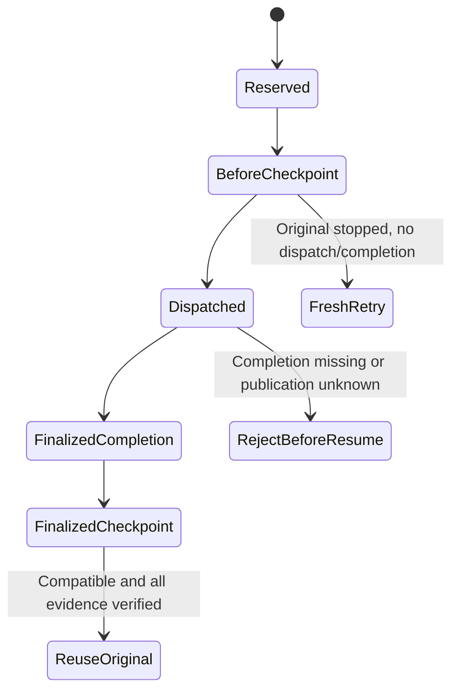

# Exact-unit checkpoint embedding preview

This unreleased, partial #765 layer builds on the
[logical-attempt core](EXECUTION_ATTEMPTS.md) and immutable manifest v1. It
provides an embedding service and unreleased source commands
`runner checkpoint create` and `runner checkpoint resume`. Installed v0.40.1
artifacts do not contain these commands. Protected HTTP create/resume operations
are registered and consumed by the source Lab. Broader native-platform evidence
and full #755 acceptance remain pending.

## Supported boundaries

| Boundary | Stored evidence | Resume behavior |
|---|---|---|
| `before-unit` | Original reservation, compatibility, creation time | After stopping the original worker, create a fresh retry child only if no original completion **or dispatch decision** exists |
| `finalized-unit` | Original reservation/completion hashes and finalized manifest reference | Verify and reuse the exact original terminal, with zero new engine calls |

These are whole exact-unit boundaries. No SDK session, open process, workspace,
in-flight tool call, partial grader, or unobserved work is checkpointed.
`before-unit` is published in the retained creator's reservation hook before
dispatch/runtime construction. `finalized-unit` is published only after joined
execution and verified immutable completion.

The dispatch decision closes a recovery ambiguity: a worker may execute and die
before recording completion. Missing completion alone must never silently
authorize a rerun. Such a source's old `before-unit` checkpoint is stale even
when no terminal can be recovered. Preserve its evidence and explicitly start
separate work only after operator investigation. This is intentionally more
conservative than automatically retrying uncertain execution.

Checkpoint existence is not worker death or a lease. Operators/external
schedulers must stop and join the original worker before recovery. Concurrent
live-worker exclusion is not implemented. Decision discovery must be complete;
truncation, malformed records, mixed missing/I/O errors, or unknown publication
fail closed rather than proving absence.

Fresh before-unit publication uses the invocation-retained creator gate rather
than global discovery. Copies of that creator share the gate; dispatch and
completion attempts take it and permanently disallow later before publication,
even when the provider fails or its outcome is unknown. The gate remains held
through exact completion-absence and original-creator checks, immutable storage,
and final checks. It is not serialized or reconstructed from a checkpoint.
Provider operations receive the caller's context, but mutex waits and blocked
providers are not made cancellable by the gate.

Publishing a fresh checkpoint beyond the provider's 1,000-record discovery bound
does **not** establish recoverability. Before-unit recovery still rejects
truncated global discovery, even for an original that never dispatched. Preserve
the source and investigate rather than treating successful publication as
permission to retry. No provider lookup or worker lease was added.

## Compatibility and restore

`executioncheckpoint.ForRequest` binds the actual runner revision, request,
identity, terminal, manifest, attempt and completion schema versions, logical
work digest, and negotiation/paid-consent policy digest. Captured model,
tool/configuration and policy values flow through the shared logical identity.
Only the later caller's declared native attempt ordinal may change.

`runnercheckpoint.Service.Resume` checks compatibility before constructing a
runtime or creating another reservation. Diagnostics expose changed field names,
not captured input. Invalid/corrupt blobs, incompatible revisions or configuration,
noncanonical wire encodings, invalid source context, present-but-unverified
completion, and stale before checkpoints are rejected without repairing source
bytes.

Finalized restore pins the original reservation and completion through the
actual source read used to publish the reuse decision, then checks the returned
sidecars before reporting restored progress. Result codecs also bind source work
to the actual reused reservation or fresh retry child. These checks do not make
the provider reads or cross-object writes a transaction.

A finalized restore returns the original terminal outcome and ordinal, including
failure or cancellation. `restored_units: 1` and `remaining_work: 0` describe the
one supported exact unit, not an entire evaluation or fleet. Failed or unavailable
observations remain unavailable, not zero. Before-boundary recovery creates a new
execution ID with an explicit `retry` parent; it cannot rehydrate the dead
process's creator capability.

## Embedding API and publication failures

Use `runnercheckpoint.NewService(runner, revision)` with the actual owning build
revision. `Submit` wraps an explicit distinct submission; `Resume` additionally
accepts the immutable checkpoint digest. Both accept the existing operator-owned
backend and trusted submission hooks. `Published` reports exact blob references,
not a mutable "latest" pointer or publication transaction.

The owning public CLI must obtain its revision from `CurrentRunnerRevision`,
which requires a clean VCS-stamped Waza CLI build. Test-provided revision strings
are integration controls, not evidence that a clean production CLI was run.
Working-directory Git, caller JSON and version-shaped fallback strings are not
accepted sources of build identity.

The shared CLI input reader accepts an explicit bound for submission wrappers
(`runnerunit.MaxSubmissionBytes`), including inherited stdin. It retains one
extra byte so the strict parser can reject oversized input rather than accepting
a truncated document. Legacy `runner run` and `runner validate` retain their
original `runnercontract.MaxRequestBytes` bound and stdin cancellation behavior.
Public commands use this wrapper bound, not the bare runner-request bound.

The CLI accepts the existing private store through `--store` or an explicit Azure
container through `--azure-container-url`; those flags are mutually exclusive.
It writes one capture-approved `waza.runner-checkpoint-result` record to stdout
and boundary/digest progress to stderr. Save stdout even when the exit is nonzero:
reused failure, cancellation, and timeout preserve their original exit codes.
An output or storage-close failure exits 2 and is not successful delivery.
See the [operator workflow](../site/src/content/docs/guides/immutable-artifacts.mdx#checkpoint-public-source-preview).

The dashboard server registers `POST /api/v1/checkpoints` and
`POST /api/v1/checkpoints/{digest}/resume`. Both accept the same submission JSON
and return the protected checkpoint-result record with `X-Waza-Exit-Code`.
They require a loopback peer, literal loopback Host, same-origin browser metadata,
JSON content type, and bounded request/response transport. The server selects
the existing `RESULTS_DIR/.waza-artifacts` store or its configured Azure provider;
request JSON cannot select host paths or provider locations. Unsupported active
providers fail closed. No raw checkpoint GET endpoint is exposed.

The source Lab's **Runner contract** page explicitly creates or resumes one unit,
shows compatibility, source withholding, original terminal outcome/ordinal, retry
parent or reuse source, and separate new/original engine-call counts. Unknown
progress stays unavailable; recorded zero stays zero. It downloads the exact
protected response, not a reconstruction or raw report. Edits, new requests and
reload failures clear old results; demo mode has no operation inputs.
Contradictory original terminal exits or new engine-call counts are rejected,
not displayed or exported as successful results.
Error observations may retain partial or empty grader verdicts; they are not
reclassified as successfully graded work.
Completion declarations must match the original execution ID and canonical
reservation digest before display or download. This checks declaration linkage,
not storage integrity or execution authority.
Resume source declarations must also hash to the requested checkpoint digest,
independent of response object-key order, before display or download.
Stopping a browser request is not proof of worker termination. This panel is
not an ordered evaluation-wide attempt history or a whole-evaluation resume UI.

`Put` can return a digest **and an error** if a blob may remain after failure.
Preserve that reference and inspect it; never treat it as verified publication.
Finalized checkpoint publication can fail after the original execution completed.
The operation then has `checkpoint_error`, exit 2, while retaining the original
submission's terminal facts. There is no cross-object transaction, automatic
rollback, inferred crash durability, or deletion of partial evidence.

Raw core results can contain original source metadata. They are not approved
public disclosure responses. `SubmitCaptured` and `ResumeCaptured` compose the
evidence owner's shared `ownedsubmission.CaptureHooks` before projection and
encoding. An incompatible resume can return a source before submission hooks run;
the wrapper withholds that unapproved source rather than encoding the raw result.
Capture-denied finalized reuse returns a protected submission error (HTTP 500,
exit 2) without new engine calls. The HTTP regression checks withheld source and
terminal data and unchanged original artifact, manifest, sidecar and checkpoint bytes.
The checkpoint result writer validates the original nested submission, including
its reservation, decision and terminal, before marshaling. Invalid UTF-8 is
rejected rather than normalized into apparently valid text. Original
checkpoint-level diagnostic strings are checked before marshaling as well.

Submission and both recovery adapters avoid HTML escaping of admitted request
JSON. Literal `<`, `>` and `&` in captured inputs do not expand solely because
the adapter wraps the request; original request-size bounds still apply.

Creator-validation failures retain elapsed declaration phases and context states
alongside the original error cause. Inspect compatibility, selection and identity
work separately from the retained-reservation and provider-validation phases;
phase timings are diagnostics, not execution or recovery evidence. Publication
budgets are unchanged. A timeout remains a publication failure: preserve the
original completion and any reported unverified blob rather than retrying.
The CLI sends underlying operation errors to bounded operator stderr while
keeping the public JSON diagnostic sanitized. Conflicting store flags also use
the single-record JSON rejection path. Build-revision admission failures retain
their actionable cause and rebuild guidance on operator stderr as well.

## Migration and validation limits

Checkpoint and checkpoint-result sidecars have independent `1.0` versions.
Legacy result files, manifest v1, identity v1 and ordinary `runner run` remain
unchanged. No historical checkpoint or ownership metadata is synthesized.
There is no implicit cross-revision resume.

The retained process controls kill an actual Go test subprocess at each
supported boundary and recover through a fresh production service owner. They
verify that finalized work is not rerun and missing/corrupt original evidence
fails closed. They use authored revision metadata and injected mock engines;
they are not production CLI/clean-build, live-inference, native Windows, or Lab
evidence. The root test process skips two Unix permission-denial cases; those
same compiled cases are separately executed under a non-root identity.

The additional Linux production-process fixture builds the ordinary owning CLI
from an isolated clean checkout of committed build inputs. A Linux syscall tracer
stops the unchanged binary when the actual immutable boundary blob becomes visible,
kills and reaps it, and joins its output-copy goroutines before starting a fresh
CLI. It does not use a bounded diagnostic write or a wall-clock pause as a barrier.
Before restore creates a fresh retry child; finalized success and failed-check
restore preserve original terminal bytes with zero new calls. A separate actual
service producer leaves a dispatch without completion; the compiled consumer
refuses it without new records. That control does not kill a CLI mid-dispatch.
These are offline mock-execution controls, not native runtime, LFS installation,
live inference, dashboard delivery, or Windows execution evidence.

Ordered evaluation-level lineage, generic protected submissions, full current-head
broad/platform gates and independent review remain release blockers. Broad test
failures and timed-out lint runs are not passing checks even when focused recovery
controls pass.
