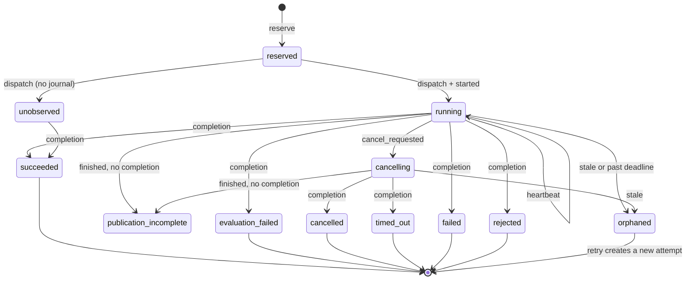

# Execution lifecycle semantics

Status: unreleased source preview (#767). Builds on
[logical work and execution attempts](EXECUTION_ATTEMPTS.md) and the
diagnostics storage layer from #957.

Every dispatched attempt has one **owner**: the process that reserved it and
holds its creator capability. The owner records a small append-only lifecycle
journal next to the attempt. Readers derive lifecycle state from that journal
and the attempt's immutable ledger records. Derivation never writes, repairs or
replaces evidence, and Waza owns no retry policy or cross-worker controller:
retry eligibility is advisory metadata for operators and external schedulers.

## Journal events

Each event is a canonical `waza.execution-lifecycle-event` 1.0 object
([schema](../schemas/execution-lifecycle-1.0.schema.json)). Events are stored as
chained diagnostic revisions scoped by execution ID, reservation digest and the
dispatch decision, so no other attempt can write into this journal.

| Event | Written when | Fields |
|-------|--------------|--------|
| `started` | Before the runtime is constructed | `deadline_at`, `heartbeat_interval_ms` |
| `heartbeat` | Every interval while the owner runs (default 10s) | `at` |
| `cancel_requested` | The owner context ends before execution returns | `reason`: `caller` (signal, client disconnect) or `deadline` |
| `cancel_acknowledged` | Execution and runtime shutdown joined after a request | `at` |
| `forced` | The native runtime transport was hard-stopped on cancellation or deadline, or shutdown exceeded its 5s bound, with or without a prior request | `at` |
| `finished` | The terminal envelope is computed, before publication | `outcome` |

Order is enforced on read: `started` first and once; acknowledgement only after
a request; at most one of acknowledgement or force; nothing after `finished`. A
corrupt, unchained or out-of-order journal is reported as
`observation: "invalid"` with a `lifecycle_journal_invalid` diagnostic and
supports no liveness claim. Only the attempt's owner can write its journal: the
writer is bound to the reserved execution, reservation digest and dispatch
decision, and every write revalidates the retained creator before provider I/O.
Public IDs alone never authorize a write. The owner waits at most 2s per write,
even when provider I/O ignores cancellation, and writes are independent of
cancellation. Journal failures never change the execution outcome: the first
failed, unknown or stalled write stops recording and is logged, and the owner
waits a further bound for an abandoned write before reporting the journal
incomplete. Lineage derives from the events recorded before the
failure, so a still-running attempt whose journal failed can later appear
`orphaned`; confirm the owner is gone before retrying.

## Derived state

`waza runner lineage` and `GET /api/v1/lineage` add a required `lifecycle`
object to every attempt:



| State | Retry eligible (reason) | Allowed actions |
|-------|-------------------------|-----------------|
| `reserved` | yes (`not_dispatched`) | `inspect`, `retry_with_parent` |
| `unobserved` | no (`liveness_unobserved`) | `inspect`, `wait` |
| `running` | no (`in_progress`) | `inspect`, `wait`, `cancel_owner` |
| `cancelling` | no (`in_progress`) | `inspect`, `wait` |
| `orphaned` | yes (`orphaned`) | `inspect`, `retry_with_parent` |
| `publication_incomplete` | yes (`publication_incomplete`) | `inspect`, `retry_with_parent` |
| `succeeded` / `evaluation_failed` | no (`succeeded` / `graded_result`) | `inspect`, `reuse` |
| `rejected`, `failed` at an input boundary | no (`input_rejected`) | `inspect`, `fix_input` |
| `cancelled` / `timed_out` | yes (`cancelled` / `timed_out`) | `inspect`, `retry_with_parent` |
| `failed` (infrastructure) | yes (`infrastructure_failure`) | `inspect`, `retry_with_parent` |
| `unverified` | no (`evidence_unverified`) | `inspect` |

Terminal metadata on every attempt:

- `cancellation`: `none`, `requested`, `acknowledged` or `forced`, plus
  `cancellation_reason`. A completed cancelled or timed-out attempt without a
  journal reports `acknowledged`, because its owner joined before publishing.
- `deadline_at` and `deadline_exceeded`: the owner's end-to-end deadline and
  whether the deadline (not the caller) ended it.
- `partial`: engine calls were made but no graded result exists, or the runtime
  was force-stopped. Partial work is never resumed; retry from scratch.
- `started_at`, `last_event_at`, `heartbeat_interval_ms`, `stale_after_ms` and
  `events` for liveness inspection.

### Orphan detection

A dispatched attempt without a completion is `orphaned` when its last journal
event is older than the stale threshold, or the current time is past its
deadline by more than the threshold. Heartbeats stop after about 4,090 events
(roughly 11 hours at the default cadence) to keep room for the final events;
after that only the deadline can mark the attempt orphaned. The threshold
defaults to three heartbeat
intervals; override it with `waza runner lineage --stale-after 2m` or
`GET /api/v1/lineage?...&stale_after_ms=120000`. A dispatched attempt with no
journal (for example, written before this release) stays `unobserved`: Waza
does not guess liveness without evidence. Orphaned records are preserved
byte-for-byte; a retry always reserves a new execution ID.

## Recovery examples

Interrupted owner (SIGINT or client disconnect): the owner records
`cancel_requested` (reason `caller`), joins the runtime, records
`cancel_acknowledged` and publishes a `cancelled` terminal (exit 3). Lineage
shows `cancelled`, retry eligible. Retry with a parent:

```json
{"kind":"waza.execution-submission","schema_version":"1.0","request":{...},
 "policy":{"mode":"distinct","parent":{"execution_id":"exec-...","relationship":"retry"}}}
```

Killed owner (SIGKILL, host loss): no completion is recorded and heartbeats
stop. After the stale threshold, lineage reports `orphaned` with an
`orphaned_attempt` diagnostic. Confirm the owner is gone, then retry with the
orphan as parent. Do not delete the orphan's records.

Native runtime with a pending call: cancellation hard-stops the private
transport. Because the stop is forced, lineage reports `cancellation: "forced"`
even when shutdown then returns promptly with a `cancelled` terminal.

Runtime that ignores shutdown: after the 5s shutdown bound the owner
force-stops the runtime and records `forced`. The terminal reports the
shutdown deadline as `timed_out`; lineage keeps the original
`cancellation_reason` and shows `cancellation: "forced"` and `partial: true`.

## Migration

The execution-lifecycle 1.0 schema is new. The unreleased execution-lineage
1.0 document gains a required `lifecycle` object per attempt and the
`lifecycle_journal_invalid` and `orphaned_attempt` diagnostic codes. Attempts
recorded before this change have no journal and derive state from ledger
records only (`observation: "unobserved"`). Terminal, attempt, completion and
manifest schemas are unchanged; no historical records are rewritten.
