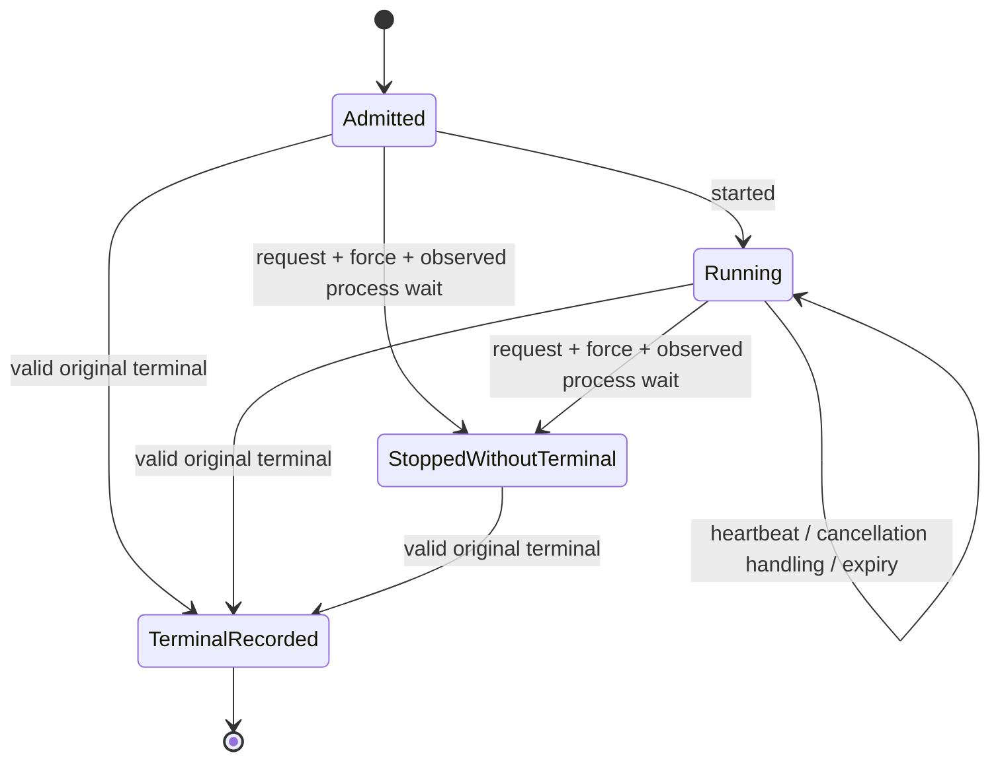

# Distributed execution lifecycle observations

**Under development for #767 / v0.41.0; not operational recovery.** The
`internal/executionlifecycle` package implements a bounded pure projection and
digest-addressed observation storage, read-only CLI/API inspection and a connected
Dashboard Lab source component, with invocation-local owner observers. Protected
checkpoint CLI/API operations now select fixed same-manifest lifecycle capture;
this does not expose an authenticated live lifecycle view. Dashboard build/browser gates
remain separate delivery requirements. Existing
`waza runner run`, HTTP terminal responses and historical local execution retain
their current behavior. Do not close #767 or advertise recovery from this layer.

The [site guide](../site/src/content/docs/guides/execution-lifecycle.mdx)
describes operator interpretation. This document defines developer invariants
and the remaining delivery gates.

## Preview and final embedded delivery

Dashboard validation has two explicitly allocated source phases. The default
`delivery_phase: preview` preserves the clean prefrontend CLI's API/process
controls, then builds and tests the current frontend and captures its generated
index, assets and screenshots. That CLI does not prove the newly built dashboard
was embedded. The final embedded browser case is explicitly skipped in preview;
this skip is never final execution evidence.

After reviewing genuine preview artifacts and committing only intended generated
index/documentation outputs, `delivery_phase: final` builds the frontend once in
its fresh owning checkout. It requires the generated tracked index/favicon to
match the committed source, then builds the production CLI from that same
physical `web/dist`, without another frontend build or restoration. Genuine Go
metadata must name the actual Git HEAD with `vcs.modified=false`. Its process
controls and full Chromium suite use that postfrontend binary. The separate
embedded case compares actual HTTP index/favicon/all asset bytes and runs protected
checkpoint creation and finalized reuse through the same-origin embedded Lab.
The final report must contain exactly one executed, passing embedded case, not
a missing, skipped, retried or failed control. No dispatch is implicit.

Current Go app-worktree builds can omit VCS metadata; they are not substitutes
for the ordinary hosted owning checkout, and no revision/dirty waiver is allowed.
This gate covers the CLI payload, not the azd extension release path. The latter
also rewrites `version.txt` and `extension.yaml` before `azd x build`; agreed
target metadata must already be committed/matching, or a separately reviewed
real-source publication contract is required. Preview or CLI-only checks do not
prove extension payload delivery, native Windows support or release publication.

## Original context and evidence

`New` takes canonical original
[attempt reservation bytes](../schemas/execution-attempt-1.0.schema.json),
independently retained original `runnerterminal.Binding`, and an optional
canonical UTC deadline. It compares the entire original identity, selection,
execution mode and complete grader set. Passing this comparison never
authenticates a worker or reconstructs a lost creator capability.

`Apply` consumes a strict
[observation 1.0 declaration](../schemas/execution-lifecycle-observation-1.0.schema.json).
Every event carries the original execution ID and reservation digest. Context
must come from actual admission, not from reading the declaration or from a
destination attempt. Null, duplicate keys, malformed Unicode, unknown members,
wrong scalar types and unrelated optional fields are rejected before decoding.
Typed encoding rejects invalid UTF-8 instead of replacing it.

Terminal observations use the existing `runnerterminal.Envelope` and original
binding. The projection retains the digest of its canonical terminal encoding
(including the terminal writer's LF), outcome, exit, failure boundary and
execution verdict. It does not retag source identity, alter billing, substitute
success, verify artifact publication, or convert a terminal summary into a
transcript/full result. `evidence: caller-declared-unverified` remains explicit.

## Transition rules

Observations require contiguous sequence numbers and nondecreasing canonical UTC
timestamps; equal timestamps are allowed. Invalid transitions leave the prior
projection unchanged. No ambient clock, process, network or timer is used by the
projection. The caller supplies observation times and an explicit as-of time.

| Event | Admission rule | Effect |
|---|---|---|
| `started` | State is `admitted` | State `running`; zero completed units observed. |
| `heartbeat` | State is `running` | Retain the supplied heartbeat observation time, not a liveness assertion. |
| `cancellation_requested` | No prior cancellation or observed stop | Phase `requested`; no acknowledgement or stop inferred. |
| `cancellation_acknowledged` | Outstanding request or force request | Record concrete `context-cancellation-observed` or `sdk-abort-returned` handling. Neither proves process shutdown. A late acknowledgement does not erase a force request. |
| `force_requested` | Requested or handling acknowledged | Phase `force_requested`; no process death inferred. |
| `stop_observed` | Force request outstanding | Record `process-wait-returned`; state `stopped-without-terminal`. No terminal outcome, grader result or retry safety is manufactured. |
| `deadline_expired` | Explicit deadline exists, has elapsed, has not been observed expired, and process stop has not been recorded | Retain expiry as an observation, not a synthetic terminal. |
| `terminal_recorded` | Original envelope passes contextual terminal validation; no prior terminal | Preserve original terminal; absorbing `terminal-recorded` state. |



An observed stop without a terminal remains evidence-incomplete. A later
context-valid original terminal can still be recorded. Configured/observed
deadline state never rewrites that terminal: if its outcome is not `timeout`,
the projection retains both facts with
`deadline-observation-differs-from-terminal-outcome`. Investigate the producer
and observation timing rather than modifying immutable evidence.

The envelope outcome/exit, execution verdict, completed-unit count and evidence
status are separate facts. A passed or failed graded observation completes one
unit, even if later shutdown makes the envelope fail. An error observation
completes zero units. No returned observation or an observed process stop
without terminal evidence means final progress is unavailable, even if
`started` previously recorded zero. The selected attempt
ordinal is not a completed-unit count.

## Heartbeats, retry advice and actions

`Snapshot(asOf, staleAfter)` requires a positive threshold. Missing heartbeat or
as-of means unknown age/orphan status: omit those fields, never fill zero/false.
When both exist, `heartbeat_age_ms` preserves explicit zero and
`suspected_orphan` preserves explicit false. Suspicion begins at the exact
threshold using nanosecond duration comparison, not rounded milliseconds. An
as-of before the latest observation or an age exceeding Go's duration range
fails rather than producing an inaccurate age.

An expired heartbeat suspects an orphan only while no terminal/observed process
stop exists. It does not prove a dead worker, reservation expiry, ownership,
global completeness or permission to reclaim.

`retry.advice` is advisory, not an eligibility grant or global execution
prohibition. Success and completed check failures give `none`; check failures
are not transient infrastructure-retry advice. Invalid input/unsupported
capability also give `none` with instructions to change the request.
Infrastructure failure, cancellation and timeout give
`conditional-fresh-attempt`: independently admit a new distinct attempt and
review side effects first. No scheduler, automatic retry, cross-worker retry
controller or lease/reclaim policy is provided.

`actions` names advisory operator steps: inspect original evidence, request
cancellation when none is recorded, investigate a suspected orphan without
reclaim, or review an independently admitted fresh attempt. These are not
executable capabilities or proof that a cancellation endpoint exists.

## Bounds and persistence

At most 128 observations are retained; slot 128 is reserved for a terminal.
Further heartbeat/control observations fail explicitly rather than consuming
that final slot. Producers must stop diagnostic emission before the limit and
propagate any observer/publication failure. Each observation and projection
is bounded to 1 MiB. Snapshot copies cannot mutate retained state; the
projection itself is invocation-local and not concurrently mutable.

`NewBlobs` uses only actual `artifactmanifest.Backend` / `Store.Put` APIs.
`Put` stores canonical bytes at the existing `blob-<digest>` key and verifies
content through the existing immutable store. `Load` requires a caller-known
full lowercase digest, rereads bounded bytes and checks digest, canonical form
and schema. It does not enumerate events, create a raw namespace, maintain an
authoritative latest pointer, hydrate an owner capability, or verify event order.
Apply loaded declarations against original admission separately.

Publication is not a transaction with projection mutation. Provider failures
return errors without a success digest; an object may remain after ambiguous
publication. Do not delete or overwrite it. Repeated identical content is
content reuse, not ownership. Local guarantees and staging residue follow the
existing [immutable artifact provider](../internal/artifactmanifest/local.go).

## Read-only inspection

An explicit retained inspection descriptor uses independent schema 1.0:
[`execution-lifecycle-inspection-1.0.schema.json`](../schemas/execution-lifecycle-inspection-1.0.schema.json).
It contains `kind: waza.execution-lifecycle-inspection`, `schema_version: "1.0"`,
the independently retained `original_admission` binding, `reservation_digest`,
ordered `observation_digests` (including explicit `[]`), and required positive
`stale_after_ms` (at most one day). Optional `deadline` and `as_of` are canonical
UTC timestamps; omit unavailable values, never use null/empty/default current
time. Do not reconstruct the binding from stored reservations or a destination
request. The context remains caller-declared, not worker-authenticated.

```bash
waza lifecycle inspect inspection.json --store .waza-artifacts
curl --silent --show-error \
  -H 'Content-Type: application/json' --data-binary @inspection.json \
  http://127.0.0.1:3000/api/v1/lifecycle/inspect
```

These commands use an existing private store. API configuration selects the
store; body input cannot supply a filesystem path, provider URL or latest pointer.
Each read checks current bytes, original declared context, ordering and bounds.
An unavailable/corrupt/mismatched observation fails inspection without returning
a stale or partial success projection. HTTP errors are 400 for invalid input,
404 for missing blobs, 409 for stored corruption/context/order mismatch, and 503
for provider failures. Media type and oversize input use 415/413. CLI exit 0 means
inspection completed, **not** execution success; read, validation, provider and
output failures exit 2. Recorded terminal outcome/exit remains a separate field.
No inspection operation mutates evidence or executes/cancels/retries work.

The output
[`execution-lifecycle-1.0.schema.json`](../schemas/execution-lifecycle-1.0.schema.json)
is a declared projection. The Lab Runner contract section submits the same
explicit descriptor, labels every lifecycle value as declared, keeps verified
worker progress unavailable, renders advisory steps as text (no retry/cancel
buttons), and downloads the same declared JSON. Context edits/reloads/failures
clear old data. The synthetic demo never substitutes lifecycle observations.
The browser fixture is compared with actual production mock admission and the
configured native inspection API, not an impossible mocked response.

## Invocation observation and validation (unreleased)

The read-only `ownedsubmission.InspectLifecycle` adapter accepts an already
composed `executionledger.Reader`, one original finalized source, and explicit
as-of/heartbeat-threshold inputs. It uses **one** `ReadCompleted` pass requesting
`lifecycle.json` and `terminal.json`; that pass verifies all manifest artifacts.
The source validator also requires `execution-attempt.json` to match the retained
canonical reservation and each `lifecycle-observation-NNN.json` descriptor to
match the canonical captured event bytes. It reuses original first-publication
admission and protected terminal-disclosure validation rather than minting an
owner capability or reading a private report as a fallback.

The narrow result labels content `verified-nonsnapshot-content` and its context
`original-source-declarations`. Its underlying projection remains explicitly
`caller-declared-unverified`; fixed native runtime observations retain
`process_exit: unknown`. A finalized source is not a running-worker snapshot,
and missing completion does not prove death or permit reclaim. Corrupt, missing,
restricted, contradictory or budget-denied source reads return no partial
projection and do not alter original artifacts. The adapter creates no backend,
namespace, writer or budget. The actual opaque `EvidenceReader.InspectLifecycle`
facade shares its existing private counter/decorated reader. Public
`waza lifecycle source source.json` and `POST /api/v1/lifecycle/source` create
one facade per response, validate the same strict source-selection profile and
return the narrow result without reading a private report.

The source selection uses `kind: waza.execution-lifecycle-source-inspection`,
`schema_version: "1.0"`, `source: {execution_id, manifest_digest}`, required
positive `stale_after_ms` (at most one day), and optional canonical UTC `as_of`.
The source API classifies invalid selection as 400, missing source as 404,
corrupt/contradictory fixed source content as 409, and provider/read-limit failure
as 503. CLI source inspection exits 0 independently of original execution exit;
failures exit 2 with no success-shaped projection. The separate Lab panel shows
original terminal/progress, scoped runtime facts and unknown process exit, and
downloads the exact response bytes. Edits and failed reloads clear it. The
manual descriptor inspection above is unchanged and is not promoted to
authenticated evidence. Browser/build/native/whole-release delivery gates remain
pending until their actual allocated current-head execution.

`runnerunit.NewPreparedLifecycleObserver` is the non-writing adapter for the
actual fixed `SubmissionHooks.SelectLifecycle` contract. `Reserved` retains the
owned reservation and original invocation deadline, then stages only the
started event and invocation-local runtime sink. `SelectLifecycle` runs after
protected terminal preparation and before independently validating the original
category inventory. It seals detached fixed metadata; it never writes blobs,
adds arbitrary artifacts, receives a rich report, or binds to a completion
digest that does not yet exist.

The core independently admits the original context, protected terminal, event
order/digests and closed runtime fields. Its single first publisher includes
`lifecycle.json` and canonical `lifecycle-observation-NNN.json` objects alongside
the separately validated original inventory. The later `Terminal` callback
only verifies unchanged original terminal bytes; it cannot create missing
inventory or republish a terminal. An invocation uses `SubmissionHooks.Factory`
to select its fresh sink after reservation, never a mutable closure on the
shared service factory. Immutable reuse selects neither factory nor observer.

Preparation, seal, verification and persistence errors are evidence-operation
failures, not permission to rewrite the actor's status, ordinal or terminal.
Production-caller controls cover success, completed check failure, cancellation,
timeout, prepublication rejection, owned-root publication failure, returned-byte
detachment, and concurrent invocation factories through the actual protected
publisher. The checkpoint CLI/API use shared
`ownedsubmission.NewLifecycleObserverHooks(time.Now, service)` with the existing
`SubmitCaptured`/`ResumeCaptured` entrypoints. The captured wrapper applies the
original category policy exactly once and retains its approval-tracked,
non-mutating source/report/terminal withholding, including incompatible restores
that return before any hook. `Service.NativeEngineFactory` selects the owned
native sink while preserving the retained mock factory. Public mock controls
prove the first manifest is the original protected inventory plus fixed lifecycle
objects and finalized reuse retains exact bytes with zero new calls; they do not
prove native execution, authenticated runtime evidence or complete recovery.

`runnerunit.NewLifecycleObserver` attaches to the actual submission's retained
creator through `Reserved` and joined `Terminal` callbacks. It validates the
creator and exact original reservation before writing observations, captures
the invocation deadline rather than its shorter publication budget, and exposes
only explicitly retained ordered digests. Reuse invokes neither callback and
does not invent a new heartbeat, cancellation acknowledgement or engine call.
Publication or clock/order failures propagate to submission failure without
creating a completion record or rewriting the original actor's terminal.
Standalone observation blobs remain declarations, not finalized-source
authentication; actual same-manifest artifact binding and native runtime
instrumentation are separate delivery requirements.

The fresh owned engine factory can select `observer.RuntimeObservations()` in
`CopilotEngineBuilderOptions.RuntimeObservations` after reservation. A sink binds
once and cannot select a shared engine, another invocation or a finalized reuse.
It captures actual client start/stop and force-call boundaries, the engine's
owned force-control request at its callback invocation, context
cancellation seen by the bounded send/disconnect handlers, and typed root-turn
SDK abort events. These are separate scoped observations: a returned call is
not model acknowledgement, a force invocation is not a successful kill, and a
turn-abort event is not an OS process exit. The SDK's actual `Cmd.Wait` and
`processDone` are private; **process exit remains unknown** in this adapter.

The explicitly allocated `TestOwnedRuntimeNativeNoSendControl` is opt-in through
`WAZA_NATIVE_LIFECYCLE_SMOKE=1`. Ordinary rejecting-runtime gates leave it disabled.
It deliberately uses the actual embedded path in an isolated no-auth,
discovery-disabled child, with a rejecting provider and zero requests, never
`Send`. Client base and session configuration use the same owned storage root,
and disconnect, session deletion and shutdown remain strict checks. Its bounded
test-worker `Wait` joins only that worker; even a passing control leaves SDK
process exit unknown. A failed session cleanup is a failed control, not a
successful startup receipt.

Capture callbacks perform no I/O or user callbacks and never wait for another
observer lock. Contention/overflow is explicit incomplete evidence, not success.
The 126 runtime slots leave room for the reservation and terminal observations.
Joined terminal handling seals detached metadata before publication; pending
callbacks prevent complete-evidence claims, and late calls affect only a
retained operator counter, never frozen bytes or a new sink. Sequence is sink
append order, not sorted timestamps or cross-goroutine causal proof. Native
metadata publication/public presentation still requires the actual owning
same-manifest artifact and privacy/default-withheld integration; this capture
does not introduce an unguarded public publication path.

Embedding-only producer controls compose `hooks.Artifacts = observer.Artifacts`
after an explicit first-publication text policy. The callback
returns one bounded `lifecycle.json` object for the **same original manifest**:
exact reservation bytes/binding, ordered observation digests and events,
invocation deadline when present, and frozen scoped runtime metadata. It
revalidates the creator/current blobs and requires the recorded terminal bytes
to equal the protected terminal supplied by the actual artifact callback.
Neither private `Report` bytes nor `ObservedReport` enter this object.
Artifact failures prevent completion while retaining the actor's original
outcome. Finalized reuse makes no capture callback and leaves original bytes
and ordinals unchanged.

This capture is not an inspection request: a reader must supply its own
explicit as-of/staleness policy and independently retained source context.
Request both `lifecycle.json` and the named terminal from the actual
`Ledger.ReadCompleted` when comparing their bytes; requested-name reads do not
implicitly populate every manifest object. Same-manifest content verification
binds the supplied metadata to that publication, not authenticated worker
ownership, model acknowledgement or verified progress. Public selection,
source-category admission and actual process/restore/browser acceptance remain
separate completion gates. The public protected facade rejects arbitrary
`Artifacts` callbacks; this producer must not be attached to bypass that guard.
Public delivery requires an admitted sealed fixed-metadata contract in the
original validated inventory, not renamed private report bytes.

The existing validation-only **Site Build** workflow accepts every PR base for
stacked layers and manual dispatch. Manual validation forces site/browser and
offline-example execution after successful change detection, even with no
changed paths; a failed change gate cannot produce a successful required check.
Main push paths, explicit read permissions, job deadlines and Pages deployment
remain separate and unchanged. Exercise source filters, dispatch/no-change and
failure controls with:

```bash
go test -count=1 ./.github/scripts -run '^TestSiteWorkflow'
```

Dashboard validation uses the existing **Dashboard Build and Test** workflow.
Its Node runtime requires JSON import attributes in browser-spec modules; a
test-discovery failure is not browser execution. Inspect actual test reports
for the lifecycle cases and downloaded JSON assertions. CI assets may be
recovered only from the matching source checkout/frontend tree; build success
alone does not establish screenshots, navigation, worker progress or recovery.
These workflows never publish releases or deploy Pages.
Prerendered schema files are served as `application/json` by the static preview
and Pages artifact path; a GET handler's development-only
`application/schema+json` header is not a deployed response guarantee. Browser
controls still require exact deployed-base paths, schema IDs, draft, kind,
version and strict object shape.

## Migration and release notes (unreleased)

Lifecycle observation schema 1.0 is additive and independently versioned.
Terminal 1.0, request 1.0, attempt/checkpoint schemas, task/eval YAML, historical
result/snapshot readers, SDK session resume and existing exit policy are
unchanged. Old artifacts do not acquire heartbeat/cancellation/progress facts.
Omitted observations remain unavailable.

This layer provides declaration/transition, actual local-provider persistence
and production CLI/API inspection controls, including projections of production
mock-runner terminal output.
It is **not** evidence of owner-authenticated events, kill-and-resume,
bounded process shutdown, checkpoint restoration, live model quality or validated dashboard/browser delivery.

Required before #767 delivery: integrate committed typed-owner observers and
authenticated original context; wire real cancellation, deadline, shutdown,
restoration-error and orphan process controls; connect actual owner-produced lifecycle evidence to the CLI/API/Lab inspection
surfaces; verify bounded shutdown and unchanged original artifacts;
execute coordinated Go/compatibility/dashboard/site gates and independent final
code review. Before-unit restoration remains zero completed units with a fresh
child reservation; finalized-unit restoration retains the original verified
terminal and executes zero engine calls. See
[the exact-unit checkpoint boundary](EXECUTION_CHECKPOINTS.md).
