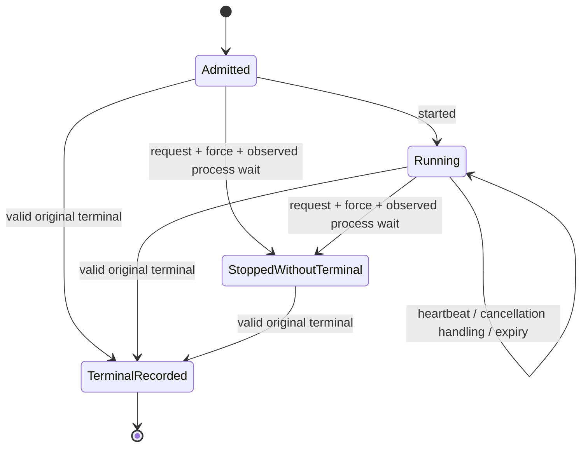

# Distributed execution lifecycle observations

**Under development for #767 / v0.41.0; not operational recovery.** The
`internal/executionlifecycle` package implements a bounded pure projection and
digest-addressed observation storage, read-only CLI/API inspection and a connected
Dashboard Lab source component. It does not yet have a production owner
observer or authenticated live lifecycle view; dashboard build/browser gates
remain separate delivery requirements. Existing
`waza runner run`, HTTP terminal responses and historical local execution retain
their current behavior. Do not close #767 or advertise recovery from this layer.

The [site guide](../site/src/content/docs/guides/execution-lifecycle.mdx)
describes operator interpretation. This document defines developer invariants
and the remaining delivery gates.

## Original context and evidence

`New` takes canonical original
[attempt reservation bytes](../schemas/execution-attempt-1.0.schema.json),
independently retained original `runnerterminal.Binding`, and an optional
canonical UTC deadline. It compares the entire original identity, selection,
execution mode and complete grader set. Passing this comparison never
authenticates a worker or reconstructs a lost creator capability.

`Apply` consumes a strict
[observation 1.0 declaration](../schemas/execution-lifecycle-observation-1.0.schema.json).
Every event carries the original execution ID and reservation digest. Context
must come from actual admission, not from reading the declaration or from a
destination attempt. Null, duplicate keys, malformed Unicode, unknown members,
wrong scalar types and unrelated optional fields are rejected before decoding.
Typed encoding rejects invalid UTF-8 instead of replacing it.

Terminal observations use the existing `runnerterminal.Envelope` and original
binding. The projection retains the digest of its canonical terminal encoding
(including the terminal writer's LF), outcome, exit, failure boundary and
execution verdict. It does not retag source identity, alter billing, substitute
success, verify artifact publication, or convert a terminal summary into a
transcript/full result. `evidence: caller-declared-unverified` remains explicit.

## Transition rules

Observations require contiguous sequence numbers and nondecreasing canonical UTC
timestamps; equal timestamps are allowed. Invalid transitions leave the prior
projection unchanged. No ambient clock, process, network or timer is used by the
projection. The caller supplies observation times and an explicit as-of time.

| Event | Admission rule | Effect |
|---|---|---|
| `started` | State is `admitted` | State `running`; zero completed units observed. |
| `heartbeat` | State is `running` | Retain the supplied heartbeat observation time, not a liveness assertion. |
| `cancellation_requested` | No prior cancellation or observed stop | Phase `requested`; no acknowledgement or stop inferred. |
| `cancellation_acknowledged` | Outstanding request or force request | Record concrete `context-cancellation-observed` or `sdk-abort-returned` handling. Neither proves process shutdown. A late acknowledgement does not erase a force request. |
| `force_requested` | Requested or handling acknowledged | Phase `force_requested`; no process death inferred. |
| `stop_observed` | Force request outstanding | Record `process-wait-returned`; state `stopped-without-terminal`. No terminal outcome, grader result or retry safety is manufactured. |
| `deadline_expired` | Explicit deadline exists, has elapsed, has not been observed expired, and process stop has not been recorded | Retain expiry as an observation, not a synthetic terminal. |
| `terminal_recorded` | Original envelope passes contextual terminal validation; no prior terminal | Preserve original terminal; absorbing `terminal-recorded` state. |



An observed stop without a terminal remains evidence-incomplete. A later
context-valid original terminal can still be recorded. Configured/observed
deadline state never rewrites that terminal: if its outcome is not `timeout`,
the projection retains both facts with
`deadline-observation-differs-from-terminal-outcome`. Investigate the producer
and observation timing rather than modifying immutable evidence.

The envelope outcome/exit, execution verdict, completed-unit count and evidence
status are separate facts. A passed or failed graded observation completes one
unit, even if later shutdown makes the envelope fail. An error observation
completes zero units. No returned observation or an observed process stop
without terminal evidence means final progress is unavailable, even if
`started` previously recorded zero. The selected attempt
ordinal is not a completed-unit count.

## Heartbeats, retry advice and actions

`Snapshot(asOf, staleAfter)` requires a positive threshold. Missing heartbeat or
as-of means unknown age/orphan status: omit those fields, never fill zero/false.
When both exist, `heartbeat_age_ms` preserves explicit zero and
`suspected_orphan` preserves explicit false. Suspicion begins at the exact
threshold using nanosecond duration comparison, not rounded milliseconds. An
as-of before the latest observation or an age exceeding Go's duration range
fails rather than producing an inaccurate age.

An expired heartbeat suspects an orphan only while no terminal/observed process
stop exists. It does not prove a dead worker, reservation expiry, ownership,
global completeness or permission to reclaim.

`retry.advice` is advisory, not an eligibility grant or global execution
prohibition. Success and completed check failures give `none`; check failures
are not transient infrastructure-retry advice. Invalid input/unsupported
capability also give `none` with instructions to change the request.
Infrastructure failure, cancellation and timeout give
`conditional-fresh-attempt`: independently admit a new distinct attempt and
review side effects first. No scheduler, automatic retry, cross-worker retry
controller or lease/reclaim policy is provided.

`actions` names advisory operator steps: inspect original evidence, request
cancellation when none is recorded, investigate a suspected orphan without
reclaim, or review an independently admitted fresh attempt. These are not
executable capabilities or proof that a cancellation endpoint exists.

## Bounds and persistence

At most 128 observations are retained; slot 128 is reserved for a terminal.
Further heartbeat/control observations fail explicitly rather than consuming
that final slot. Producers must stop diagnostic emission before the limit and
propagate any observer/publication failure. Each observation and projection
is bounded to 1 MiB. Snapshot copies cannot mutate retained state; the
projection itself is invocation-local and not concurrently mutable.

`NewBlobs` uses only actual `artifactmanifest.Backend` / `Store.Put` APIs.
`Put` stores canonical bytes at the existing `blob-<digest>` key and verifies
content through the existing immutable store. `Load` requires a caller-known
full lowercase digest, rereads bounded bytes and checks digest, canonical form
and schema. It does not enumerate events, create a raw namespace, maintain an
authoritative latest pointer, hydrate an owner capability, or verify event order.
Apply loaded declarations against original admission separately.

Publication is not a transaction with projection mutation. Provider failures
return errors without a success digest; an object may remain after ambiguous
publication. Do not delete or overwrite it. Repeated identical content is
content reuse, not ownership. Local guarantees and staging residue follow the
existing [immutable artifact provider](../internal/artifactmanifest/local.go).

## Read-only inspection

An explicit retained inspection descriptor uses independent schema 1.0:
[`execution-lifecycle-inspection-1.0.schema.json`](../schemas/execution-lifecycle-inspection-1.0.schema.json).
It contains `kind: waza.execution-lifecycle-inspection`, `schema_version: "1.0"`,
the independently retained `original_admission` binding, `reservation_digest`,
ordered `observation_digests` (including explicit `[]`), and required positive
`stale_after_ms` (at most one day). Optional `deadline` and `as_of` are canonical
UTC timestamps; omit unavailable values, never use null/empty/default current
time. Do not reconstruct the binding from stored reservations or a destination
request. The context remains caller-declared, not worker-authenticated.

```bash
waza lifecycle inspect inspection.json --store .waza-artifacts
curl --silent --show-error \
  -H 'Content-Type: application/json' --data-binary @inspection.json \
  http://127.0.0.1:3000/api/v1/lifecycle/inspect
```

These commands use an existing private store. API configuration selects the
store; body input cannot supply a filesystem path, provider URL or latest pointer.
Each read checks current bytes, original declared context, ordering and bounds.
An unavailable/corrupt/mismatched observation fails inspection without returning
a stale or partial success projection. HTTP errors are 400 for invalid input,
404 for missing blobs, 409 for stored corruption/context/order mismatch, and 503
for provider failures. Media type and oversize input use 415/413. CLI exit 0 means
inspection completed, **not** execution success; read, validation, provider and
output failures exit 2. Recorded terminal outcome/exit remains a separate field.
No inspection operation mutates evidence or executes/cancels/retries work.

The output
[`execution-lifecycle-1.0.schema.json`](../schemas/execution-lifecycle-1.0.schema.json)
is a declared projection. The Lab Runner contract section submits the same
explicit descriptor, labels every lifecycle value as declared, keeps verified
worker progress unavailable, renders advisory steps as text (no retry/cancel
buttons), and downloads the same declared JSON. Context edits/reloads/failures
clear old data. The synthetic demo never substitutes lifecycle observations.
The browser fixture is compared with actual production mock admission and the
configured native inspection API, not an impossible mocked response.

## Migration and release notes (unreleased)

Lifecycle observation schema 1.0 is additive and independently versioned.
Terminal 1.0, request 1.0, attempt/checkpoint schemas, task/eval YAML, historical
result/snapshot readers, SDK session resume and existing exit policy are
unchanged. Old artifacts do not acquire heartbeat/cancellation/progress facts.
Omitted observations remain unavailable.

This layer provides declaration/transition, actual local-provider persistence
and production CLI/API inspection controls, including projections of production
mock-runner terminal output.
It is **not** evidence of owner-authenticated events, kill-and-resume,
bounded process shutdown, checkpoint restoration, live model quality or validated dashboard/browser delivery.

Required before #767 delivery: integrate committed typed-owner observers and
authenticated original context; wire real cancellation, deadline, shutdown,
restoration-error and orphan process controls; connect actual owner-produced lifecycle evidence to the CLI/API/Lab inspection
surfaces; verify bounded shutdown and unchanged original artifacts;
execute coordinated Go/compatibility/dashboard/site gates and independent final
code review. Before-unit restoration remains zero completed units with a fresh
child reservation; finalized-unit restoration retains the original verified
terminal and executes zero engine calls. See
[the exact-unit checkpoint boundary](EXECUTION_CHECKPOINTS.md).
