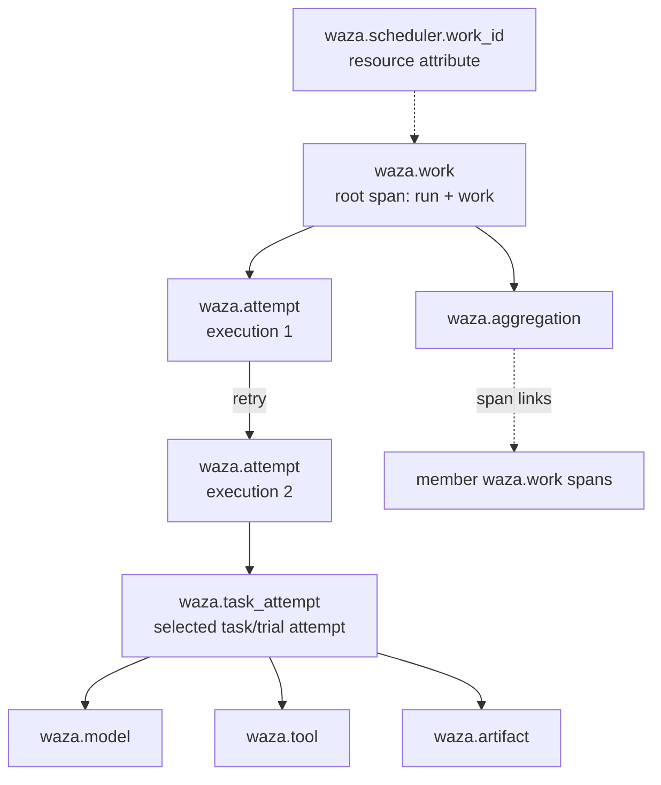

# Execution telemetry and correlation contract

`waza runner telemetry` derives vendor-neutral, OpenTelemetry-shaped traces,
metrics and logs from Waza's public runner contract documents. Every signal is
correlated through deterministic identifiers, so an external scheduler, a
tracing backend and the Waza Lab can point at the same logical work, attempt,
artifact and aggregation without sharing payloads.

The contract is versioned as `waza.execution-telemetry` `1.0`. Its report is
described by [`schemas/execution-telemetry-1.0.schema.json`](../schemas/execution-telemetry-1.0.schema.json)
(published at `https://microsoft.github.io/waza/schemas/execution-telemetry-1.0.schema.json`).

## What it consumes

Telemetry is derived after the fact from the same documents the runner already
publishes. Only the terminal envelope is required; each optional document adds
detail and is checked for correlation before use.

| Flag | Document | Adds |
|------|----------|------|
| `--terminal` (required) | `waza.runner-terminal` 1.0 | run, work, task/trial attempt identity, outcome |
| `--manifest` | `waza.artifact-manifest` 1.0 | admitted binding, artifact spans, manifest digest |
| `--attempt` | `waza.execution-attempt` 1.0 | execution ID and parent relationship of the observed attempt |
| `--lineage` | `waza.execution-lineage` 1.0 | every attempt of the logical work, retries and lifecycle times |
| `--report` | results JSON (`waza run -o`) | model usage and tool-call spans for the exact selected run |
| `--aggregate` | `waza.manifest-aggregate` 1.0 | aggregation span with links to member work traces |
| `--scheduler-work-id` | operator value | the external scheduler's work identifier as a resource attribute |

A document that names a different run, work or attempt is rejected (exit 6)
instead of being merged:

- With `--manifest`, the terminal must be the exact bytes of the manifest's
  terminal artifact (SHA-256 and size), and an `--attempt` sidecar must carry the
  manifest's full binding and be the exact bytes of its `execution-attempt.json`
  artifact. Pass the published files unmodified.
- `--lineage` requires `--attempt` or `--manifest` to select the terminal's
  execution. The selected entry's recorded native attempt, manifest digest,
  parent and terminal outcome must agree with the supplied documents; fields an
  earlier lineage snapshot has not recorded yet stay unavailable.
- An aggregate must contain the supplied manifest (or, without a manifest, a
  member for the same logical run and work).
- The results JSON is read with the shared results reader, so unsupported
  `schemaVersion` values are rejected. The run for the selected task and run
  number is bound by the terminal observation projected from it: attempts,
  status, error and grader verdicts must match, or the input is rejected. A
  report is `unmatched` when the terminal has no observation or the run is
  absent; telemetry never falls back to another run.

Tool activity is read from the normalized `tool_events` record, falling back to
legacy `session_digest.tool_calls` for older results.

## Correlation identifiers



- **Trace ID**: the first 16 bytes of SHA-256 over `waza-trace-v1`, the run ID
  and the work ID. Every attempt and retry of one logical work shares the trace.
- **Span IDs**: the first 8 bytes of SHA-256 over `waza-span-v1`, the span kind
  and its stable keys (execution ID, attempt ID, manifest digest, artifact name,
  model or tool index). The same inputs always produce the same IDs, so
  re-deriving telemetry never creates duplicate spans. Without an attempt
  sidecar or lineage, the manifest digest keys the task and attempt spans so
  separate publications of one selection stay distinct; a terminal alone cannot
  tell such publications apart.
- **Aggregation links**: each admitted aggregate member is linked to the
  `waza.work` span of its own run and work. An aggregate member that names the
  supplied manifest but records a binding for another run or work is rejected
  (exit 6).
- **Diagnostic logs**: a lineage diagnostic is attached to an attempt span only
  when that span was emitted; otherwise it stays on the `waza.work` span and the
  execution ID remains an attribute.

## Signals

### Spans

| Name | Parent | Purpose |
|------|--------|---------|
| `waza.work` | none (root) | the logical run and work |
| `waza.attempt` | parent attempt, else root | one immutable execution attempt from the lineage |
| `waza.task_attempt` | selected attempt | the exact task/trial attempt in the terminal |
| `waza.model` | task attempt | recorded model usage per model |
| `waza.tool` | task attempt | one span per recorded tool call (capped) |
| `waza.artifact` | task attempt | one span per published immutable artifact |
| `waza.aggregation` | root | manifest aggregate with links to member traces |

### Log events

Log bodies carry the event name only, never message text or payloads.

| Event | Emitted for |
|-------|-------------|
| `waza.attempt.terminal` | each attempt with a terminal outcome |
| `waza.diagnostic` | terminal, lineage and aggregation diagnostic codes (codes only) |
| `waza.telemetry.dropped` | each drop reason that occurred, per signal |

### Metrics

All metrics are monotonic cumulative sums. The metrics resource is
service-level only (`service.name`, `service.version`,
`waza.telemetry.schema_version`), so run, work and scheduler identifiers never
become series dimensions. Each data point carries one exemplar with the trace
ID and `waza.work` span ID for correlation, and bounded attributes only.

| Metric | Unit | Data point attributes |
|--------|------|-----------------------|
| `waza.execution.attempts` | `{attempt}` | `waza.outcome`, `waza.attempt.status` |
| `waza.execution.artifacts` | `{artifact}` | none |
| `waza.execution.artifact.size` | `By` | none |
| `gen_ai.client.token.usage` | `{token}` | `gen_ai.request.model`, `gen_ai.token.type` |
| `waza.tool.calls` | `{call}` | `gen_ai.tool.name`, `waza.tool.success` |
| `waza.aggregation.members` | `{member}` | `waza.aggregation.member_state` |
| `waza.telemetry.dropped` | `{signal}` | `waza.signal`, `waza.drop.reason` |

## Stable attributes

Every emitted key comes from this catalog. Unknown keys, keys outside their
allowed placement and payload keys are dropped and counted. Renaming or
retyping a key is a breaking change to schema version 1.0.

Classes: **identifier** (high cardinality, never on metric data points),
**bounded** (closed or naturally small value set), **measure** (numeric),
**payload digest** (only under `--payload-policy digest`), **payload** (never
emitted).

| Key | Type | Class | Placement |
|-----|------|-------|-----------|
| `service.name` | string | bounded | resource |
| `service.version` | string | bounded | resource |
| `waza.telemetry.schema_version` | string | bounded | resource |
| `waza.run.id` | string | identifier | trace/log resource, span, link |
| `waza.work.id` | string | identifier | trace/log resource, span, link |
| `waza.scheduler.work_id` | string | identifier | trace/log resource |
| `waza.execution.id` | string | identifier | span, link, log |
| `waza.attempt.order` | int | measure | span |
| `waza.attempt.native` | int | measure | span |
| `waza.attempt.status` | string | bounded | span, metric |
| `waza.attempt.parent_relationship` | string | bounded | span, link |
| `waza.lifecycle.state` | string | bounded | span |
| `waza.outcome` | string | bounded | span, metric, log |
| `waza.exit_code` | int | bounded | span, log |
| `waza.failure_boundary` | string | bounded | span, log |
| `waza.manifest.sha256` | string | identifier | span, link, log |
| `waza.identity.digest` | string | identifier | span |
| `waza.shard.id` | string | identifier | span |
| `waza.task.id` | string | identifier | span |
| `waza.trial.id` | string | identifier | span |
| `waza.attempt.id` | string | identifier | span, log |
| `waza.selection.task` | string | identifier | span |
| `waza.selection.trial` | int | measure | span |
| `waza.selection.attempt` | int | measure | span |
| `waza.execution.mode` | string | bounded | span |
| `gen_ai.operation.name` | string | bounded | span |
| `gen_ai.request.model` | string | bounded | span, metric |
| `gen_ai.usage.input_tokens` | int | measure | span |
| `gen_ai.usage.output_tokens` | int | measure | span |
| `gen_ai.token.type` | string | bounded | metric |
| `waza.usage.cache_read_tokens` | int | measure | span |
| `waza.usage.cache_write_tokens` | int | measure | span |
| `waza.usage.request_count` | double | measure | span |
| `gen_ai.tool.name` | string | bounded | span, metric |
| `gen_ai.tool.call.id` | string | identifier | span |
| `waza.tool.success` | bool | bounded | span, metric |
| `waza.tool.index` | int | measure | span |
| `waza.artifact.name` | string | bounded | span |
| `waza.artifact.sha256` | string | identifier | span |
| `waza.artifact.size_bytes` | int | measure | span |
| `waza.artifact.media_type` | string | bounded | span |
| `waza.artifact.terminal` | bool | bounded | span |
| `waza.aggregation.sha256` | string | identifier | span, log |
| `waza.aggregation.state` | string | bounded | span |
| `waza.aggregation.members` | int | measure | span |
| `waza.aggregation.verified_manifests` | int | measure | span |
| `waza.aggregation.member_state` | string | bounded | link, metric |
| `waza.link.relationship` | string | bounded | link |
| `event.name` | string | bounded | log |
| `waza.diagnostic.code` | string | bounded | log |
| `waza.diagnostic.source` | string | bounded | log |
| `waza.signal` | string | bounded | metric, log |
| `waza.drop.reason` | string | bounded | metric, log |
| `otel.metric.overflow` | bool | bounded | metric |
| `waza.prompt.sha256` | string | payload digest | span |
| `waza.prompt.length` | int | payload digest | span |
| `waza.completion.sha256` | string | payload digest | span |
| `waza.completion.length` | int | payload digest | span |
| `waza.tool.arguments.sha256` | string | payload digest | span |
| `waza.tool.arguments.length` | int | payload digest | span |
| `waza.tool.result.sha256` | string | payload digest | span |
| `waza.tool.result.length` | int | payload digest | span |
| `gen_ai.prompt` | string | payload | never emitted |
| `gen_ai.completion` | string | payload | never emitted |
| `gen_ai.tool.arguments` | string | payload | never emitted |
| `gen_ai.tool.result` | string | payload | never emitted |

## Payload policy

| Policy | Behavior |
|--------|----------|
| `exclude` (default) | No prompt, output, tool argument or tool result content or digest is emitted. Each excluded slot is counted as a `payload_excluded` drop. |
| `digest` | Adds SHA-256 and byte-length surrogates only (`waza.*.sha256`, `waza.*.length`). Content is still never emitted. |

There is no raw-payload mode. Diagnostic messages are reduced to their codes,
and export errors never echo receiver response bodies or request headers.

## Cardinality safeguards

| Limit | Default | When exceeded |
|-------|---------|---------------|
| Spans per derivation | 2048 | further spans are dropped (`span_limit`) |
| Tool spans per task attempt | 256 | extra tool calls still count in metrics (`tool_span_limit`) |
| Log records | 1024 | further logs are dropped (`log_limit`) |
| Attributes per span, link, log or data point | 32 | extra keys are dropped (`attribute_limit`) |
| String attribute length | 256 bytes | truncated on a UTF-8 boundary (`attribute_truncated`) |
| Series per metric | 32 | new series fold into one `otel.metric.overflow=true` series (`metric_cardinality`) |
| Links per span | 128 | further links are dropped (`link_limit`) |

Unregistered keys are dropped as `unregistered_attribute`, and keys used outside
their allowed placement as `attribute_placement`. Every drop is reported in the
report's `dropped` list, the `waza.telemetry.dropped` metric and
`waza.telemetry.dropped` log events, so loss is never silent.

## Exporting

```bash
# Files: traces.otlp.json, metrics.otlp.json, logs.otlp.json, telemetry-report.json
waza runner telemetry --terminal terminal.json --manifest manifest.json \
  --lineage lineage.json --report results.json --out-dir telemetry/

# OTLP/HTTP JSON to any collector (posts to /v1/traces, /v1/metrics, /v1/logs)
waza runner telemetry --terminal terminal.json \
  --otlp-endpoint http://localhost:4318 --otlp-header "Authorization=Bearer $TOKEN"
```

- The file exporter never overwrites existing files (`output_exists`).
- Each signal file is a complete OTLP/JSON export request that can be replayed
  to any OTLP/HTTP receiver that accepts JSON.
- The OTLP endpoint must be an absolute `http` or `https` URL without
  credentials, query, fragment or `@` in its path, and its signal URLs must
  fit 512 bytes; send credentials with `--otlp-header`. Header values are
  never written to the report.
- Redirects are not followed: a `3xx` response is a failed export. A `2xx`
  response is accepted only with an empty body or one JSON object of at most
  64 KiB; any other acknowledgement is `invalid_response`.
- The report records one export entry per signal and destination with state
  `exported`, `partial` (the receiver returned `partialSuccess` rejections) or
  `failed`, plus an HTTP status and a fixed error code (`output_exists`,
  `write_error`, `transport_error`, `timeout`, `http_status`,
  `partial_success`, `invalid_response`).

The report JSON is printed to stdout. Exit codes: `0` success, `2` export
failure, including partial receiver rejection (the report is still printed), `6` invalid or uncorrelated input (including an explicitly supplied empty file).

## Troubleshooting

| Symptom | Cause | Fix |
|---------|-------|-----|
| `telemetry sources do not correlate` | a document names another run, work or attempt | pass documents from the same execution |
| `terminal has no admitted identity` | the run failed before identity derivation | no correlation IDs exist for that run |
| report source `unmatched` | results JSON lacks the selected task and run number, or the terminal has no observation | pass the results file from the same run |
| export `http_status` 401/403 | collector rejected credentials | check `--otlp-header` |
| export `output_exists` | `--out-dir` already holds telemetry | use a new directory |
| many `metric_cardinality` drops | many distinct tool or model names | expected; totals stay exact in the overflow series |

## Lab

The Lab's **Execution telemetry** panel reads a `telemetry-report.json`,
validates its shape and shows correlation identifiers, source availability,
signal counts by name, drops and export health. It rejects documents that
contain unknown fields, so payloads cannot be pasted into the view.

## Scope and deferred work

- Telemetry is derived post hoc from published contract documents; it is not
  emitted live from inside the runner's execution path.
- OTLP export uses HTTP with JSON encoding only; gRPC and protobuf are not
  supported.
- There is intentionally no raw-payload policy.
- The existing `waza run --otel-*` evaluation tracing is unchanged.
