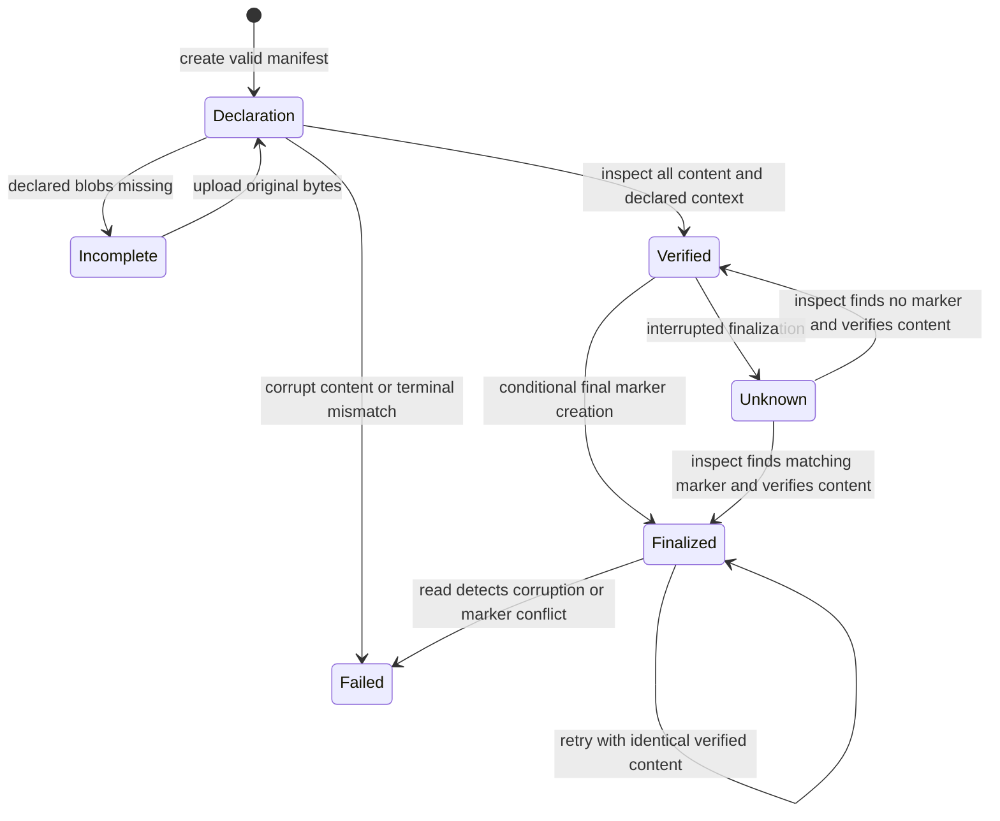

# Immutable artifact publication

The opt-in v0.41 publication path stores a schema-v1 declaration, original
artifact bytes, and a conditional finalization marker. It is separate from
mutable evaluation results. The [public guide](https://microsoft.github.io/waza/guides/immutable-artifacts/)
is the user entry point; this document specifies the developer and operator
contract.

## Scope and trust boundary

`internal/artifactmanifest` provides local and Azure implementations of the same
create-if-absent/read-and-verify protocol. It does not execute a runner, admit a
request, derive an identity, or manufacture evidence.

`binding.identity`, `binding.selection`, `binding.execution_mode`, and
`binding.grader_ids` are **caller declarations**. Verification compares the
terminal envelope with that declared context. Matching bytes and declarations
are not trusted admission, witnessed execution, or live-agent attestation.
The receipt's `verification` is `content-and-declared-context-only`.
Neither a finalized marker nor `integrity: "verified"` means that the evaluation
passed. Mock, failed, and error envelopes retain their own meaning.
No missing scores, billing, usage, transcript, or provenance are inferred.

Finalization is scoped to the **manifest digest**, not `identity.attempt`.
Two different manifest digests with the same declared v0.40 runner identity
may both finalize. Attempt ownership and append-only duplicate/conflict decisions
belong to the separate attempt ledger (#764), not this store. There is no new
unique-attempt field in this manifest schema.

## Original-wire admission and bounds

The authoritative schemas are
[`artifact-manifest-1.0.schema.json`](../schemas/artifact-manifest-1.0.schema.json)
and its local
[`runner-terminal-1.0.schema.json`](../schemas/runner-terminal-1.0.schema.json)
references. `Parse` validates the original JSON before decoding into Go structs;
it rejects duplicate keys/escaped aliases, malformed Unicode, trailing JSON,
unknown fields, missing required values, nulls where disallowed, and incorrect
wire types. It does not default malformed input into valid zero values.
Schema compilation is offline; no external schema fetch is required.

The manifest has exactly these required top-level fields:

| Field | Contract |
|---|---|
| `kind` | `waza.artifact-manifest` |
| `schema_version` | `1.0`, independent of runner, result, and application versions |
| `binding` | Required `identity`, `selection`, `execution_mode`, and `grader_ids`; mode is `mock` or `copilot` |
| `terminal_artifact` | The logical name of an artifact present in `artifacts` |
| `artifacts` | 1–128 objects with required `name`, `sha256`, `size_bytes`, and `media_type` |

Identity uses the existing `sha256-waza-c14n-v1` fields: `version`,
`canonical_digest`, `run`, `shard`, `task`, `trial`, and `attempt`. Selection has
`shard`, `task`, and positive integer `trial` and `attempt` ordinals. Grader IDs
are an explicit array, including `[]` when the declared set is empty; IDs are
unique, nonempty, at most 128 entries, and at most 256 schema characters each.
Native admission additionally limits each grader ID and selection shard/task to
256 UTF-8 bytes, matching the existing terminal validator. Multibyte Unicode
does not bypass these byte bounds.

Artifact names are unique, 1–128 ASCII characters, and match
`^[a-zA-Z0-9][a-zA-Z0-9._-]*$`. They are logical names, not paths or URLs.
Hashes are full 64-character lowercase hexadecimal SHA-256 values. Media types
are nonempty strings of at most 128 schema characters.

| Bound | Maximum |
|---|---|
| Submitted and stored manifest | 1 MiB (1,048,576 bytes) |
| Each artifact | 64 MiB (67,108,864 bytes) |
| Sum of declared artifact sizes | 256 MiB (268,435,456 bytes) |
| Dedicated terminal artifact | 1 MiB; media type must be exactly `application/json` |

Zero-byte artifacts are permitted by the declaration schema. A zero-byte
terminal cannot pass terminal JSON validation. Terminal validation also applies
its own byte bounds and schema/context consistency checks. Identity and selection
must match the declaration; when an observation exists, its execution mode,
selection, engine-call count, run/attempt ordinals, and grader results must be
consistent. Completed observations must contain the complete declared grader set;
error observations must not invent missing verdicts. A shape-valid declaration
alone does not prove that its terminal is present or valid.

## Canonical manifest bytes and original artifact bytes

`Encode` copies the caller's slices, sorts artifacts by logical name and sorts
`grader_ids`, then serializes the fixed Go structs as compact JSON:

1. Top level: `kind`, `schema_version`, `binding`, `terminal_artifact`, `artifacts`.
2. Binding: `identity`, `selection`, `execution_mode`, `grader_ids`.
3. Identity: `version`, `canonical_digest`, `run`, `shard`, `task`, `trial`, `attempt`.
4. Selection: `shard`, `task`, `trial`, `attempt`.
5. Each artifact: `name`, `sha256`, `size_bytes`, `media_type`.

There is no trailing newline. This is **not generic JSON Canonicalization Scheme
(JCS)** or alphabetic object-key sorting. String escaping follows compact Go
`encoding/json`, including `\u003c`, `\u003e`, `\u0026`, `\u2028`, and `\u2029`
for `<`, `>`, `&`, U+2028, and U+2029. No Unicode normalization is applied.
The manifest digest hashes these canonical bytes, not the submitted
`manifest.json` file's whitespace or field order.

Artifact hashes and sizes, including the terminal, describe their **original
bytes**. Reformatting terminal JSON, adding a newline, or changing LF to CRLF
changes its artifact digest even if parsed values are identical. Upload checks
both size and hash before committing an object. Never regenerate or normalize
bytes between declaring and uploading them.

The frozen byte oracle is
[`internal/artifactmanifest/testdata/oracle.mjs`](../internal/artifactmanifest/testdata/oracle.mjs);
its synthetic declaration fixture is not a finalizable terminal or execution
receipt.

## Publication protocol



Creating the declaration **before** uploads is safe. It advertises intent, not
completed publication. Upload order does not establish completion. `Finalize`
first performs a full inspection, conditionally creates `final-<manifestdigest>`
whose bytes are that same 64-character digest, then inspects again.

Object keys are `manifest-<canonical-manifest-sha256>`,
`blob-<original-artifact-sha256>`, and `final-<manifest-sha256>`.
Neither backend offers overwrite or delete through this interface. Existing
objects are reread and verified; the same valid content is idempotent.
An existing final marker containing another valid digest is a typed conflict
and remains untouched. A malformed marker is corrupt, not evidence of completion.
Preserve conflicting evidence; attempt-ledger decisions must not be replaced by
silently rewriting declarations or markers.

`Inspect` rereads the manifest, all declared blobs, terminal JSON, and marker on
every call. It verifies canonical stored manifest bytes, sizes, hashes, and
declared-context consistency. It does not trust cached receipts or metadata
alone. Missing blobs, corrupt content, terminal mismatches, and storage errors
fail closed. An observed missing final marker leaves publication `unfinalized`; complete
content can still have `integrity: "verified"`. A matching marker can report
publication `finalized` alongside failed integrity if a later read finds bad
content. Publication is `unknown` when no usable marker observation was obtained,
including invalid digest, unavailable store, unreadable or malformed marker,
mixed missing/read failures, or an ambiguous finalization write. This does not
mean that no marker exists. Independent content or provider-close failures do
not erase a marker state that was actually observed. Consumers must check both
fields and diagnostics; `unknown` is never a successful inspection.

## CLI and dashboard

For a local store, create the root first in a private location:

```bash
mkdir -m700 .waza-artifacts
waza artifact create manifest.json --store .waza-artifacts
waza artifact upload manifest.json terminal terminal.json --store .waza-artifacts
```

The public guide shows how to construct `manifest.json` from an actual completed
runner envelope using only the schema's fields. `terminal` above is the declared
logical name. Upload every other declared artifact using its own name and file.
Copy the digest returned by `create` into `DIGEST`, then run:

```bash
waza artifact inspect "$DIGEST" --store .waza-artifacts
waza artifact finalize "$DIGEST" --store .waza-artifacts
waza artifact inspect "$DIGEST" --store .waza-artifacts
```

For Azure, use `--azure-container-url` **instead of** `--store`:

```bash
waza artifact create manifest.json \
  --azure-container-url https://account.blob.core.windows.net/container
waza artifact upload manifest.json terminal terminal.json \
  --azure-container-url https://account.blob.core.windows.net/container
waza artifact finalize "$DIGEST" \
  --azure-container-url https://account.blob.core.windows.net/container
waza artifact inspect "$DIGEST" \
  --azure-container-url https://account.blob.core.windows.net/container
```

The container must already exist. Provide usable credentials through the CLI's
default credential chain, or pass an explicit `azcore.TokenCredential` when
constructing the backend in Go. `NewAzure` requires that explicit credential
argument and installs the pinned Azure service-version policy for every caller,
preserving caller-owned options and other policies. Construction does not log
in. Container URLs must be HTTPS and contain
no embedded credentials, query/SAS token, or fragment. Authorization failures
are storage errors, not permission to fall back to mutable storage or sign in
automatically.

The read-only `GET /api/v1/manifests` catalog exposes up to 1,000 persisted
declaration pointers, with explicit truncation and
`verification: "unverified-pointers-only"`. Discovery is not a complete fleet
inventory or evidence of valid results. Local scans also stop after 10,000
directory entries, including retained staging. Select a pointer and inspect it
separately; corrupt declarations remain discoverable without being verified.

The read-only `GET /api/v1/manifests/{digest}` and Dashboard Lab inspection panel
use the immutable backend. For local inspection, `.waza-artifacts` is beneath
the dashboard's `--results-dir`; create and publish into that exact root.
For Azure, configure the dashboard's Azure backend. CLI publication and dashboard
inspection must select the same store. The GET/panel inspect rather than create,
upload, finalize, execute, or attest. Receipts expose logical artifact names and
typed diagnostics, not local filesystem paths or provider URLs.

## Backend guarantees and limitations

The browser regression in `web/e2e/runner-negotiation.spec.ts` exercises the
embedded Lab against the real Go server: it runs the mock runner, publishes its
original terminal bytes through the artifact CLI, and inspects missing uploads,
verified unfinalized content, repeated finalization, malformed and conflicting
markers, and later artifact corruption. The served index and its referenced
resources must match the same physical build bytes, not the SPA fallback. The
test does not substitute API receipts or claim live execution evidence.

### Separate raw execution-ledger namespace

`NewNamespace(backend, ExecutionLedgerNamespaceV1)` accepts only the
`execution-ledger-v1` namespace on initialized local or Azure providers. Other
providers fail with `ErrUnsupportedBackend`, not an adapter or local fallback.
Artifact `Backend.Create/Get` retain their strict digest-bound keys; opaque
ledger records cannot be disguised as artifact blobs.

Logical keys are `reservation/exec-<64 lowercase hex>`,
`completion/exec-<64 lowercase hex>`, and
`decision/decision-<64 lowercase hex>`. They map internally to flat,
namespace-prefixed physical names, not caller-controlled filesystem paths.
Each raw object is bounded to 1 MiB. `Namespace.Create` returns true only after
unambiguous exclusive creation and exact-byte readback. Occupied records return
`ErrOccupied` even for identical bytes. Failed delivery or readback can leave
an immutable record without returning successful creation.

`ReadUnverified` returns detached current bytes for the caller's own canonical,
context and hash validation. `ListUnverified` returns at most 1,000 sorted
logical pointers with explicit truncation; local scans stop at 10,000 entries.
These operations do not validate sidecars, establish global ordering or a
complete logical inventory, grant execution ownership, or attest execution.
Malformed stored keys and read/close failures are errors, not passing records.

`Namespace.Reader(func(ReadBackend) ReadBackend)` creates a read-only
`NamespaceReader` from an already admitted provider. Its decorator receives only
a scoped `Get(ctx, logicalKey, limit)` capability, not the provider or any
create/list operation. It validates the existing logical key grammar and the
0..1 MiB read bound before raw I/O. `NamespaceReader.ReadUnverified` returns
detached raw bytes, not validated sidecars or ownership.
Nil decorators and nil returned readers are explicit errors. The admitted
namespace and its create/creator behavior remain unchanged.

A consumer can share cumulative budget state with its artifact `Backend.Get`
wrapper used by `Store.ReadCompleted`. Reserve the supplied limit plus one
excess-detection byte **before** each underlying read; refund only observed
successful bytes. Failed reads can discard consumed bytes, so retain their full
reservation even when the returned slice is nil. Budget exhaustion must prevent
I/O and propagate as a failed/incomplete read, not a verified partial aggregate.
This does not change `NewNamespace` provider admission or creator semantics.

The typed attempt/decision/completion profiles and creator-capability rules
belong to #764. Only its unambiguous successful creator may obtain the typed
in-process capability; existence, occupied records and ambiguous failures must
not recover it. Crash retries use a new attempt, never overwrite or reclaim a
reservation. This raw namespace has no update, delete, lease or cross-object
transaction. Its append-only guarantees apply to cooperating API writers,
not adversarial external replacement or durable ownership attestation.

### Content-addressed artifact providers

`artifactmanifest.OpenBackend(directory, azureURL)` is the shared runtime
opener used by the CLI and native API. An explicit Azure URL selects Azure,
never a local fallback; an omitted URL opens only the existing local directory.
It returns the actual backend and its close operation so bounded consumers can
wrap reads before constructing a `Store`. It does not initiate interactive
Azure login. Token acquisition can invoke installed Azure CLI or azd credential
helpers; runtime provider authentication is not process-free. Pure schema and
manifest validation do not open providers or invoke those helpers.

`Store.ReadCompleted(ctx, digest, artifactNames...)` returns a
`CompletedPublication` containing the canonical `Manifest`, its exact
`ManifestBytes`, selected original `ArtifactBytes`, and verification `Receipt`.
It retains bytes during the same all-artifact hash/size, native terminal binding,
and final-marker inspection pass; it does not inspect then reopen them.
Omission selects only the terminal, bounded by the native terminal envelope
limit. Unknown or duplicate requested names fail. All references are checked
even when their bytes are not selected. Selected buffers are bounded by the
256 MiB admitted total; artifact reads allow only that total plus one
excess-detection byte per object. This is not a claim that all content is
resident simultaneously or an atomic cross-object snapshot.

Only finalized, current-integrity-verified publications return bytes. A valid
recorded failure or cancellation remains unchanged; it is not converted to a
successful execution. Ordinary `Inspect` still reports verified but unfinalized
declarations. Returned manifest and byte slices are invocation-owned, not cached
mutable storage pointers. Consumers must validate the captured terminal and
their own source-binding profiles; the receipt is not execution attestation.
If the manifest is later missing or corrupt, inspection still checks its final
marker independently and retains both publication state and content failure.
A matching marker never makes failed or unavailable content verified.

Local storage retains an `os.Root` handle. It stages bytes using exclusive
creation with mode `0600`, sets the owned descriptor read-only (`0400`), checks
write, permission-change and close errors, then hard-links the
complete file into its final name without replacement. This gives atomic
visibility of one complete object on filesystems supporting the operation.
Unsupported filesystems fail; there is no overwrite fallback.
Reads reject nonregular objects, check file identity and bounded size, and verify
the returned bytes.

`.pending-*` staging entries are intentionally retained **even after successful
publication**, and also on write, close, or link failure. Automatic deletion could
delete a competing replacement, so this implementation never performs it.
An operator must budget storage and manage retention separately, after stopping
writers and establishing ownership. Do not delete unknown entries as generic
recovery. Successful final names are hard links to staging files; editing a
staging file can corrupt the published object too.

Azure uses single-object conditional PUT with `If-None-Match: *`; an expected
already-present response is followed by content verification. Downloads enforce
bounded content length and exact returned-byte length before hash checks.
These are equivalent no-overwrite and verification semantics, not claims of
identical filesystem or cloud implementation.

Use a private, access-controlled root/container. Root confinement and byte hashes
do not authenticate a hostile filesystem administrator, storage operator, or
publisher. This protocol is not a whole-publication transaction, crash-durability
guarantee, replication protocol, or Azure account immutability policy. It does not
claim native-platform coverage merely because a filesystem API exists.

## Recovery and troubleshooting

| Diagnostic/state | Action |
|---|---|
| `missing_object` | Upload the missing declared bytes into the same store, then inspect and retry finalization. A missing declaration needs `create` first. |
| `corrupt_object` | Preserve bytes and operator diagnostics. Investigate the store and use a clean store; do not overwrite the addressed object. |
| `terminal_mismatch` | Compare terminal identity, selection, mode, and graders with the declaration. Preserve the original; publish corrected content separately. |
| `publication_conflict` | Preserve the differing marker. It is not an attempt-ownership decision; investigate corruption or competing publication without replacing evidence. |
| `invalid_declaration` | Correct original JSON/schema/bounds; use a full lowercase digest. Do not coerce missing/null fields into defaults. |
| `storage_error` | Check root/container existence, permissions, credentials, cancellation, and hard-link support. A failed response is not proof that nothing committed. |
| `unknown` publication | No usable marker observation is available, or a write may have committed despite its error. Preserve evidence and retry inspection of the same digest/backend; do not infer absence or overwrite. |
| `unfinalized` with verified integrity | All content passed verification but no final marker exists. Finalize explicitly. |
| `.pending-*` residue | Expected retained staging, not proof of a completed result. Preserve it; no automatic cleanup is performed. |

An interruption or network timeout may occur **after** an object or marker becomes
visible but before the caller receives success. Recover with `inspect` using the
same digest and backend, not overwrite or deletion. If content verifies and no
marker exists, retry `finalize`; if it is already finalized and verified, no new
publication is needed. If inspection itself fails, commitment remains unknown.

## Additive v0.41 migration and release notes

- Artifact manifest schema `1.0` and its commands are opt-in additions. Existing
  result JSON, runner terminal envelopes, and their independent versions are not
  automatically migrated or rewritten.
- Legacy `ResultStore` retains its mutable behavior. Selecting the new immutable
  backend is explicit; upgrading does not make ordinary result writes immutable.
- To adopt, retain the original terminal and artifact files, build a declaration,
  create it, upload the declared bytes, verify, and finalize in a dedicated store.
  A historical result without a valid dedicated terminal and declared binding is
  not converted by inventing identity, billing, or execution evidence.
- Read-only API/Lab inspection reports content integrity and declared-context
  consistency. It neither changes the terminal outcome nor adds live assurance.
- Receipt `publication` remains a required string and includes `unknown` for
  unobserved state. Receipt consumers must accept that error state without
  treating it as success or converting it to absent/null. Declaration schema
  `1.0`, legacy results, and terminal versions are unchanged.
- Finalization is per manifest; attempt identity ownership remains a separate
  ledger concern. Operators must account for retained local staging and recover
  ambiguous commits through inspection.
