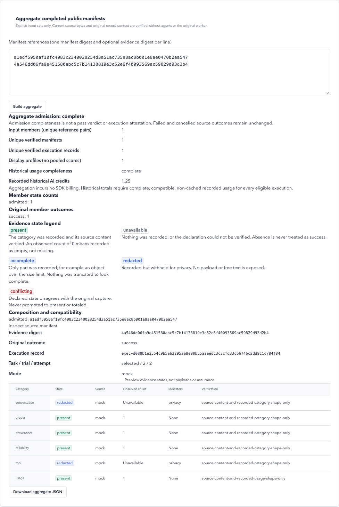

# Standalone completed-manifest aggregation

The opt-in, unreleased v0.41 aggregate profile (#766) reads **public completed
manifests**, not mutable `results.json`, worker state or creator capabilities.
It does not construct an engine, invoke a subprocess, read ambient project
configuration or obtain credentials. The command accepts an explicitly selected
existing **local** store. Azure aggregation is not supported by this profile:
the default credential chain may invoke external credential helpers.

## Commands and interpretation

```bash
# DIGEST is a full lowercase manifest SHA-256 from artifact finalize.
waza aggregate --store .waza-artifacts "$DIGEST" -o aggregate.json

# Reference pairs additionally qualify categories and execution records.
waza aggregate --store .waza-artifacts --inputs inputs.json -o qualified.json
```

`inputs.json` is a nonempty array of at most 128 objects. Each object has
`manifest_sha256` and optionally `evidence_sha256`. Explicit null/empty evidence
references, unknown fields, duplicate keys and abbreviated digests are invalid.
See the [site worked example](../site/src/content/docs/guides/manifest-aggregation.mdx).

The command emits the evaluated report to stdout and, when selected, exclusively
creates `--output`. Existing output files and symlinks are never replaced.
An incomplete/conflicting evaluated report is **saved and emitted before a
nonzero exit**. Input admission, unavailable store, output write/close and stdout
errors also fail. An output failure may leave a partial invocation-created file;
the error identifies it and no competing/user-owned file is deleted. This is
exclusive file creation, not a transactional or crash-durable publication.

The read-only `POST /api/v1/aggregates` route accepts the same reference array
against the server's explicitly configured results store. Evaluated reports use
HTTP 200 (complete) or 409 (incomplete/conflicting), preserving report bodies.
Malformed requests use 400; unavailable/unsupported providers use 503. Requests
cannot choose paths, credentials, providers or budgets. Lab retains evaluated
409 reports, exposes composition/category states/omissions/compatibility and
downloads the exact API JSON. Source links inspect manifest receipts, not
restricted artifact payloads.

HTTP body admission retains the 1 MiB request limit and has a five-second read
deadline, before any store is opened. A stalled upload returns 408 with
`aggregate_request_timeout`; cancellation stops admission (408 when delivery is
still possible). Partial uploads close the connection rather
than draining indefinitely. Deadline setup/reset failure returns 500 with
`aggregate_transport_unavailable`. Unsupported bounded delivery aborts the
transport without an implicit successful response. Successful input admission
clears its read deadline before the separate 30-second evaluation budget.
Response delivery is bounded to five seconds and preserves canonical report
bytes unchanged; a failed/partial delivery is not a report receipt.
The aggregate client allows 50 seconds: these three phases plus ten seconds of
headroom. Caller cancellation remains active. This is not a universal server
lifetime guarantee: source open/close and synchronous filesystem I/O have their
own constraints. Aggregate diagnostics use the existing bounded reporter;
a blocked operator sink cannot retain one new logging goroutine per request.

Open `waza serve --lab --results-dir RESULTS_DIR`, select **Runner**, then use
**Aggregate completed public manifests**. The store is
`RESULTS_DIR/.waza-artifacts`, independent of the server's working directory.
Aggregation is disabled in the synthetic demo and active non-local providers
are rejected without attempting credential discovery.



The example's usage is authored mock-source data, not observed SDK billing.

**Complete means aggregate admission completed, not that any task passed.**
Original failed, cancelled and timed-out terminal outcomes remain visible.
Optional absent sidecars, supported metadata-only manifests and legitimate
privacy-redacted categories do not make admission incomplete. Supplied invalid
sidecars or unverified execution claims do.

## Population and conflict rules

Three explicitly named populations must not be interchanged:

1. `input_members`: unique exact manifest/evidence reference pairs, including
   omissions and multiple views. State and outcome counts use this denominator.
2. `unique_verified_manifests`: distinct manifests whose current complete bytes,
   terminal binding and final marker were verified.
3. `unique_verified_execution_records`: distinct source execution IDs whose
   original canonical reservation/completion records match the verified manifest.
   Record-context verification is **not execution attestation**.

The sidecar-selected attempt descriptor must match the original reservation's
digest, byte length and JSON media type even when it uses a custom artifact
name. Matching execution ID and binding alone do not establish this association.

All source objects and the terminal are verified by `Store.ReadCompleted`, even
when evidence-sidecar selection does not retain terminal bytes. Aggregation never
infers a unique execution from a legacy attempt ordinal or a digest.

Members are display-grouped by the entire admitted identity, selection, mode and
sorted grader profile. Different evals/runs/tasks/trials/attempts/modes/profiles
remain separate. Distinct actual execution records in the same profile are
valid repeated executions: retain them all, without a latest winner or pooled
scores. Multiple compatible sidecars/views of one record remain separate members
but contribute at most one execution. A saved report may not map one execution
ID to different manifests; multiple views remain valid when they name the same
manifest. Do not union category disclosure or select the most permissive view.
Actual incompatible origin/binding/record/usage claims produce explicit
conflicts; no arbitrary winner is selected.

### Historical usage, never aggregation billing

Aggregation itself incurs no SDK billing. `recorded_historical_usage` is available
only for a nonempty population of uniquely admitted native execution records
whose supplied views all provide compatible, present recorded native usage.
Failed/cancelled executions are eligible when their usage is genuinely complete.
Cached lineage or cached categories, unknown legacy identity, missing usage,
withheld views or conflicting usage withhold the **whole total**, not a partial
subtotal. Missing credits/model attribution remain unavailable. Explicit recorded
zero credits and native zero counters remain zero, not absence.
Saved-report and client admission also reject a complete usage claim when any
supplied view lacks execution identity or a verified, present single recorded
usage observation, or declares cached categories/lineage exclusion. A compatible
eligible view cannot override another view's exclusion. Complete metadata-only
admission still retains unavailable/null usage. These checks do not reverify
saved evidence or require live-only provenance. Optional aggregate credits and
model attribution may remain absent; absence is unavailable, not recorded zero.

Totals use `models.AggregateUsageStats` in sorted execution-ID order. Mock,
authored, cached and unknown source labels remain distinguishable per view.
Recorded content and shape do not prove SDK execution, billing authenticity,
independent witnessing or assurance.

## Canonical schema, compatibility and migration

Aggregate `kind: waza.manifest-aggregate`, `schema_version: "1.0"` is independent
of manifest, evidence, attempt, terminal and legacy result versions. Canonical
bytes contain no timestamp, self-hash, filesystem path, provider URL, captured
payload or free-text diagnostic. Reference pairs, groups, category records,
diagnostic codes, map keys and summation inputs have deterministic ordering.
Identical requested sets **and observed source state** produce identical bytes;
an earlier successful read is never a cache of current verification.

| Input | v1 interpretation |
|---|---|
| Completed manifest 1.0, terminal 1.0, no sidecar | Complete metadata-only admission; execution/usage unknown |
| Evidence 1.0, capture 1.0 with original attempt/completion 1.0 | Verify current bytes, category shape and original record context separately |
| Optional sidecar omitted | Not a failed input; no inferred category/usage/ownership |
| Supplied sidecar invalid, missing, mismatched or unsupported | Explicit incomplete/conflicting member |
| Missing/corrupt source or absent/conflicting final marker | Explicit omission/conflict; independently valid neighbors retained |
| Mixed supported legacy/native sources | Preserve per-member profile and unavailable usage, never upgrade legacy evidence |
| Unknown major/profile version | Explicit unsupported/invalid profile; no repair or downgrade |
| Historical mutable result files | Not aggregate inputs; remain readable through existing result readers |

Members with a verified execution may carry `parent` (`execution_id` and `retry`
or `branch`, read from the original reservation). Members with a sidecar may carry
`lineage` (source `manifest` digests with `retry`, `resume`, `cache` or
`aggregation`, sorted). Both are omitted when absent and never select a winner:
the original and each retry stay separate members with their own outcomes. See
[evidence states](EVIDENCE-STATES.md) for how to read each category state.

No automatic migration synthesizes execution records, scores, billing or evidence.
Retain the original immutable store, select exact digests and add a real public
sidecar only when original evidence exists. Existing readers/writer versions and
ordinary run/regrade/cache behavior are unchanged.

Developer entrypoints are `manifestaggregate.Build(ctx, Sources, []Input, Limits)`,
`ParseInputs`, `Encode` and `Parse`. Sources explicitly carry a read-only object
capability and optional scoped `NamespaceReader`; no backend-derived namespace
discovery or creator hydration occurs. One per-build budget bounds object count
and total object/namespace reads, reserving the full permitted read before I/O.
Errors retain their reservation because consumed bytes may be unknown. Default
limits are 128 input references, 4,096 reads, 512 MiB cumulative source reads and
32 MiB report bytes (including worst-case escaped identifiers), in addition to
each existing source profile's limits. The aggregate client enforces the same
32 MiB UTF-8 byte limit and saved-report population/state/group accounting.
Unrelated JSON clients retain their existing parser limit. Numeric sum overflow
withholds historical usage with an explicit diagnostic rather than emitting
wrapped counters.
Recorded usage totals must also stay within JavaScript's exact integer range
(`0..9007199254740991`) for the JSON/API/Lab contract. An input or sum outside
that supported range, non-finite arithmetic, or addition that loses an entire
positive floating contribution withholds the total. Native floating fields
retain their existing IEEE-754 arithmetic; no exact-decimal or derived billing
claim is added. An empty eligible population and unknown identity/usage remain
unavailable/null, never an available zero or an unlabeled subset total.

The full serialized Go-escaped UTF-8 report is measured after accounting. If
recorded usage would push it above 32 MiB, the entire total is withheld with
`recorded_usage_report_size_unavailable`; all members, diagnostics and the unique
execution denominator remain unchanged. No model/provider strings are truncated
and no smaller execution subset becomes the total. If membership without usage
cannot fit, aggregation returns an explicit size-limit error rather than dropping
members. Native source limits and the report cap are unchanged.

`Build` returns report plus classified error for evaluated per-input failures.
`Parse` validates saved wire/accounting only; it is not current source inspection.
Canonical report bytes and any future storage/publication receipts must remain
separate; a stored hash alone does not establish current completeness.

## Troubleshooting

- `missing_source`: preserve the request set; restore its original declared
  objects/finalization instead of silently dropping members.
- `corrupt_source` / `conflicting_source`: preserve evidence and inspect original
  public manifests and records. Never overwrite or choose an arbitrary winner.
- `unsupported_or_invalid_profile`: inspect independent version declarations;
  use a compatible reader, not invented conversion or legacy identity.
- `execution_read_capability_unavailable`: provide the explicit public namespace
  read capability. Do not recover private ownership or fall back to raw reads.
- `read_budget_exhausted`: report remains incomplete. Reduce an explicitly
  selected set or use an embedding caller with reviewed finite bounds; do not
  describe a subset as the complete original population.
- `complete_historical_usage_unavailable`: inspect each view's source/state and
  cached lineage. An unavailable total is not zero or a passing quality verdict.

This source preview is not a v0.41 publication announcement or full platform
acceptance claim. Hosted checks, independent review and release delivery remain
separate gates.
