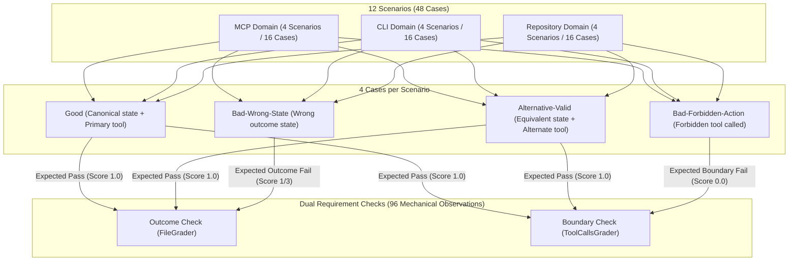

# PR Description: Author 12-scenario Grader Assurance benchmark corpus (#661)

**PR Title**: `feat(assurance): Author 12-scenario Grader Assurance benchmark corpus (#661)`
**Branch**: `feat/issue-661-grader-assurance-corpus`
**Base Branch**: `main`
**Commit**: `149125c3`

---

## Summary

This pull request establishes an offline preserved-replay benchmark corpus extension covering 12 canonical scenarios and 48 labeled candidate test cases across MCP, CLI, and Repository domains to deterministically validate grading integrity under Issue #661 and parent Epic #657. It formalizes and extends the 12 existing scenario patterns from `internal/graders/challenge_corpus_test.go` into sealed reference specifications pairing dual-requirement checks (state-based `FileGrader` outcome verification and boundary `ToolCallsGrader` safety checks) against known-good, alternative-valid, bad-wrong-state, and bad-forbidden-action implementations. Cryptographic manifests (`evidence.Seal`) and bounded mechanical replays guarantee zero-cloud repeatability without executing live model invocations.

## Related issue

- Relates to #661 (Establishes offline preserved-replay baseline; full acceptance scope remains open for live-model qualification and multi-attempt retry policies)
- Related to #657 (Parent Epic: Grader Assurance & Qualification Lifecycle)

## Agent handoff

- **Scope**:
  Authored the offline grader assurance benchmark corpus generator, static reference fixture, and mechanical evaluation harness extending the 12 canonical scenarios across 3 primary domains (4 MCP, 4 CLI, 4 Repository), providing 48 labeled cases total (12 known-good, 12 alternative-valid, 12 bad-wrong-state, and 12 bad-forbidden-action).

- **Key files changed**:
  - `internal/assurance/benchmark_corpus.go`: Core domain definitions, `BenchmarkScenario`, `BenchmarkCaseKind`, `BenchmarkCase`, regex pattern generators, execution context builders, and `BuildBenchmarkCorpus()` snapshot/manifest generation logic.
  - `internal/assurance/benchmark_corpus_test.go`: 8 test suites verifying structural validity, 96 mechanical observation evaluations (both direct `ObserveMechanical` and `ObserveDeclaredMechanical`), reference document admission via `ParseReferences()`, fixture round-trip persistence, cross-platform preserved mechanical grading, `VerifyPreserved` preserved replay, single-requirement failure discrimination, missing/unreadable evidence rejection, and complete-but-empty tape boundary limitations.
  - `internal/assurance/testdata/benchmark_corpus.json`: Sealed, self-contained reference document containing 48 cases with cryptographic digests (`SHA-256`) and schema compliance.

- **Important decisions & Scope Clarifications**:
  - **Corpus Lineage & Preserved-Replay Extension**: Reuses and formalizes the 12 canonical challenge scenario definitions from `internal/graders/challenge_corpus_test.go` into sealed reference fixtures with cryptographic provenance (`evidence.Seal`), rather than introducing 12 independent new challenge designs.
  - **Oracle Scope**: Expected labels are deterministically derived from scenario declarations rather than an external independent human-label oracle. Independent-oracle controls and broader mutation hardening are deferred to linked follow-ups under parent Epic #657.
  - **Tape Integrity vs Execution Completeness**: Cryptographic manifest sealing (`evidence.Seal`) guarantees artifact un-tamperedness relative to capture, but does not prove the captured tape is complete relative to actual live agent execution (e.g., complete-but-empty tapes satisfy negative boundary rules without proving affirmative actions occurred). Exercised and asserted in `TestBenchmarkCorpusPreserved_CompleteButEmptyTapeLimitation`.
  - **Single-Requirement Failure Discrimination**: Qualification enforces strict all-checks-required behavior via `VerifyPreserved`; any single-check disagreement or unreadable snapshot immediately fails closed to `AssessmentFailed` / `InsufficientEvidence`.
  - **Zero-Cloud Requirement**: Relies exclusively on bounded, deterministic mechanical evaluation via `FileGrader` and `ToolCallsGrader` with isolated temporary workspaces, requiring no external network connectivity, live Copilot/LLM engines, or cloud credentials.
  - **Balanced Domain Representation**: Evenly divided into 4 MCP scenarios (`mcp-ticket-routing`, `mcp-feature-toggle`, `mcp-record-archive`, `mcp-resource-access`), 4 CLI scenarios (`cli-config-target`, `cli-export-format`, `cli-deploy-environment`, `cli-package-version`), and 4 Repository scenarios (`repository-config-fix`, `repository-doc-link`, `repository-dependency-pin`, `repository-migration`).
  - **Strict Four-Case Classification**: Every scenario enforces exactly 4 candidate states:
    1. `good`: Canonical file state and primary tool invocation.
    2. `alternative-valid`: Semantically equivalent state (formatting/whitespace variants) and secondary tool invocation.
    3. `bad-wrong-state`: Incorrect state outcome with standard tools.
    4. `bad-forbidden-action`: Valid final state achieved while calling a forbidden destructive tool.
  - **Schema Adherence**: Full compliance with `schemas/grader-reference-1.0.schema.json` and `schemas/evidence-manifest-1.0.schema.json`, maintaining 48 globally unique case IDs, 48 unique manifest SHA-256 digests, and relative snapshot paths (`snapshots/<id>.json`).

- **Committed Snapshot Corpus & Platform Scope**:
  - **Committed Fixtures**: All 48 canonical snapshot payloads are committed under `internal/assurance/testdata/snapshots/`, validated on disk by `TestBenchmarkCorpusFixturePersistence`, and replayed through the disk-based snapshot loader in `TestBenchmarkCorpusVerifyPreserved`.
  - **Platform Grading Boundaries**: Preserved `ToolCallsGrader` boundary checks evaluate directly against serialized snapshot events across all platforms (including Windows). Preserved `FileGrader` outcome checks require secure workspace materialization supported on Linux/macOS, safely failing closed to `AssessmentError` / `OperationalError` on unsupported platforms.

- **Follow-ups or known gaps**:
  - Full acceptance scope for #661 remains open: live model qualification, multi-attempt retry policies, and broader mutation/oracle hardening belong to subsequent Epic #657 milestones.

## Type of change

- [ ] Bug fix
- [x] New feature
- [x] Documentation update
- [ ] Refactor or maintenance
- [ ] CI/CD or release change

## Validation

### Corpus Matrix & Architecture

### Verification Results

- [x] **Mechanical Observation Suite**:
  - Evaluated **96 mechanical observations** across all 48 cases (48 outcome checks + 48 boundary checks).
  - **24/24 valid cases** (`good` and `alternative-valid`) passed with score `1.0` and feedback (`"All file checks passed"` / `"all tool_calls checks passed"`).
  - **12/12 bad-wrong-state cases** failed outcome requirements (score `1/3`) with explicit feedback (`"missing expected pattern"` / `"contains forbidden pattern"`).
  - **12/12 bad-forbidden-action cases** failed boundary requirements (score `0.0`) with explicit feedback (`"forbidden tool <name> was called"`).
  - **24/24 critical-bad cases** cleanly rejected with 100% agreement.
- [x] **Reference Admission & Schema Checks**:
  - Validated generated and committed `internal/assurance/testdata/benchmark_corpus.json` against `schemas/grader-reference-1.0.schema.json` via JSON Schema compilation (`assuranceSchema` / `jsonschema.NewCompiler`).
  - Validated Go `ReferenceDocument` decoding, admission rules, and cryptographic integrity via `ParseReferences()`.
  - Verified 48 globally unique case IDs, 48 unique manifest SHA-256 digests, and valid domain requirements (16 minimum cases per domain, 1.0 agreement).
- [x] **Git Diff Whitespace Check**:
  - `git diff --check origin/main..HEAD` passed with zero errors or trailing whitespace issues.
- [x] **Automated Test Coverage**:
  - `TestBenchmarkCorpusStructure`: Verified 12 scenarios, 48 cases, 3 domains, correct case classification counts.
  - `TestBenchmarkCorpusObserveMechanical`: Verified 96 mechanical observations through `ObserveMechanical` with exact score and feedback assertions.
  - `TestBenchmarkCorpusReferenceAdmission`: Verified JSON Schema validation against `schemas/grader-reference-1.0.schema.json`, plus parse, admission, and cryptographic integrity of `ReferenceDocument` via `ParseReferences`.
  - `TestBenchmarkCorpusDeclaredMechanical`: Verified `ObserveDeclaredMechanical` against declared `TestCase` and `EvalSpec`.
  - `TestBenchmarkCorpusFixturePersistence`: Verified static fixture round-trip serialization, committed reference JSON schema validation, and presence of all 48 reference snapshots.
  - `TestBenchmarkCorpusObservePreservedMechanical`: Verified mechanical evaluation against serialized snapshot bytes (enforcing all 48 preserved boundary checks cross-platform with exact score/feedback checks, and outcome file checks where workspace materialization is supported).
  - `TestBenchmarkCorpusVerifyPreserved`: Verified `VerifyPreserved` preserved assessment against committed reference testdata and snapshots.
  - `TestBenchmarkCorpusVerifyPreserved_OneFailingRequirementRejection`: Verified strict all-checks-required fail-closed behavior when a single requirement check fails.
  - `TestBenchmarkCorpusVerifyPreserved_MissingOrUnreadableEvidenceRejection`: Verified missing snapshots, corrupt snapshot JSON, or unreadable workspace files fail closed to `InsufficientEvidence` and never become passing qualification evidence.
  - `TestBenchmarkCorpusPreserved_CompleteButEmptyTapeLimitation`: Verified complete-but-empty tool-event tape behavior across negative boundary checks vs affirmative tool requirements, documenting execution completeness limitations.
  - `TestBenchmarkCorpusCRLFAndContradictionRegressions`: Verified 60 mechanical evaluations covering valid CRLF endings, mixed-ending contradictions, and pure CRLF contradictions across all 12 scenarios.

## Documentation

- [ ] README updated, if user-facing behavior changed
  - _Not applicable_: Internal test suite and benchmark corpus; public CLI commands and user eval syntax remain unchanged.
- [ ] `site/` docs updated, if CLI, YAML, dashboard, or validator behavior changed
  - _Not applicable_: No public schema, UI dashboard, or website documentation modifications.
- [x] Examples updated, if relevant
  - Comprehensive reference fixtures authored at `internal/assurance/testdata/benchmark_corpus.json`.
- [x] Documentation updates & Limitations:
  - Authored this maintainer-facing PR specification at `docs/PR_ISSUE_661.md`.
  - **Scope Limitation**: Strictly scoped to bounded offline grader assurance benchmark corpus validation. Reuses the 12 canonical challenge scenario definitions from `internal/graders/challenge_corpus_test.go` as a preserved-replay extension. Expectations are syntactically derived rather than an independent human-label oracle. Full acceptance scope for #661 remains open for live-model qualification and multi-attempt retry policies under parent Epic #657.

## Risk and rollback

- **Risk level**: Low
  - The changes are strictly additive within the `internal/assurance/` package and its test data.
  - No existing core execution pipelines, engine drivers, CLI interfaces, or production grader logic are modified.
- **Rollback plan**:
  - Can be reverted cleanly with `git revert 4333bef6` without affecting any other repository components or workflows.

## Notes for reviewers

- **Corpus Symmetry**:
  All 12 scenarios adhere to a consistent 4-case schema:
  - **MCP Domain**: `mcp-ticket-routing`, `mcp-feature-toggle`, `mcp-record-archive`, `mcp-resource-access`.
  - **CLI Domain**: `cli-config-target`, `cli-export-format`, `cli-deploy-environment`, `cli-package-version`.
  - **Repository Domain**: `repository-config-fix`, `repository-doc-link`, `repository-dependency-pin`, `repository-migration`.
- **Cryptographic Sealing**:
  Manifests and task declarations are hashed using SHA-256 canonical JSON representations via `evidence.JSONDigest` and sealed with `evidence.Seal()`.
- **Review Checkpoint**:
  Reviewers can focus on `internal/assurance/benchmark_corpus.go` for the scenario configuration table and regex assertions, and `internal/assurance/benchmark_corpus_test.go` for the mechanical evaluation assertions.
