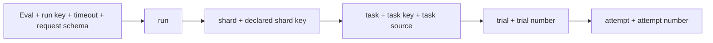

# Deterministic runner identities

This page specifies the **unreleased** `sha256-waza-c14n-v1` identity ABI in
`internal/runneridentity` and its production integration for
[#759](https://github.com/microsoft/waza/issues/759). This source preview does not
announce the [v0.40.0 release](https://github.com/microsoft/waza/issues/754).
The [negotiation contract](RUNNER_CONTRACT.md) is a separate boundary.
The [site guide](../site/src/content/docs/guides/runner-identities.mdx) is the
canonical user-facing normalization, lineage and migration reference.

## Reading an identity

An identity names a declared logical unit, not an observed execution. Two
identical dispatches intentionally receive the same IDs. A changed attempt
number creates a new attempt ID but preserves its logical trial/task/shard/run.
It does not prove execution, exactly-once delivery, duplicate suppression,
runtime attestation, storage isolation, or that captured input matches a real
file. No timestamp, PID, hostname, current directory, resolved path, environment,
model output, billing, or engine-generated session ID participates.

The typed output records `version`, `canonical_digest`, `run`, `shard`, `task`,
`trial`, and `attempt`. The five IDs have their corresponding lowercase prefix
and a full 64-character lowercase SHA-256 digest. `canonical_digest` is the
unprefixed digest for the complete selected input tuple. IDs are not truncated.
A mathematical hash-collision possibility remains; this is domain separation
and conformance coverage, not a proof of collision impossibility.



Changing the task source does not rename its run or shard. The run is scoped
to the captured eval, not a manifest of every task in a scheduler's fleet.
Consequently, a run ID alone does not establish that all dispatched task sources
are consistent or complete. Such aggregation/manifests are outside this ABI.

## Typed integration surface

```go
id, err := runneridentity.DeriveJSON(originalRequestBytes)
// For callers with only a typed request:
id, err = runneridentity.Derive(request) // *runnercontract.Request
// Inspect the source encoding without deriving a hierarchy:
canonical, err := runneridentity.CanonicalSource(request.Input.Eval)
```

All functions return explicit errors; failed derivation returns no identity.
`DeriveJSON` applies the actual current request schema/parser, including required
presence, duplicate-key, Unicode and tuple bounds. `Derive` validates the typed
shape and rejects invalid UTF-8 sources before JSON encoding can replace bytes.
A typed Go struct cannot distinguish a missing wire boolean from explicit
false. Therefore **parse original bytes first**, or use `DeriveJSON`, at public
boundaries. Neither API constructs a runtime, reads project configuration or
files, calls a model, mutates caller input, or admits execution.

The public 4 MiB limit applies to the original request bytes, not an internally
re-encoded representation. Public callers retain those bytes for `DeriveJSON`;
valid unescaped `<`, `>` and `&` must not become oversized merely because Go's
default JSON encoder HTML-escapes them. `Derive` validates its own encoded typed
shape and cannot recover the original wire size or field presence.

The source normalizer deliberately supports more scalar precision than the
current exact-unit execution profile. It is not a replacement for #758's
offline model parsing, configuration validation, task-ID checks, trial/attempt
bounds against the eval, disabled-task checks or capability negotiation. In
particular, #758 rejects authored floats, nonempty context/metadata and external
paths. A `canonical-only` fixture demonstrates the encoding, **not** accepted or
executed runner work. Do not widen #758 admission just because this package
can encode a value.

## Source normalization

Each captured eval/task is one UTF-8 YAML mapping, at most the runner request
limit (currently 4 MiB), with at most 64 nested child levels. The original source
is parsed directly into `yaml.Node`; it is never hashed through defaulted Go
model structs, `map[string]any` numeric decoding, or IEEE-754 conversion.
The YAML node resolver is the repository's pinned `gopkg.in/yaml.v3`; changes to
resolution behavior require conformance review and, if different, a new ABI.

| Declaration | Rule |
|---|---|
| Mapping | Unique string keys, sorted by unsigned UTF-8 bytes; preserve every key/value, including unknown fields in canonical-only input. Execution admission still rejects unknown model fields. |
| Sequence | Preserve order and length. No sorting or deduplication. |
| String | Exact decoded Unicode scalar sequence; no NFC/NFD normalization, case folding, trimming, path normalization or environment substitution. Different scalar types remain different. |
| Integer | YAML `!!int`, arbitrary-precision signed decimal output; equivalent signs, radices, underscores and leading-zero octal normalize to their exact integer value. Integer negative zero equals integer zero. |
| Float | YAML `!!float`, finite decimal only, exact symbolic decimal coefficient/exponent; remove insignificant leading/trailing coefficient zeros and normalize exponent spelling. Never round through binary floating point. Preserve negative float zero. |
| Boolean | YAML `!!bool` values become true/false; quoted boolean-looking text remains a string. |
| Null | YAML null spellings become null. Missing key, null, empty string, zero, false, empty mapping and empty sequence are all different. |
| Presentation | Comments, mapping order, quotes/escapes with the same decoded scalar, flow/block formatting, document markers and source LF/CRLF are not identity-bearing. |
| Text line endings | YAML normalizes physical source line breaks, including literal blocks, to LF. Explicit string escapes `\r\n` and `\n` remain different text. Do not rewrite decoded strings. |

Reject aliases, anchors (even unused), merge keys, duplicate decoded keys,
non-string keys, multiple documents, invalid UTF-8/Unicode escapes, non-finite
floats, timestamp tags, custom tags and unsupported collection/scalar tags.
Date-like text must be quoted to be a string. This avoids guessed equivalence
and implicit native/timezone conversion. YAML supplementary characters use a
valid scalar escape such as `\U0001f600`, not JSON-style surrogate-pair escapes.

Float canonicalization splits the finite decimal into coefficient digits and
base-10 exponent without expanding the exponent. For example `12.50e-1` and
`1.25` both encode `125e-2`. `0.0` encodes `0e0`, `-0.0` encodes `-0e0`;
neither is the integer `0`. Decimal digits beyond binary64 precision survive.
Exponents are arbitrary-precision signed integers; huge exponents do not cause
huge zero-filled strings. Implicit YAML tag resolution is preserved: use explicit
`!!int`/`!!float` for canonical-only values outside the resolver's native range.

## Exact canonical byte grammar

All structural tokens are ASCII. Lengths/counts are unpadded unsigned decimal.
String lengths count **UTF-8 bytes**, not Unicode characters or UTF-16 units.
There are no separators or terminators beyond those shown.

| Node | Bytes |
|---|---|
| String | `s<byte-length>:<decoded UTF-8>` |
| Integer | `i<byte-length>:<canonical decimal>` |
| Float | `f<byte-length>:<canonical coefficient>e<canonical exponent>` (the length covers the entire coefficient/exponent text) |
| False / true / null | `b0` / `b1` / `n` |
| Sequence | `a<element-count>:<encoded children>` |
| Mapping | `m<pair-count>:<encoded string key><encoded value>...`, sorted keys |

Examples: `{}` is `m0:`, `{v: null}` is `m1:s1:vn`,
`{v: 0}` is `m1:s1:vi1:0`, and `{v: "0"}` is `m1:s1:vs1:0`.
Length framing prevents concatenation ambiguity even when source strings contain
colons, embedded NUL or grammar-looking text.

For namespace `N` and ordered string fields `F`, define:

`H(N,F) = lowercase-hex(SHA256(UTF8(version) || NUL || UTF8(N) || NUL || encodeStringSequence(F)))`

`encodeStringSequence` is `a<count>:` followed by the `s` encoding of each
field. Canonical source bytes occupy one string field, not a decoded subtree.
Parent references below are **unprefixed** lowercase digests, not display IDs.
All tuple integers use unpadded base-10 text.

| Namespace | Ordered string fields |
|---|---|
| `run` | request `schema_version`, `run_key`, `timeout_ms`, canonical eval |
| `shard` | run digest, declared `input.shard` |
| `task` | shard digest, `selection.task`, canonical task |
| `trial` | task digest, `selection.trial` |
| `attempt` | trial digest, `selection.attempt` |
| `input` | run digest, shard digest, task digest, trial digest, attempt digest |

`selection.shard` must equal `input.shard` or derivation fails. No field depends
on the order in which a scheduler dispatches work. Run key and exact authored
sources are declaration identity, not trusted provenance. `versions`,
`required_capabilities`, `optional_capabilities` and `allow_paid_execution` are
negotiation/permission metadata and intentionally excluded; they never authorize
execution here. Selected capability/runtime behavior still needs separate
producer provenance; this ABI does not attest a runtime choice.

## Frozen conformance evidence

[vectors.json](../internal/runneridentity/testdata/vectors.json) has 29 frozen
vectors with explicit canonical bytes and all six expected digests.
[reference.mjs](../internal/runneridentity/testdata/reference.mjs) calculates them
independently using Node crypto and manually typed canonical trees, not Go or a
YAML parser. It verifies the frozen file by default. `--write` is an explicit
ABI-authoring action, not a test repair. The Go test pins its SHA-256:
`3acf83109f3939bed296b005d9802e5bd67c8c6730c6894a3bd411e408c738ae`
(physical JSON CRLF is normalized to LF for that file checksum only).

The tests compare canonical bytes and full IDs, exercise equivalent/near-miss
controls, mutate every authored value leaf in the valid baseline sources, and
check precisely which ancestors remain stable. Fresh subprocesses derive every
vector under different temporary working/home directories and timezones.
The same Go tests are platform-independent and selected by normal package
discovery; **native Linux/Windows execution remains a final-layer CI gate**.
macOS execution or Windows cross-compilation is not native Windows evidence.

```sh
NO_COLOR=1 ENABLE_COPILOT_TESTS=false go test ./internal/runneridentity ./internal/runnercontract -count=1
go vet ./internal/runneridentity ./internal/runnercontract
golangci-lint run ./internal/runneridentity/... ./internal/runnercontract/...
node internal/runneridentity/testdata/reference.mjs
```

Fixtures are synthetic declarations and expected hash outputs, not executed
result examples. The `exact-unit` labels identify the intended source profile,
not evidence of #758 producer execution.

## Stability and migration boundary

The verified unshipped draft #779 (`4fdbaf62e9dcf4ded2055c1919544973bc42761d`,
base `6c100c73786c6440f564f6df114ca2fbd473f167`) supplied the hierarchy and
domain-separation prior art. Its `sha256-json-v1` defaulting/numeric behavior and
old identity vector are **not** this algorithm and are not rewritten/imported as
an oracle. This new version intentionally produces different identifiers.

Any change to fields, scalar/tag semantics, Unicode policy, framing, namespaces,
parent inclusion or digest algorithm requires a new identity version and new
vectors. Request schema version and future result schema version are independent.
Old results without identity metadata remain **unavailable**, not inferred
`sha256-waza-c14n-v1`. Do not backfill verified identities from incomplete
historical results. An external consumer must compare both derivation version
and ID, retain legacy IDs as legacy, and recalculate only from complete original
declared sources when an explicit migration is requested.

## Production integration and terminal handoff

`runnerunit` invokes `DeriveJSON` on the original bytes after negotiation/parsing, exact
source/profile validation and `PrepareInlineInput`, but before the runtime
factory. The parsed request retains original authored strings; defaulted models
and runtime paths never supply identity input. Errors reject explicitly with
`invalid_identity`, zero calls and no identity. Unadmitted/unsupported requests
have no identity. Later runtime rejection, factory failure, cancellation, timeout,
execution or shutdown failure retains identity without implying execution.

`Report.Identity` is `*runneridentity.Identity` with `json:"identity,omitempty"`.
CLI stdout (including shell-redirection saves), HTTP responses, Lab lineage and
validation JSON exports carry the same producer's seven fields. Receipt schema
`waza.runner-unit` version `1.0` accepts this optional additive field; old receipts
without it remain readable. Null/partial/unknown-version identity or identity on
a rejected receipt is invalid. No historical eval reader or writer is tightened.
This layer adds no advertised capability or request field.

The original 29-vector oracle above remains unchanged. Its `exact-unit` source
labels describe source syntax, **not execution admission**: those task sources
omit the grader required by the current bounded profile. A separate independent
[producer reference](../internal/runnerunit/testdata/identity-reference.mjs)
uses manually typed canonical trees for the real `examples/runner/unit.json`
and ten controls. Its frozen [11 vectors](../internal/runnerunit/testdata/identities.json)
are pinned to LF-normalized SHA-256
`fea761f0270c22dbf3a79760b8877bfac32ab8e14022f7d058401e149e9e88b0`.
Production tests compare every full identity through validation, execution,
CLI serialization, HTTP, Lab rendering and downloaded JSON, including source
presentation and negotiation-only alternatives. Runtime factory buffer mutation
proves identity/prepared input are captured before construction.

```sh
node internal/runnerunit/testdata/identity-reference.mjs
NO_COLOR=1 go test ./internal/runnerunit ./cmd/waza -run 'Test.*(Identity|Identities)' -count=1
```

The next #760 layer owns terminal schema/emission/exit mapping, not this receipt.
It must use this canonical type and already-derived optional value after
successful exact admission; it must not derive again from observations or
invent identity on rejection. No persistence, archive ingestion, reconciliation,
remote scheduling, terminal writer or terminal version is implemented here.
