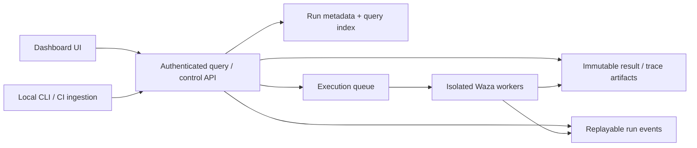

import ZoomImage from '../../../components/ZoomImage.astro';

**Available in v0.39.0 and opt-in:** install the published standalone release
or build current source as described in
[release availability](../../reference/releases/). Older standalone
`v0.38.10` does not include this prototype.

`waza serve --lab` opens the **experimental real-results dashboard** at `/#/lab`.
The classic dashboard remains available at `/#/` on the same server. The Go
evaluation engine is unchanged; the lab is a viewer, not an execution service.

<ZoomImage src="../../images/dashboard-lab-overview.png" alt="Dashboard lab with linked quality charts, model performance, attention items, and run history." />

The screenshots show the separately labeled **synthetic demo** at `/#/lab/demo`.
The default lab reads your saved Waza results, never substitutes synthetic data
on errors, and labels unsupported metadata as unavailable.

## Run locally

The source-build preview adds a **Runner contract** section for live, offline
version/capability checks and exact work selection validation. It shows requested
and resolved shard/task/trial/attempt, validation state, zero engine calls and
that adjacent work was not selected. Admitted results also show the input-derived
logical run/shard/task/trial/attempt hierarchy, canonical digest and derivation
version, and export the same validation JSON. Identity is not execution evidence;
older or rejected receipts show it as unavailable. These Lab actions never start an evaluation.
This is separate from saved run evidence and is
unavailable in the synthetic demo. See [Runner contract and API](../runner-contract/)
and [logical identity normalization and migration](../runner-identities/).

For a dashboard built from this source tree:

```bash
waza serve --lab --results-dir ./results --no-browser
# Open http://localhost:3000/#/lab
# Classic dashboard: http://localhost:3000/#/
```

`--lab` chooses the printed and auto-opened URL. It does not redirect the root
or replace classic views. `--lab` and `--tcp` are mutually exclusive. The server
keeps its existing loopback bind; no cloud authentication or hosting is added.

Local artifacts refresh every 15 seconds or with **Refresh results**. Once
summaries identify a remote archive, automatic polling stops: use **Refresh
results** to reload it explicitly rather than repeatedly downloading every
remote artifact. Empty archives keep checking for their first saved result.
Storage-backed results use the existing configured storage adapter. Loading,
refresh failures, stale results, and retry actions are visible. The default
window is **All time**, so older histories remain accessible.
Successful summary refreshes also refresh mounted inspector and comparison
evidence, even when regrading keeps the run ID and timestamp unchanged. Failed
refreshes retain previously loaded summaries and evidence; a failed local reload
does not discard the classic dashboard's cached artifacts.
Comparison evidence is refreshed as one selected pair. If either detail request
fails, both previously loaded members and a comparison-bound inspector retain the
last wholly successful pair, with the actual refresh error shown. An explicit
retry or a later local refresh replaces both members together. Selecting a
different pair loads its own evidence; this is not a transaction across backend
artifacts or unrelated inspectors. Remote archives still refresh only on demand.
The inspector retains a selected task while it still exists; if a refresh removes
it, both the selector and evidence use the first remaining failed task, or the
first remaining task when none failed. Empty task sets have no task selection.
That resolved fallback becomes the selection: reintroducing a removed task does
not switch back to it unless you explicitly select it. Initial summary-only
loading does not reset a requested task.
This refresh also applies when storage is enabled with the local/default backend.
An incomplete or invalid rewrite of a previously loaded artifact reports a
refresh error and retains the prior snapshot. Intentional file deletion is
reflected after a successful scan; unrelated malformed new files remain ignored.
An uncreated empty results directory remains empty across refreshes. Inaccessible
new unrelated paths are skipped; failures affecting the root or previously
admitted artifacts retain explicit errors and the prior snapshot.

For frontend-only exploration of the synthetic demo, no Go server is needed:

```bash
cd web
npm ci
npm run dev -- --host 127.0.0.1
# Open the URL printed by Vite, followed by /#/lab/demo
```

A previously installed Waza release does not gain the lab merely by checking out
this source. Build the frontend and binary to embed the updated dashboard, or use
the frontend-only development workflow above.

## Explore the real-results dashboard

| Workspace | Working interactions |
|---|---|
| Overview | Eval/skill/model/window filters, selectable quality-chart dates, model cross-filtering, failing-run drilldown |
| Current runs | Select a saved run and inspect artifact-derived SSE activity; reconnection, deduplication, and terminal states |
| Run history | Search, outcome filters, task evidence inspection, and selection of two runs from the same eval |
| Compare | Baseline/candidate selection, reported weighted task-score deltas, regression evidence, added/missing task coverage |
| Reports | Filtered JSON/CSV downloads and browser print/save-PDF |
| Skills & evals | Suites observed in run history; readiness, requirement coverage, and skill token budgets explicitly unavailable |

Try **Overview → failing run → Grader evidence → Conversation → Recorded evidence → Trajectory → Reports**.
The inspector uses actual recorded prompts, graders, session digests, responder
metadata, model usage, reliability statistics, portable evidence, scoped
requirement observations, prompt-judging metadata, and the existing trajectory
viewer. It supports keyboard focus containment, Escape to close, and focus
restoration. Detail artifacts are loaded on demand rather than downloading all
transcripts for the overview.
Evidence tabs use a single Tab stop with ArrowLeft/ArrowRight, Home, and End to
move focus and selection. Nullable task/grader arrays are empty recorded
evidence, not errors or invented scores, including in JSON reports.

### Read a multi-turn conversation

Open a run, select its task, and choose **Conversation**. Recorded user and
**Agent under test** messages appear in their saved order, fully expanded with
line breaks preserved. Tool events, reasoning and streaming deltas are omitted;
use **Trajectory** for the underlying event view.

This view uses only saved `user.message` and `assistant.message` events from the
**first repetition**. It does not assess transcript completeness or reconstruct
missing messages from the initial prompt, grader feedback or final output.
Missing message content and tasks with no recorded conversation are explicit.
The existing API omits empty text, so **No message text recorded** does not
distinguish an empty original message from unavailable text.
The synthetic demo does not invent a recorded conversation.

**User** labels identify the message role, not whether a human or model authored
that specific message. When responder metadata exists, its simulated-user
follow-up count is shown separately; per-message provenance is unavailable.
Changing tasks or refreshing saved results updates the conversation along with
the other inspector evidence.

<ZoomImage src="../../images/dashboard-lab-conversation.png" alt="Lab Conversation tab showing expanded, ordered user and agent messages from an authored mock fixture." />

<ZoomImage src="../../images/dashboard-lab-compare.png" alt="Baseline comparison with aligned task scores, regressions, and added task coverage." />

<ZoomImage src="../../images/dashboard-lab-evidence.png" alt="Lab inspector displaying fixture-backed reliability and evidence metadata, marked mock and not verified." />

This evidence screenshot uses cached mock-provenance metadata, without a new
independent judging claim. Recorded judging is tested separately using a
producer-projected, non-cached task; cached evidence and fresh judging are not
combined for the same task repetition.

The **Recorded evidence** tab shows stored task trial counts and intervals,
suite reliability, provenance-bound evidence metadata, and independent prompt
judge observations. Invalid metadata is withheld; missing historical metadata is
**Not assessed**. Digests and artifact references do not expose file contents or
prove external state, requirement enforcement, or that a judge inspected every
item. The synthetic demo does not fabricate these records.
Malformed trial counts, intervals, and `pass^k` estimates are explicitly withheld
rather than formatted as valid reliability evidence; recorded zeroes remain
visible.

### Release policies and assurance use classic views

Lab's **Compare** workspace is descriptive; it does not assess controlled
release policies or load native collection sidecars. From Lab, choose
**Original dashboard → Release policies** to open `/#/release` on the same
server. The [release evidence view](../dashboard/#release-policies) reads local
controlled collections under `--results-dir`, including native attempt
outcomes, errors, output, model attribution, usage completeness, and lifecycle
observations. It provides decision JSON and native-attempt CSV exports,
separate from Lab's run reports.

[Native collection](../controlled-comparisons/#opt-in-to-native-copilot-collection)
requires explicit policy selection and may incur provider usage. Viewing saved
evidence does not start collection. Native assurance is unsupported; runtime
version and provider currency remain unavailable. Client tool denial is not
server isolation, and observed budgets are not atomic spending caps.

For a supplied standalone assurance report, choose **Original dashboard →
Assurance** at `/#/assurance`. The [assurance inspector](../dashboard/#grader-assurance)
validates the report in your browser; it does not run graders or establish a
release-policy pass.

The real-results **Skill** and **Eval** controls are independent: select one
eval when a skill has multiple suites, or combine both to narrow the scope.
Eval selection matches the stored eval identity even when skill metadata is
absent; identical skill and eval names are not interchangeable. **All evals**
and **Reset filters** clear the eval restriction. The synthetic demo retains
its existing skill-only filter.
History search also matches the recorded eval identity, independently of the
Eval dropdown. Missing or blank skill metadata displays **Unavailable** but
does not become a skill identity or filter option. An authored skill named
`Unavailable` remains a real, selectable skill. Inspector configuration and JSON
reports preserve absent skill fields rather than replacing them with the eval
name or a presentation label. Observed-suite links scope by their actual eval
identity, including suites with no recorded skill.
Saved-result decoding, storage, and the summary/detail API preserve an explicitly
recorded `"skill": ""` as a blank string. An absent or `null` skill is unavailable
and omitted from the API, not inferred from the eval name. Rewriting a decoded
artifact retains that distinction, including historical nested baselines.
`waza grade --output` also preserves recorded skill presence and original run
provenance while updating grading fields and the result writer version.

The sidebar reports the same refresh policy as the results status: local
archives refresh every 15 seconds, while remote archives refresh on demand.
Before the first archive response, it shows that the refresh policy is loading.

Scope filters apply to historical summaries, tables, comparisons, reports, the
observed catalog, and activity run selection. Selecting a chart date filters runs
while the trend retains the time-window context.

**Current runs is saved-result replay**, not an active-worker monitor. The
existing API reconstructs task/grader events and timestamps from result
artifacts. Browser reconnections resume with `Last-Event-ID`. The lab closes
terminal or malformed streams, reports connection errors, and clears activity
when the selected run changes. Start/cancel/retry controls and real execution
discovery are not available.
Retrying connections show **Reconnecting** while the browser is attempting to
reopen them. Permanently closed connections show an error and require **Reconnect
stream**; they do not claim an automatic retry is in progress.

### Data honesty

- A task pass rate is distinct from its weighted quality score.
- Task scores aggregate repetitions; grader evidence and trajectories describe
  the **first repetition**, not every trial. Missing weighted scores remain unavailable.
  Omitted or null task/suite weighted-score fields are not recorded zeroes;
  explicit numeric zero remains a valid recorded score.
- AI Credits use authoritative API values, never token-derived estimates.
  Unknown billing is shown as unavailable; aggregate credit values are explicitly
  **known subtotals**, with reporting coverage.
- Baselines are scoped to the same nonempty eval identity. Tasks align by stable
  IDs, or unique legacy names when both artifacts lack IDs. Duplicate identities
  are non-comparable, not silently paired.
  Added/missing tasks are **not comparable**, not zero-score regressions.
  The candidate picker remains available for singleton suites; only comparison
  evidence requires a matching baseline.
- Comparisons are descriptive, not claims of statistical significance.
- Comparisons align weighted task scores; they do not compare confidence
  intervals, `pass^k`, provenance, or prompt-judging observations.
- Eval names do not prove matching spec/grader revisions; verify compatibility
  before drawing conclusions. Git revisions and full configurations are unavailable.
- JSON exports have their own report format marker and `synthetic: false`, with
  selected API run details. Detail downloads use bounded concurrency; any failure
  aborts the export without downloading a partial report. These reports are not
  Waza `EvaluationOutcome` artifacts. JSON includes recorded reliability,
  evidence, and prompt-judging API metadata. CSV is a run-level summary only; it
  does not include task-level intervals, provenance, evidence, or judge
  observations. It preserves numeric credit precision and leaves unknown fields
  empty; browser print can save a PDF.

### Isolated synthetic demo

`/#/lab/demo` retains the original UX mock with deterministic 84-run fixtures
dated October 6, 2026, illustrative configuration/readiness/CI metadata, and
browser-only current-run playback. Try **Overview → Azure deploy regression →
Respect the tool policy → Grader evidence → Trajectory → Reports**.
This demo makes no API requests, never executes evaluations, and exports
`synthetic: true` reports. Playback jobs are separate from historical reports.
It is never selected automatically after a real-data error.

## Research and design rationale

Research observed on **2026-10-06**. These are independently verified reference
patterns, not copied implementations or promises of feature parity.

| Reference | Verified capability | Waza design implication |
|---|---|---|
| [Aspire dashboard](https://aspire.dev/dashboard/overview/) | Resource state in AppHost mode; logs, traces, metrics, correlated inspection; standalone OTLP viewer | Treat current runs and evidence inspection as first-class operational workspaces, not just charts |
| [Flint Chart](https://github.com/microsoft/flint-chart) | Semantic chart specs, visual themes, multiple rendering backends | Make chart meaning and visual conventions consistent across reports |
| [Flint interactions](https://github.com/microsoft/flint-chart/blob/main/docs/interaction-spec.md) | Highlighting, linked brushing, navigation, annotations, keyboard targeting; documented `interaction_spec` support on the Vega-Lite interactive surface | Connect chart selection to application-level filters and task evidence |
| [Vally serve](https://github.com/microsoft/vally/blob/main/docs-site/src/content/docs/reference/cli/serve.mdx) | Results-directory serving, optional SQLite history, paginated REST API, score matrix, rankings, grader/tool analysis, comparison | Separate queryable historical analytics from artifacts and foreground grader failure analysis |
| [Vally dashboard source](https://github.com/microsoft/vally/blob/main/packages/server/src/dashboard/index.ts) | Chart.js charts for duration, tokens, results/tool distributions; all-outcomes exploration and model comparisons | Use comparison and score matrices to explain outcomes, rather than a wall of aggregate charts |
| [Braintrust comparisons](https://www.braintrust.dev/docs/evaluate/compare-experiments) | Baselines, aligned test cases, regression/improvement deltas, report export | Make regression → evidence → shareable report a coherent journey |
| [Promptfoo web UI](https://www.promptfoo.dev/docs/usage/web-ui/) | Search/filterable result tables, cell inspection, comparison, config visibility, exports | Preserve a dense evidence table alongside visual exploration |
| [Langfuse datasets](https://langfuse.com/docs/evaluation/experiments/datasets) | Project-scoped datasets with inputs, expected outputs, and experiment workflows | Give eval suites and their versions a visible home rather than only listing executions |

Vally's inspected dashboard/server surfaces were oriented toward stored outcome
analytics. We did not find an SSE live-run or execution-control UI there. Its
configurable network bind and host-header protections do not constitute a complete
authenticated multi-user cloud service. This is a scoped source observation,
not a claim that Vally cannot add those capabilities.

This prototype uses **native SVG/React charts inspired by Flint**, not the Flint
package. It implements date/model cross-filtering; it does not claim linked
brushing, pan/zoom, or every Flint preset. A future integration should evaluate
Flint's Vega-Lite interactive surface, route semantic events into shared filter
state, validate per-chart interaction support, and measure bundle/runtime cost.
It need not use Flint's hosted MCP service or send private eval data anywhere.

## Waza feature coverage

The lab makes room for the full lifecycle, but **does not implement every
CLI command in the browser**.

| Existing Waza surface | Prototype representation | Production work still needed |
|---|---|---|
| Skill/custom-agent authoring, scaffolding, suggestions | Skills/evals catalog and capability map | Suite discovery, editing, validation, registry/lock provenance |
| Sensei/readiness, tokens, spec verification, coverage | Illustrative per-skill quality/coverage/budget | Real check/coverage outputs and artifact links |
| Eval model, judge, repetitions, weighted graders | Real history, recorded metadata, score matrix, grader evidence | Full-fidelity repetition-level data and configuration |
| Triggers, responders, command mocks, fixture isolation | Recorded responder metadata, declared dependency modes in Configuration, and sanitized mocked CLI attempts in Trajectory | Dedicated trigger/MCP invocation analysis and fixture-isolation evidence; declarations do not prove dependency use |
| Custom-agent tool policies | Actual digest/trajectory denials in the inspector; illustrative demo denial | Richer invocation and policy analysis |
| Token, request, per-model AI Credit diagnostics | Real summary totals, precise credits/coverage, task digest, model usage in recorded metadata | Dedicated session-ledger and per-model analysis views |
| Snapshot/replay, adversarial packs, telemetry | Trajectory and capability map | Real snapshot/fault-pack links and trace correlation |
| Compare, CI, storage, result reports | Real storage sources, stable-task comparisons, report download | Compatible spec versions, CI/revision provenance, durable ingestion |
| Controlled release policies and native collection | Separate classic Release policies view at `/#/release`, including native evidence and exports | No Lab policy assessment or collection controls; descriptive Compare is not a release gate |
| Grader assurance | Separate classic Assurance inspector at `/#/assurance` for supplied reports | No Lab assurance execution or inferred qualification from task scores |
| Runtime progress/cancellation/retries | Artifact-derived SSE replay; explicit demo playback | Authoritative worker state, live events, authenticated run-control APIs |

The real catalog derives observed suites from results; it does not discover all
installed skills. Readiness, coverage, token budgets, and git revisions remain
unavailable. The synthetic catalog is illustrative only.

## Local-first and cloud architecture

**Current implementation:** a lazy-loaded React route with scoped light styles,
polled real-result summaries, lazy evidence loading, replayable SSE, and in-browser
exports. `GET /api/v1/lab/runs` refreshes local artifacts without changing classic
listing behavior. Additive API metadata includes skill, repetitions, weighted
scores, and stable task IDs. The original dashboard retains its shell, routes,
and dark theme. No new storage, authentication, or deployment resources are added.

**Recommended future architecture:** the same UI and versioned query/event
contracts in both deployment modes, with execution separated from viewing.



Locally, preserve loopback defaults and use the existing result artifacts with a
durable query index (SQLite is a candidate). In a shared cloud service, introduce
identity, project authorization, durable database/object storage, and separate
execution workers. Choose the cloud provider and deployment product after
validating the UI and execution requirements.

Production requirements include retention, redaction, audit trails, pagination,
artifact/spec revisions, stable task/run identity, retry/attempt provenance, and
authoritative run states. Existing artifact-derived SSE replay is useful prior
art, but must not be described as a worker queue or proof of real-time execution
control. A live event contract needs sequence/resume behavior, disconnect/error
states, and reconnect handling.

### Hosting the mock

`npm run build` produces static frontend assets. Those assets can be served by a
static host without credentials or an API for `/#/lab/demo`; the real lab and classic dashboard
routes still need Waza's API. Keep the lab's synthetic banner intact. Static
hosting demonstrates UX only, not a hosted eval service.

Build output belongs to the existing embedded dashboard pipeline. Do not commit
generated hashed asset references as an incidental build change.

## Verification

```bash
cd web
npm run build
npm run lint
npx playwright test e2e/dashboard-lab.spec.ts e2e/dashboard-lab-real.spec.ts --project=chromium
npx playwright test e2e/screenshots.spec.ts --project=chromium --grep dashboard-lab
```

Browser coverage exercises real summaries, arbitrary models, lazy evidence,
precision, API errors/retries/refresh, stable and legacy IDs, duplicate identities,
report failures, event replay/deduplication/reconnection, and the isolated demo.
Go coverage checks flag selection/TCP exclusion, launch URLs, metadata mapping,
storage provenance, and refreshed artifacts. Run the classic dashboard suite as
well when changing shared routing or export helpers.
