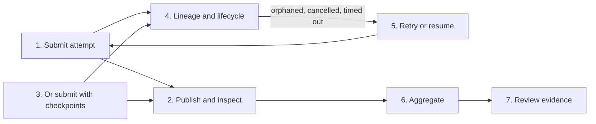

**Unreleased v0.41 source preview.** These commands are not in installed v0.40.1
artifacts. This page connects the durable-execution contracts in the order an
operator meets them. Each step links to the guide that owns its full contract.

Waza owns immutable records and read-only derivations. Your scheduler owns
dispatch, retry policy and worker shutdown. Waza never overwrites evidence,
never infers success from missing data, and never resumes across incompatible
runner, schema, model, tool or policy versions.



## 1. Submit a distinct attempt

Wrap one captured exact-unit request and submit it to a private store:

```bash
mkdir -m700 .waza-artifacts
jq -n --slurpfile request examples/runner/unit.json \
  '{kind:"waza.execution-submission",schema_version:"1.0",request:$request[0]}' \
  > submission.json
waza runner submit --store .waza-artifacts < submission.json > submit-result.json
```

Each distinct submission reserves a fresh execution ID for the same logical
run/work identity. Concurrent duplicates become separate immutable attempts;
they never replace each other. See
[logical attempts](../immutable-artifacts/#logical-attempts-embedding-preview)
and [deterministic identities](../runner-identities/).

## 2. Publish and inspect immutable artifacts

A completed submission publishes its terminal under an immutable manifest. For
artifacts you publish yourself, use `waza artifact create`, `upload`, `finalize`
and `inspect`. Repeating an identical create or finalize is safe; differing
content is a typed conflict. Always read the receipt, not just the exit code:

```bash
DIGEST="$(jq -er '.completion.manifest_digest' submit-result.json)"
waza artifact inspect "$DIGEST" --store .waza-artifacts | jq '{publication,integrity}'
```

`publication` (`finalized`, `unfinalized`, `unknown`) and `integrity` are
separate fields. `unknown` is never treated as unfinalized or verified. See
[read receipts](../immutable-artifacts/#read-receipts-not-just-completion) and
[recover safely](../immutable-artifacts/#recover-safely).

## 3. Create checkpoints at safe boundaries

`checkpoint create` is an **alternative** to step 1's `runner submit`, not a
follow-up: it submits its own distinct attempt and publishes checkpoints for
it. Use it instead of `runner submit` for work you want to be resumable, and
read downstream references from its nested `submission`. Running both executes
the unit twice as two attempts.

Checkpoints exist only at two whole-unit boundaries: `before-unit` and
`finalized-unit`. No in-flight process, SDK session, partial grader or
workspace is restored.

```bash
waza runner checkpoint create --store .waza-artifacts \
  < submission.json > checkpoint-result.json
CHECKPOINT="$(jq -er '.finalized_checkpoint_sha256' checkpoint-result.json)"
DIGEST="$(jq -er '.submission.completion.manifest_digest' checkpoint-result.json)"
```

Build the CLI from a clean, VCS-stamped tree; other builds are rejected before
store access. Boundary and digest progress go to stderr. Keep the result even on a nonzero
exit. See
[checkpoint public source preview](../immutable-artifacts/#checkpoint-public-source-preview).

## 4. Watch lineage and lifecycle

```bash
waza runner lineage --run RUN_ID --work WORK_ID --store .waza-artifacts
```

Lineage lists attempts in parent order with a derived `lifecycle`: state,
`cancellation` (`none`, `requested`, `acknowledged`, `forced`),
`deadline_exceeded`, `partial`, advisory retry eligibility and allowed actions.
Cancellation is acknowledged when the owner joins the runtime; a runtime that
ignores the 5s shutdown bound is recorded as `forced`. A killed owner stops
heartbeating and becomes `orphaned` after `--stale-after` (default three
heartbeat intervals). See
[execution lifecycle and recovery](../immutable-artifacts/#execution-lifecycle-and-recovery)
and [cancellation boundaries](../runner-terminal/#cancellation-output-and-delivery).

## 5. Retry or resume

Choose by lifecycle state and checkpoint boundary:

| Situation | Action |
|---|---|
| `orphaned`, `cancelled`, `timed_out` or infrastructure `failed` | Stop and join the original worker, then submit `"policy":{"mode":"distinct","parent":{"execution_id":"exec-...","relationship":"retry"}}`. |
| Finalized checkpoint exists | `waza runner checkpoint resume "$CHECKPOINT" --store .waza-artifacts < submission.json` reuses the original terminal with zero new engine calls. |
| Before-unit checkpoint and the original never dispatched | Stop and join the original worker, then resume `before_checkpoint_sha256`; it creates a fresh retry child. |
| `succeeded` or `evaluation_failed` | Do not retry; inspect, or submit policy `reuse` with the verified source. |
| Input `failed` or `rejected` | Fix the input. |

Check before resuming. Availability reads only and repairs nothing; resume
repeats every check:

```bash
waza runner checkpoint availability "$CHECKPOINT" --store .waza-artifacts \
  < submission.json | jq '{status,resume_action,diagnostics}'
```

Partial work inside a unit is never resumed. See
[checkpoint troubleshooting](../immutable-artifacts/#checkpoint-troubleshooting).

## 6. Aggregate completed manifests

Aggregation reads an explicit set of completed public manifests. It starts no
agent and does not need the original worker:

```bash
waza aggregate --store .waza-artifacts "$DIGEST" -o aggregate.json
```

Use `--inputs inputs.json` instead of positional digests to pair manifests with
evidence sidecars.

The same inputs give the same report. Missing, corrupt, conflicting, cancelled
and failed inputs stay visible as members; incomplete or conflicting reports
are saved and then exit nonzero. Retries are kept as separate members without a
winner. See
[the worked example](../manifest-aggregation/#worked-example-retained-public-sources)
and [the three populations](../manifest-aggregation/#understand-the-three-populations).

## 7. Review evidence states

Each member reports `conversation`, `tool`, `grader`, `reliability`, `usage` and
`provenance` as `present`, `unavailable`, `incomplete`, `redacted` or
`conflicting`. Evidence completeness is not a verdict, and missing usage is
never estimated. See
[the five states](../evidence-review/#the-five-states) and
[retries, resumes and lineage](../evidence-review/#retries-resumes-and-lineage).

## Troubleshooting

| Symptom | Meaning | Where to go |
|---|---|---|
| `concurrent_distinct_attempts` in lineage | Several parentless writers for one work item | [Logical attempts](../immutable-artifacts/#logical-attempts-embedding-preview) |
| `publication: "unknown"` | Finalization may or may not have committed | [Recover safely](../immutable-artifacts/#recover-safely) |
| `checkpoint_incompatible` | Build or captured configuration changed | [Checkpoint troubleshooting](../immutable-artifacts/#checkpoint-troubleshooting) |
| `checkpoint_stale` | The original already dispatched | [Checkpoint troubleshooting](../immutable-artifacts/#checkpoint-troubleshooting) |
| `orphaned` attempt | Heartbeats stopped past the stale threshold | [Execution lifecycle](../immutable-artifacts/#execution-lifecycle-and-recovery) |
| Aggregate exits nonzero | Inputs are incomplete or conflicting | [Aggregation troubleshooting](../manifest-aggregation/#compatibility-migration-and-troubleshooting) |
| Category `conflicting` | Sidecar disagrees with the capture | [Evidence troubleshooting](../evidence-review/#troubleshooting) |

In every case, preserve the original records. Never edit, delete or overwrite
published objects to make a check pass.

## Lab and boundaries

`waza serve --lab` shows the same contracts: manifest inspection, attempt
lineage with derived lifecycle, checkpoint availability and results, and
aggregates. These views read public manifests and lifecycle journals. Checkpoint
create and resume are explicit operator requests to the protected runner
contract; the Lab adds no queue, retry policy or mutable state. See
[Dashboard Lab](../dashboard-lab/).

Not provided: scheduler-owned retries, a global transaction coordinator,
exactly-once execution, or replication guarantees from storage backends. See
[v0.41 migration and release notes](../immutable-artifacts/#v041-migration-and-release-notes).
