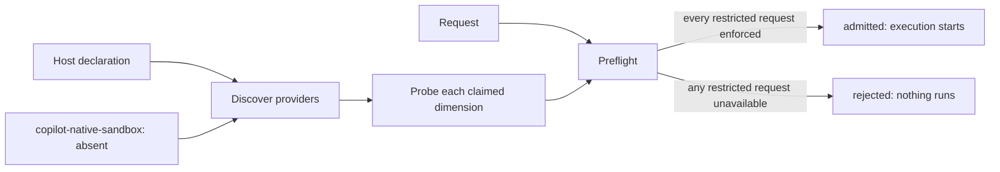

**Unreleased; targeted for v0.42.0 (#773).** Schema:
[`execution-isolation-1.0.schema.json`](/waza/schemas/execution-isolation-1.0.schema.json)
(`$id` `https://microsoft.github.io/waza/schemas/execution-isolation-1.0.schema.json`).

Waza can now **declare, discover and check** isolation boundaries before an
execution starts. It does **not enforce** any boundary itself. Enforcement
belongs to whatever encloses the Waza process (a container, VM, sandbox or OS
policy) or to a runtime provider such as the Copilot-native sandbox (#544).
Waza's job is to refuse to start when a requested boundary cannot be shown to
hold, and never to report a boundary it cannot prove.

## Dimensions

| Dimension | What restricted means | Conformance probe (attempted violation) |
|-----------|-----------------------|-----------------------------------------|
| `filesystem` | Writes are confined to the task workspace and the shared system temp dir | Confirms the workspace is writable, then tries to create a file in the workspace parent, the home directory, the current directory and every declared `outside_paths` entry (declared paths add to the defaults). Paths inside the workspace or the system temp dir are skipped, because Waza needs the temp dir to create workspaces. |
| `environment` | Secrets that exist outside the boundary are withheld | Scans variable **names** (never values) for `TOKEN`, `SECRET`, `PASSWORD`, `PASSWD`, `CREDENTIAL`, `API_KEY`, `APIKEY`, `ACCESS_KEY`, `PRIVATE_KEY`, `CONNECTION_STRING` and the declared `secret_names`. A visible name is a violation. Absence is always inconclusive: from inside the boundary a withheld secret cannot be told apart from one that was never supplied, so the host provider never proves `environment` and a restricted request is rejected until a provider with verifiable withholding evidence (such as a native sandbox) is present. |
| `network` | Off-host connections are blocked; loopback (`127.0.0.1`, `::1`) stays inside the boundary | Dials each declared `host:port` target; any connection is a violation. Enforced only when every dial fails **and** the process has no up, non-loopback network interface with an address (as in `docker --network none`). |
| `subprocess` | Child processes cannot be started | Starts the Waza binary (with `WAZA_ISOLATION_SUBPROCESS_PROBE=1`, which exits immediately) and the platform shell (`/bin/sh -c "exit 0"`, or `cmd.exe /c "exit 0"` on Windows). If either starts, the boundary is violated. Denials are only samples (executable-specific rules can deny both while allowing another child), so the host provider never proves `subprocess`; a restricted request is rejected until a provider that verifies a process-wide restriction is present. |
| `remote_tools` | Off-host tool/MCP endpoints are unreachable; tool servers on loopback are local and stay reachable | Dials each declared remote tool `host:port` target, with the same interface requirement as `network`. |

Each probe produces one outcome:

| Outcome | Meaning | Effect |
|---------|---------|--------|
| `enforced` | The attempted violation was blocked in a way that proves a boundary (permission denied, read-only filesystem, no network interface) | The dimension is available and `effective: restricted` |
| `violated` | The attempted violation succeeded | The dimension is unavailable; a violation always wins over another provider's enforcement |
| `inconclusive` | The result proves nothing (failed dials while a network interface is up, secrets merely absent, sampled spawns denied, unexpected error, no probe) | The dimension is unavailable |

A failed dial to a sampled target cannot prove a whole network policy: a
destination-specific firewall, an IPv6-only route failure, a closed port or a
DNS outage all fail one target while other connections stay possible. The
network and remote tool probes therefore claim enforcement only when no
non-loopback interface is up, which proves that no off-host destination is
reachable. Loopback is deliberately outside these dimensions, matching
`docker --network none`: processes inside the boundary, including local
loopback MCP servers, can still reach each other. Declaring a loopback target
makes a reachable local service a violation, but undeclared loopback services
are not probed.
Declare IP-literal targets that are reachable when the boundary is absent, for
example a public HTTPS endpoint such as `1.1.1.1:443`, so a missing boundary
is reported as `violated`.

## Documents

All three documents share the schema and are distinguished by `kind`. Parsing is
strict: duplicate keys, unknown fields and the wrong `kind` are rejected.

**Request** (`waza.execution-isolation-request`): the requested posture per
dimension. Omitted dimensions are `unrestricted`.

```json
{
  "kind": "waza.execution-isolation-request",
  "schema_version": "1.0",
  "dimensions": { "network": "restricted", "subprocess": "unrestricted" }
}
```

**Host declaration** (`waza.execution-isolation-host`): an operator's claim
that the environment enclosing Waza enforces some boundaries. A claim is only
a hypothesis; every claimed dimension is probed.

```json
{
  "kind": "waza.execution-isolation-host",
  "schema_version": "1.0",
  "enforced_by": "docker --network none --read-only",
  "dimensions": {
    "filesystem": { "outside_paths": ["/etc", "/usr"] },
    "environment": { "secret_names": ["MY_DEPLOY_KEY"] },
    "network": { "targets": ["1.1.1.1:443"] },
    "remote_tools": { "targets": ["api.githubcopilot.com:443"] }
  }
}
```

**Preflight report** (`waza.execution-isolation-preflight`): providers, and for
each of the five dimensions (always in the order above) `requested`,
`available`, `effective`, `enforcement_source`, every probe and a
`diagnostic` whenever the dimension is not available.

| `effective` | When |
|-------------|------|
| `restricted` | An available provider's probe proved enforcement and no probe violated it (reported even if the dimension was not requested) |
| `unavailable` | `restricted` was requested and could not be proved. The report `decision` is `rejected` |
| `unrestricted` | Not requested and not proved |

The schema forbids overclaims: `available: true` requires
`effective: restricted`, an `enforcement_source` and no diagnostic;
`decision: admitted` forbids any `unavailable` dimension. Waza and the Lab
additionally reject reports whose evidence does not support them: dimensions
out of order, probes from providers that are not available, an
`enforcement_source` without its passing probe, or a diagnostic that does not
follow from the probes.

## Providers

| Provider | Status in this build |
|----------|----------------------|
| `copilot-native-sandbox` | Always `absent`: the Copilot-native sandbox (#544) is not integrated. It claims no boundary. |
| `host-declaration` | `absent` without `--host`/`--isolation-host`; otherwise `available` and its claims are probed. |



## CLI

```bash
# Discovery only: what can this host prove?
waza isolation preflight --host host.json

# Match a request; exit 1 when a requested boundary is unavailable
waza isolation preflight --request request.json --host host.json -o isolation.json

# Gate a run: rejected before any engine, workspace or result is created
waza run eval.yaml --isolation-request request.json --isolation-host host.json --isolation-report isolation.json
```

`waza isolation preflight` exits `0` when admitted, `1` when rejected and `2`
for invalid input. `waza run` exits `2` when the isolation preflight rejects
the request; the report is still written when `--isolation-report` is given.
The report path must differ from the eval files, `--output`, and the request
and host files, so the report never replaces an input or a result. When
`environment` is effectively restricted, `run` loads every selected eval
(including all `--discover` skills) before the first one starts and rejects
the run if any stdio `config.mcp_servers` entry sets environment variables
(decoded exactly as the runtime decodes them), because those variables reach
the MCP server after the preflight and are never probed. An admitted report is
written only after every selected eval passes this check, so the artifact
never records an admission the run withdrew.
Without `--isolation-request` and `--isolation-host`, `run` is unchanged.

## Safe configuration example

Run Waza inside a container whose boundaries enclose the agent:

```bash
docker run --rm --network none --read-only --tmpfs /tmp \
  -v "$PWD:/work:ro" -w /work waza:local \
  waza run eval.yaml --isolation-request request.json --isolation-host host.json \
  --output /tmp/results.json --isolation-report /tmp/isolation.json
```

The project is mounted read-only because the current directory is probed as
an outside path; results and the report go to the temp dir, the only writable
location besides the task workspace.

Do not pass credentials into the container; a visible secret-named variable
is reported as a violation even when `environment` is not requested.
`--network none` also blocks a real Copilot engine, so request `network` and
`remote_tools` only for mock or offline engines.

## Deployment limitations

- The host boundary must enclose the Waza process and everything it launches.
  A `subprocess` restriction therefore also prevents engines that launch
  helper processes (including the Copilot CLI) from starting.
- Probes are point-in-time evidence from the Waza process, not continuous
  monitoring. A boundary can change after the preflight.
- The probe workspace is a fresh temporary directory, not the task workspace
  created later.
- The system temp dir stays writable, so a `filesystem` restriction does not
  isolate concurrent tasks from each other inside it.
- Secret detection is by variable name; a secret under an innocuous name is
  not detected unless declared in `secret_names`. The host provider can only
  detect exposure, never prove withholding, so `environment: restricted` is
  always rejected until a provider with verifiable evidence is available.
- `network` and `remote_tools` are provable only on hosts with no external
  network interface; per-destination firewalls are reported `inconclusive`.
- `subprocess` can be detected as violated but never proved by the host
  provider, so `subprocess: restricted` is always rejected for now.
- Enforcement is inferred from error classification; platforms that report
  blocked operations with unusual errors yield `inconclusive`, never a false
  `enforced`.
- Isolation is requested via CLI flags only; there is no eval YAML field and
  no runner API integration yet.

## Integrating a provider

- A provider implements `Name()` and `Discover(ctx)`, returning a status and
  claims. Only `available` providers are probed.
- Every claim must carry a probe that attempts the real violation. A claim
  without a probe is `inconclusive`.
- Never make Waza enforce a boundary to satisfy a probe, and never report
  `enforced` without blocked-violation evidence.
- The Copilot-native sandbox (#544) plugs in as a provider; until it lands it
  is reported `absent` with a reason.

## Troubleshooting

| Diagnostic | Cause | Fix |
|------------|-------|-----|
| `no_provider` | No available provider claims the dimension | Add the dimension to the host declaration, and enforce it in the enclosing environment |
| `probe_violated` | The attempted violation succeeded | The declared boundary is not in effect; fix the container or OS policy |
| `probe_inconclusive` | The probe proved nothing | For network targets run without external interfaces (for example `--network none`) and use a reachable IP-literal endpoint; environment cannot be proved by the host provider; otherwise read the probe `detail` |
