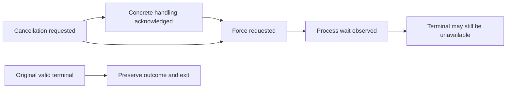

**Under development for v0.41.0 / #767.** A bounded lifecycle projection and
immutable observation-blob contract exist. Production owner observation hooks,
lifecycle CLI/API and the connected Dashboard Lab presentation are not yet
delivered. Use the existing [runner terminal response](../runner-terminal/)
for actual outcome and exit. The following is contract guidance, not a running
recovery example or a statement that new cancellation endpoints are available.

## Cancellation is not a single fact

A recorded request does not prove delivery. Context cancellation observed or a
successful SDK Abort return records specific handling, not process death.
Force requested is distinct from process wait/join observed. When a stopped
worker has no terminal, preserve the missing-evidence state rather than
manufacturing a cancelled or successful result.

## Interpret each field independently

| Field | Meaning |
|---|---|
| `state` | `admitted`, `running`, `stopped-without-terminal`, or `terminal-recorded`; these are declared observations, not authenticated worker state. |
| `terminal` | Original contextual terminal digest, outcome, exit, boundary and execution verdict; no retagging or substitution. |
| `completed_units` | Zero or one when observed, otherwise omitted. Completed failed checks still count as completed work. |
| `cancellation` | Requested, specific handling acknowledged, force requested or observed stop. The value `none` means no cancellation observation is recorded, not verified shutdown. |
| `deadline`, `deadline_expired` | Configured deadline and separately observed expiry. These cannot overwrite an original terminal. |
| `heartbeat`, `as_of`, `heartbeat_age_ms`, `suspected_orphan` | Missing heartbeat/as-of means unknown. An expired observed heartbeat only suspects an orphan. |
| `retry.advice` | Advice, not retry authorization or a global prohibition of fresh execution. |
| `evidence` | `caller-declared-unverified`; content integrity is not worker authentication or completion verification. |
| `actions` | Advisory operator steps, not executable capabilities. |

Unavailable usage, terminal evidence and progress are not zero or success.
If shutdown fails after a completed check verdict, preserve that verdict and
the failing envelope outcome/exit separately. A timeout observation does not
invent a terminal timeout; an inconsistency with an original terminal is
diagnosed and retained.

## Operator recovery interpretation

For a stale heartbeat without terminal evidence, inspect the original attempt,
worker and immutable artifacts. Do not reclaim, overwrite or delete its
reservation. A later heartbeat can remove the suspicion; a terminal remains
the original source evidence, not a newly named retry result.

For infrastructure failure, cancellation or timeout, conditional fresh-attempt
advice requires independent admission and side-effect review. Failed checks
are not transient-retry advice. Waza owns neither scheduler retry policy nor
a cross-worker retry controller.

Only before-unit and finalized-unit checkpoint boundaries are intended:
before-unit requires a fresh distinct child reservation with zero completed
work; finalized-unit requires verification of the complete original source and
retains that terminal with zero engine calls. Mid-runtime/session/workspace
recovery is unsupported. No codec, matching digest, stale timestamp or identical
occupied reservation reconstructs creator ownership.

## Migration and delivery status

Lifecycle observation schema 1.0 is independently versioned; existing runner
terminal 1.0, local results, task/eval schemas and exit behavior are unchanged.
Old artifacts do not acquire inferred liveness, cancellation acknowledgement
or completion. Observation blobs are immutable and caller-digest-addressed:
there is no latest pointer, global event inventory or lease expiry.

The full developer transition table, bounds, source-context rules and remaining
delivery gates are in
[the lifecycle contract](https://github.com/microsoft/waza/blob/main/docs/EXECUTION_LIFECYCLE.md).
The [Dashboard Lab guide](../dashboard-lab/) describes the existing prototype;
this page does not claim a lifecycle panel is present.
