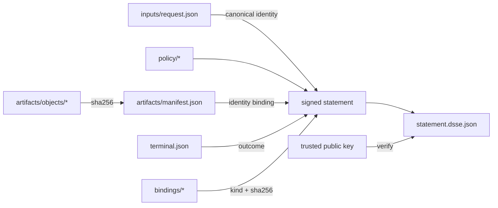

import { Aside } from '@astrojs/starlight/components';

<Aside type="caution">Unreleased, planned for v0.42.0 (#769). Installed v0.41.0 artifacts do not include these commands.</Aside>

`waza runner provenance` generates a signed, offline-verifiable provenance
bundle for one completed runner execution. It answers: which exact inputs ran,
in which runner image, under which Waza version, runner API, policy, runtime and
model, which artifacts were produced, and what was the terminal outcome.

## Bundle layout

A bundle is a directory (or the same members uploaded to the Lab):

| Member | Role |
| --- | --- |
| `bundle.json` | Unsigned index ([`provenance-bundle-1.0`](/waza/schemas/provenance-bundle-1.0.schema.json)): signer mode and key ID |
| `statement.dsse.json` | DSSE envelope whose payload is an in-toto v1 statement ([`provenance-statement-1.0`](/waza/schemas/provenance-statement-1.0.schema.json)) |
| `inputs/request.json` | Canonical runner request that was executed |
| `policy/<name>` | Policy document governing the execution |
| `artifacts/manifest.json` | Canonical `waza.artifact-manifest` |
| `artifacts/objects/<name>` | Every manifest-declared artifact, including the terminal envelope |
| `bindings/<name>` | Optional extension members bound by digest (see below) |

The statement's subjects are the manifest and every artifact object. Its
predicate (`https://microsoft.github.io/waza/provenance/execution/v1`, profile
`waza.execution-provenance/1.0`) records:

| Claim | Source | Verification |
| --- | --- | --- |
| `inputs.request`, `inputs.identity` | Request bytes | Digest checked; canonical identity recomputed |
| `runner.api_version`, `request_schema_version` | Request | Recomputed by negotiation |
| `runtime.executor`, `model`, `execution_mode` | Captured eval config | Recomputed; must match the manifest mode |
| `policy` | Policy document | Digest checked; optionally pinned |
| `artifacts.manifest`, `artifacts.objects` | Canonical manifest | Digests checked; manifest identity must equal the input identity |
| `outcome` | Terminal artifact | Recomputed from the terminal bound to the manifest |
| `runner.image`, `waza.version` | Declared by the generator | Covered by the signature; pin with `--expect-image-digest` / `--expect-waza-version` |
| `bindings` | Extension members | Digest checked, then the registered verifier for each kind |



## Signing

| Mode | Status | Notes |
| --- | --- | --- |
| `local-ed25519` | Available | PKCS#8 PEM private key; offline. `waza runner provenance keygen` creates one (mode 0600, never overwritten). |
| `sigstore-keyless` | Unavailable | Documented interface only. Generation exits 5; verification fails with `signer_unavailable`. |
| `managed-kms` | Unavailable | Documented interface only. Generation exits 5; verification fails with `signer_unavailable`. |

The key ID is `sha256:` plus the hex digest of the PKIX DER public key. Signers
implement `provenance.Signer` (`Mode`, `KeyID`, `Sign`) and verifiers implement
`provenance.SignatureVerifier`; keyless or managed integrations plug in there
without changing the bundle format. The DSSE pre-authentication encoding binds
the payload type `application/vnd.in-toto+json`.

## Verification

`waza runner provenance verify --bundle DIR --public-key KEY.pem` runs offline
and prints a [`waza.provenance-verification`](/waza/schemas/provenance-verification-1.0.schema.json)
report with 13 checks in fixed order: `bundle`, `signature`, `statement`,
`inputs`, `runner`, `runtime`, `policy`, `image`, `waza_version`, `artifacts`,
`outcome`, `bindings`, `members`. The status is `verified` (exit 0) only when
every check passed; otherwise `failed` (exit 1). Checks after a failed
signature are `skipped` and the report omits the predicate.

Verification fails closed:

- Trust comes only from verifier-supplied public keys, never from the bundle.
- Every member must be bound by the signed statement; extra files fail with
  `member_unbound`, symlinks and devices with `member_irregular`.
- Signed claims are compared with values recomputed from the members, so a
  re-signed false claim (for example a different outcome) still fails.
- Declared claims pass as `declared` unless pinned, then as `pinned`.

### Failure codes

| Code | Meaning | Action |
| --- | --- | --- |
| `trust_anchor_missing` | No public key supplied | Pass `--public-key` |
| `key_untrusted` | Signed by a key you did not trust | Obtain the signer's public key out of band |
| `signature_invalid` | Envelope or payload altered | Treat the bundle as tampered |
| `signer_unavailable` | Keyless or KMS bundle | Not verifiable by this build |
| `input_digest_mismatch`, `input_identity_mismatch` | Request altered or claim false | Treat as tampered |
| `input_not_admitted` | Request is not an admissible runner unit | Regenerate from the admitted request |
| `artifact_digest_mismatch`, `manifest_digest_mismatch`, `artifact_undeclared` | Artifact chain altered | Treat as tampered |
| `manifest_binding_mismatch` | Manifest selection, execution mode or grader IDs differ from the admitted request | Treat as tampered |
| `claim_missing` | A required claim (such as a non-empty policy or Waza version) is absent | Regenerate with every claim |
| `outcome_mismatch`, `outcome_digest_mismatch` | Terminal outcome altered | Treat as tampered |
| `runtime_mismatch`, `runner_api_mismatch` | Runtime or API claim false | Treat as tampered |
| `image_digest_unexpected`, `waza_version_unexpected`, `policy_unexpected` | Pin differs from the signed claim | Confirm the image, version or policy you consumed |
| `binding_unsupported` | Binding kind has no verifier in this build | Upgrade or drop the binding |
| `member_unbound`, `member_irregular` | Unexpected member | Remove it or regenerate the bundle |
| `members_unlisted` | Bundle cannot be listed or has more than 512 entries | Remove extra files or regenerate the bundle |

Generation refuses to sign a statement outside the profile (`statement_invalid`)
or a bundle that verification would refuse to read (`bundle_too_large`). Reports
list at most 512 members, bound members first; any unbound entries left out are
counted in `members_omitted`.

## Extension point: additional bindings

`predicate.bindings` binds additional members (for example a component
inventory or SBOM, #770) by digest:

```json
{"kind": "<kind>", "path": "bindings/<name>", "sha256": "<hex>", "media_type": "<type>"}
```

- Generation: `GenerateInput.Bindings` (`BindingInput{Kind, Name, MediaType, Data}`)
  or CLI `--bind kind=path`.
- Verification: register a verifier with
  `provenance.RegisterBindingVerifier(kind, BindingVerifier)`. It receives the
  digest-checked bytes and the signed statement, so it can require the
  inventory to name the same canonical inputs and artifacts.
- Unknown kinds fail closed at generation (`binding_invalid`) and verification
  (`binding_unsupported`). Kinds match `^[a-z][a-z0-9.-]{0,63}$`.

## Lab

The Lab runner page includes **Execution provenance**: choose a bundle
directory, paste the trusted public key, optionally pin the image digest, and
select **Verify provenance**. The browser posts the members to
`POST /api/v1/provenance/verify` (no host paths are read), validates the report
against its schema, and shows the verification state, signer, statement and
member download links, bound digests, and failure reasons. It is unavailable in
the synthetic demo. Uploads are limited to 48 MiB after base64 encoding; verify
larger bundles with `waza runner provenance verify`.

## Migration

Existing manifests, terminals and runner requests are unchanged. Provenance is
additive: generate it after a run from the same request, manifest and objects.
