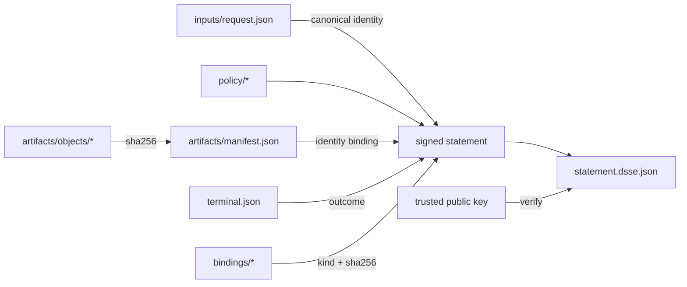

import { Aside } from '@astrojs/starlight/components';

<Aside type="caution">Available in v0.42.0 (#769). Installed v0.41.0 artifacts do not include these commands.</Aside>

`waza runner provenance` generates a signed, offline-verifiable provenance
bundle for one completed runner execution. It answers: which exact inputs ran,
in which runner image, under which Waza version, runner API, policy, runtime and
model, which artifacts were produced, and what was the terminal outcome.

## Bundle layout

A bundle is a directory (or the same members uploaded to the Lab):

| Member | Role |
| --- | --- |
| `bundle.json` | Unsigned index ([`provenance-bundle-1.0`](/waza/schemas/provenance-bundle-1.0.schema.json)): signer mode and key ID |
| `statement.dsse.json` | DSSE envelope whose payload is an in-toto v1 statement ([`provenance-statement-1.0`](/waza/schemas/provenance-statement-1.0.schema.json)) |
| `sigstore.bundle.json` | Keyless only: matching DSSE envelope, Fulcio certificate and offline transparency evidence; not a trust anchor |
| `inputs/request.json` | Canonical runner request that was executed |
| `policy/<name>` | Policy document governing the execution |
| `artifacts/manifest.json` | Canonical `waza.artifact-manifest` |
| `artifacts/objects/<name>` | Every manifest-declared artifact, including the terminal envelope |
| `bindings/<name>` | Optional extension members bound by digest (see below) |

The statement's subjects are the manifest and every artifact object. Its
predicate (`https://microsoft.github.io/waza/provenance/execution/v1`, profile
`waza.execution-provenance/1.0`) records:

| Claim | Source | Verification |
| --- | --- | --- |
| `inputs.request`, `inputs.identity` | Request bytes | Digest checked; canonical identity recomputed |
| `runner.api_version`, `request_schema_version` | Request | Recomputed by negotiation |
| `runtime.executor`, `model`, `execution_mode` | Captured eval config | Recomputed; must match the manifest mode |
| `policy` | Policy document | Digest checked; optionally pinned |
| `artifacts.manifest`, `artifacts.objects` | Canonical manifest | Digests checked; manifest identity must equal the input identity |
| `outcome` | Terminal artifact | Recomputed from the terminal bound to the manifest |
| `runner.image`, `waza.version` | Declared by the generator | Covered by the signature; pin with `--expect-image-digest` / `--expect-waza-version` |
| `bindings` | Extension members | Digest checked, then the registered verifier for each kind |



## Signing

| Mode | Status | Notes |
| --- | --- | --- |
| `local-ed25519` | Available, unchanged default | PKCS#8 PEM private key; offline. `waza runner provenance keygen` creates one (mode 0600, never overwritten). |
| `sigstore-keyless` | Available, opt-in CLI | GitHub Actions OIDC, public-good Fulcio and Rekor v1; online signing, offline verification with operator-supplied trust and identity policy. |
| `managed-kms` | Unavailable | Documented interface only. Generation exits 5; verification fails with `signer_unavailable`. |

The key ID is `sha256:` plus the hex digest of the PKIX DER public key. Signers
implement `provenance.Signer` (`Mode`, `KeyID`, `Sign`) and verifiers implement
`provenance.SignatureVerifier`; keyless or managed integrations plug in there
without changing the bundle format. The DSSE pre-authentication encoding binds
the payload type `application/vnd.in-toto+json`.

### Keyless prerequisites: complete these before signing

- [ ] Use the v0.42.0 CLI or later. Installed v0.41.0 does not have these
  commands. Local Ed25519 remains the default; select
  `--signer sigstore-keyless` explicitly. No local private-key file is needed.
- [ ] Run generation **inside GitHub Actions** (`GITHUB_ACTIONS=true`), with
  job permissions `id-token: write` and `contents: read`. GitHub must provide
  `ACTIONS_ID_TOKEN_REQUEST_URL` and `ACTIONS_ID_TOKEN_REQUEST_TOKEN`; do not
  copy, print or manually persist these credentials. Waza requests audience
  `sigstore` automatically. A local terminal or a GitHub PAT is not a substitute.
- [ ] Allow HTTPS egress to GitHub's job-provided OIDC endpoint,
  `https://fulcio.sigstore.dev` and `https://rekor.sigstore.dev` (Rekor v1).
  Certificate issuance and log submission require network access.
- [ ] Obtain and approve a **verifier-owned Sigstore trusted-root JSON** through
  authenticated Sigstore TUF, as below. Pass `--trusted-root FILE` to **both
  generate and verify**. Waza does not fetch it automatically; never take it
  from the execution bundle, its producer's download, or an arbitrary URL.
- [ ] Choose the exact trusted repository, workflow file and ref in advance.
  Verification requires the exact issuer and exactly one exact identity or
  anchored identity regexp. Protect that workflow/ref and its signing inputs;
  trusted-root authentication does not authorize every GitHub workflow.
- [ ] Have the actual completed execution's canonical request, canonical
  manifest, every manifest-declared artifact (including the terminal), nonempty
  governing policy, actual immutable runner image digest and Waza version.
  Signing does not run a task or reconstruct missing execution evidence.
- [ ] Approve public-good disclosure. **Do not sign secrets or private
  artifacts with this profile.** The Fulcio certificate (workflow identity),
  signatures and DSSE payload/envelope digests become publicly recorded in
  Rekor's append-only log. Waza's Rekor v1 `dsse` entry records digests rather
  than the plaintext statement, but the **whole DSSE statement is sent to the
  service for validation**. The bundle itself contains the full statement and
  execution members; review it before publishing.

This supported example deliberately excludes pull-request events and forks.
OIDC availability elsewhere depends on GitHub's event, permission and
organization policy; this is not a claim that all fork PRs lack OIDC.
Never use `pull_request_target` to sign artifacts from untrusted PR code.

### Acquire the trusted root separately

On an operator-controlled connected machine, use the official Sigstore
`cosign initialize` TUF client. The following Bash commands pin Cosign
**v3.0.2** (Go 1.24.6+ to install); they do not install or modify Waza.
Use a new working directory so that an old cached target cannot mask failure:

```bash
set -euo pipefail
mkdir sigstore-trust-bootstrap
cd sigstore-trust-bootstrap
mkdir bin
GOBIN="$PWD/bin" go install github.com/sigstore/cosign/v3/cmd/cosign@v3.0.2
export TUF_ROOT="$PWD/tuf-cache"
./bin/cosign initialize --mirror https://tuf-repo-cdn.sigstore.dev
root="$TUF_ROOT/tuf-repo-cdn.sigstore.dev/targets/trusted_root.json"
test -s "$root"
cp "$root" trusted_root.json
sha256sum trusted_root.json
```

Cosign starts with the Sigstore TUF root embedded in that pinned release and
authenticates updated metadata and the `trusted_root.json` target. **Do not
replace this with `curl trusted_root.json`** or confuse the TUF bootstrap
`root.json` metadata with the Sigstore `trusted_root.json` consumed by Waza.
The `test` is required: initialization can fall back to legacy individual
targets; Waza requires the combined trusted-root JSON (at most 1 MiB).

Approve the resulting file and record its digest/acquisition date under your
trust-management process. Provision it independently to the signing job and
verifier, for example as reviewed `trust/sigstore-trusted-root.json` in a
protected repository. Refresh through TUF when Sigstore rotates signing
material; retain approved historical trust needed for older bundles. A hash
identifies the reviewed bytes, but is not itself root authentication. Root
acquisition needs network access; subsequent Waza verification does not.

The operator must **authenticate the trusted root independently** before using
it. Waza checks the JSON and requires at least one Fulcio CA and one Rekor log
for signing, before requesting OIDC or contacting either service. This
non-empty check is **not authentication**, proof of current validity, or proof
that the root matches the public services.

### Example GitHub Actions signing job

**Documentation example only, not an installed Waza release requirement.**
Save as `.github/workflows/execution-provenance.yml` in your own repository,
replace `OWNER/REPO`, and provision these prerequisites first:

| Path or repository variable | Required content |
| --- | --- |
| `tools/waza` | Approved Linux executable containing these commands, provisioned through your verified tool distribution |
| `trust/sigstore-trusted-root.json` | Operator-approved TUF target, not supplied by the execution bundle |
| `evidence/completed-run/request.json` | Actual canonical request submitted for this execution |
| `evidence/completed-run/manifest.json` | Matching canonical artifact manifest |
| `evidence/completed-run/objects/` | Every declared object at its manifest name, including terminal evidence |
| `evidence/completed-run/policy.json` | The policy governing that same execution |
| `WAZA_RUNNER_IMAGE_REFERENCE` | Actual runner image reference |
| `WAZA_RUNNER_IMAGE_DIGEST` | Actual consumed `sha256:` image digest, not a tag or fabricated example |
| `WAZA_VERSION` | Actual Waza version used for the execution |

The example consumes an already completed run staged by your trusted execution
process; it does not manufacture a manifest or imply that signing executes it.
Replace those paths with your same-run staging paths if needed. Repository
variables are configuration, not evidence: validate their values against your
execution records. Only vetted inputs and tools should enter this privileged job.

```yaml
name: Execution provenance
on:
  push:
    branches: [main]
  workflow_dispatch:
permissions:
  contents: read
jobs:
  sign:
    if: github.repository == 'OWNER/REPO' && github.ref == 'refs/heads/main'
    runs-on: ubuntu-latest
    timeout-minutes: 10
    permissions:
      contents: read
      id-token: write
    env:
      WAZA_RUNNER_IMAGE_REFERENCE: ${{ vars.WAZA_RUNNER_IMAGE_REFERENCE }}
      WAZA_RUNNER_IMAGE_DIGEST: ${{ vars.WAZA_RUNNER_IMAGE_DIGEST }}
      WAZA_VERSION: ${{ vars.WAZA_VERSION }}
    steps:
      - uses: actions/checkout@11bd71901bbe5b1630ceea73d27597364c9af683 # v4.2.2
        with:
          persist-credentials: false
      - name: Sign the completed execution
        shell: bash
        run: |
          set -euo pipefail
          test -x tools/waza
          test -s trust/sigstore-trusted-root.json
          test -s evidence/completed-run/request.json
          test -s evidence/completed-run/manifest.json
          test -s evidence/completed-run/policy.json
          test -d evidence/completed-run/objects
          : "${WAZA_RUNNER_IMAGE_REFERENCE:?Set the actual runner image reference}"
          : "${WAZA_RUNNER_IMAGE_DIGEST:?Set the actual immutable runner image digest}"
          : "${WAZA_VERSION:?Set the actual execution Waza version}"
          tools/waza runner provenance generate \
            --signer sigstore-keyless \
            --trusted-root trust/sigstore-trusted-root.json \
            --request evidence/completed-run/request.json \
            --manifest evidence/completed-run/manifest.json \
            --artifacts evidence/completed-run/objects \
            --policy evidence/completed-run/policy.json \
            --image-reference "$WAZA_RUNNER_IMAGE_REFERENCE" \
            --image-digest "$WAZA_RUNNER_IMAGE_DIGEST" \
            --waza-version "$WAZA_VERSION" \
            --out provenance
      - uses: actions/upload-artifact@ea165f8d65b6e75b540449e92b4886f43607fa02 # v4.6.2
        with:
          name: execution-provenance
          path: provenance/
          if-no-files-found: error
```

This does not alter Waza's release pipeline or enable automatic signing.
Operators must explicitly install/adopt it. Publishing an execution bundle
does not approve a release or prove deployment, runtime isolation or model quality.

### Offline keyless verification and identity policy

Extract the bundle as `provenance/`. On the verifier's machine, supply its own
approved root and replace the owner/repository with your approved identity:

```bash
waza runner provenance verify --bundle provenance \
  --trusted-root trust/sigstore-trusted-root.json \
  --certificate-oidc-issuer https://token.actions.githubusercontent.com \
  --certificate-identity 'https://github.com/OWNER/REPO/.github/workflows/execution-provenance.yml@refs/heads/main' \
  --expect-image-digest "$EXPECTED_RUNNER_IMAGE_DIGEST" \
  --expect-waza-version "$EXPECTED_WAZA_VERSION"
```

Set both `EXPECTED_*` values independently from the image/version you actually
consumed; do not copy them from the untrusted statement. The certificate identity
is its workflow URL SAN, **not** the OIDC token's `repo:...` subject. A different
repository, `.github/workflows/other.yml`, or `@refs/heads/dev` fails this exact
policy. To trust one tag instead, use the exact
`https://github.com/OWNER/REPO/.github/workflows/execution-provenance.yml@refs/tags/v0.42.0`
identity and arrange a separately approved tag-triggered signing workflow.
Reusable workflows may have the reusable workflow's signer identity; approve
that actual identity explicitly rather than broadening to all workflows.

If intentionally allowing main and one approved tag for the **same** workflow,
replace `--certificate-identity` with this scoped regexp (not both):

```bash
--certificate-identity-regexp '^https://github\.com/OWNER/REPO/\.github/workflows/execution-provenance\.yml@refs/(heads/main|tags/v0\.42\.0)$'
```

Escape any regexp metacharacters in your own owner/repository names too.
Both anchors are mandatory; avoid `.*`, unescaped dots and organization-wide
patterns. Waza also anchors the entire expression, including alternatives, so
each match must cover the complete certificate identity. The issuer remains an
exact match. Do not combine `--public-key`
with any keyless trust/identity flags.

Waza verifies the Fulcio chain and certificate identity/issuer,
Rekor v1 inclusion proof and signed checkpoint, signed integrated timestamp (SET),
DSSE signature, and exact equality of the Sigstore sidecar's payload/signature
with `statement.dsse.json`. It then checks **all** Waza member claims below.
The sidecar is signature evidence, not a root obtained from the bundle.
Short-lived certificates are checked at the authenticated signing time;
verification needs neither a fresh OIDC token nor live Fulcio/Rekor access.
This profile does **not** verify certificate-transparency SCTs. Its standard
Sigstore sidecar must use the exact v0.3 media type
`application/vnd.dev.sigstore.bundle.v0.3+json`; each Rekor v1 entry must include
an inclusion proof, checkpoint and SET. Legacy sidecars are rejected. This
must not be described as independently verifying CT log inclusion.

Image/version remain **declared** claims unless independently pinned with
`--expect-image-digest` / `--expect-waza-version`; keyless signing does not
turn them into measured deployment evidence. There is no managed-KMS support
or key-revocation workflow. Waza uses sigstore-go v1.3.0 to retain Go 1.26.4
compatibility (v1.4.0 requires Go 1.27).

Signing requests use 30-second service timeouts and a 90-second signer context.
Queued callers, GitHub OIDC token requests, and Fulcio requests honor caller
context cancellation; these settings are **not a hard overall wall-clock
guarantee**. A failed or canceled
signing attempt may already have created a **public Rekor entry**, even though
Waza emits no bundle: service submission precedes final trust verification.

GitHub OIDC acquisition never follows redirects with the Actions request token.
Fulcio requests carrying the issued ID token are confined to
`https://fulcio.sigstore.dev` on port 443, including every redirect hop.
Same-origin HTTPS redirects are allowed; plaintext HTTP, another host or port,
and URLs containing credentials are rejected before transmission. This is a
token-specific protection, not a general Sigstore redirect guarantee: Rekor
receives neither OIDC token, and its client's redirect behavior is unchanged.

### Keyless troubleshooting

Messages below may have additional command/error context:

| Message or report code | Exit | Action |
| --- | --- | --- |
| `GitHub Actions OIDC unavailable; require permissions id-token: write and ACTIONS_ID_TOKEN_REQUEST_URL/TOKEN` | 5 (generate) | Run in the approved Actions job; check effective job permissions and organization/event policy. Do not substitute a PAT. |
| `GitHub Actions OIDC request URL must be HTTPS` | 5 (generate) | Use GitHub's ambient HTTPS URL; do not override it. |
| `GitHub Actions OIDC request URL must use a public GitHub Actions host` | 5 (generate) | The ambient URL must use a subdomain of `actions.githubusercontent.com`, without a nonstandard port. Custom/enterprise OIDC request hosts are not supported. |
| `GitHub Actions OIDC request failed` / `GitHub Actions OIDC request returned HTTP ...` | 5 (generate) | Check OIDC egress, job credentials and permissions without logging tokens. |
| `Fulcio/Rekor signing or trust validation failed (check OIDC permissions, egress and trusted root)` | 5 (generate) | Check both service endpoints, approved current TUF trust and OIDC audience/permissions. An unexpected Fulcio redirect destination also fails signing; do not forward tokens manually to alternative endpoints. |
| `reading --trusted-root ...` / `invalid Sigstore trusted root: ...` | 2 | Supply a readable approved Sigstore trusted-root JSON, not TUF `root.json`. |
| `keyless signing trusted root requires at least one Fulcio CA and one Rekor log` | 5 (generate) | Obtain independently authenticated trust containing both CA and Rekor material. Waza rejects this incomplete root before requesting OIDC or calling signing services. |
| `keyless signing canceled: ...` | 5 (generate) | The caller canceled signing or its context deadline expired. No bundle is emitted; a previously submitted Rekor entry may remain public. |
| `keyless verification requires --certificate-oidc-issuer and exactly one of --certificate-identity or --certificate-identity-regexp` | 2 | Supply the issuer and exactly one identity policy. |
| `--certificate-identity-regexp must be anchored with ^ and $` | 2 | Anchor and narrowly scope the regexp. |
| `--public-key cannot be combined with keyless trust flags` | 2 | Select either local-key verification or the keyless policy. |
| `signature_invalid` with `Sigstore certificate, identity or transparency verification failed: ...` | 1 (verify) | Check approved identity/ref, issuer, trusted root and intact evidence; do not relax policy to accept unexpected identities. |
| `signature_invalid` with `Sigstore evidence does not match the Waza DSSE envelope` | 1 (verify) | Reject mixed/tampered sidecars; obtain the complete original bundle. |

Bad generation inputs/flags/root exit 2; missing OIDC or signing-service failure
exits 5. Invalid verification evidence exits 1 with a failed verification report,
not successful provenance. Local-key usage below remains unchanged.

### Upstream references

- [GitHub OIDC reference: permissions, ambient credentials and claims](https://docs.github.com/en/actions/reference/security/oidc).
- [Pinned Cosign v3.0.2 TUF initialization implementation](https://github.com/sigstore/cosign/blob/v3.0.2/cmd/cosign/cli/initialize/init.go)
  and [Sigstore root-signing repository](https://github.com/sigstore/root-signing).
- [sigstore-go v1.3.0 Rekor v1 DSSE submission](https://github.com/sigstore/sigstore-go/blob/v1.3.0/pkg/sign/transparency.go)
  and [Rekor DSSE canonicalization](https://github.com/sigstore/rekor/blob/v1.4.3/pkg/types/dsse/v0.0.1/entry.go):
  the proposed envelope is validated, while the persisted entry contains
  signatures/verifiers and envelope/payload hashes, not its plaintext payload.

## Verification

`waza runner provenance verify --bundle DIR --public-key KEY.pem` runs offline
and prints a [`waza.provenance-verification`](/waza/schemas/provenance-verification-1.0.schema.json)
report with 13 checks in fixed order: `bundle`, `signature`, `statement`,
`inputs`, `runner`, `runtime`, `policy`, `image`, `waza_version`, `artifacts`,
`outcome`, `bindings`, `members`. The status is `verified` (exit 0) only when
every check passed; otherwise `failed` (exit 1). Checks after a failed
signature are `skipped` and the report omits the predicate.

Verification fails closed:

- Trust comes only from verifier-supplied public keys, or independently supplied
  Sigstore trusted root **and** certificate identity/issuer policy, never from the bundle.
- Every execution member must be bound by the signed statement; the keyless
  `sigstore.bundle.json` is separately admitted and checked as signature evidence.
  Extra files fail with
  `member_unbound`, symlinks and devices with `member_irregular`.
- Signed claims are compared with values recomputed from the members, so a
  re-signed false claim (for example a different outcome) still fails.
- Declared claims pass as `declared` unless pinned, then as `pinned`.

### Failure codes

| Code | Meaning | Action |
| --- | --- | --- |
| `trust_anchor_missing` | No public key supplied, or a keyless bundle verified without keyless trust and identity policy | Pass `--public-key`, or for keyless `--trusted-root`, `--certificate-oidc-issuer` and one identity flag |
| `sigstore_evidence_missing` | Keyless bundle lacks a readable `sigstore.bundle.json` | Obtain the complete original bundle |
| `key_untrusted` | Signed by a key you did not trust | Obtain the signer's public key out of band |
| `signature_invalid` | Invalid signature, identity, trust, sidecar version or transparency evidence | Reject the bundle and check the verifier policy and original evidence |
| `signer_unavailable` | Managed-KMS bundle | Not verifiable by this build |
| `input_digest_mismatch`, `input_identity_mismatch` | Request altered or claim false | Treat as tampered |
| `input_not_admitted` | Request is not an admissible runner unit | Regenerate from the admitted request |
| `artifact_digest_mismatch`, `manifest_digest_mismatch`, `artifact_undeclared` | Artifact chain altered | Treat as tampered |
| `manifest_binding_mismatch` | Manifest selection, execution mode or grader IDs differ from the admitted request | Treat as tampered |
| `claim_missing` | A required claim (such as a non-empty policy or Waza version) is absent | Regenerate with every claim |
| `outcome_mismatch`, `outcome_digest_mismatch` | Terminal outcome altered | Treat as tampered |
| `runtime_mismatch`, `runner_api_mismatch` | Runtime or API claim false | Treat as tampered |
| `image_digest_unexpected`, `waza_version_unexpected`, `policy_unexpected` | Pin differs from the signed claim | Confirm the image, version or policy you consumed |
| `binding_unsupported` | Binding kind has no verifier in this build | Upgrade or drop the binding |
| `member_unbound`, `member_irregular` | Unexpected member | Remove it or regenerate the bundle |
| `members_unlisted` | Bundle cannot be listed or has more than 512 entries | Remove extra files or regenerate the bundle |

Generation refuses to sign a statement outside the profile (`statement_invalid`)
or a bundle that verification would refuse to read (`bundle_too_large`). Reports
list at most 512 members, bound members first; any unbound entries left out are
counted in `members_omitted`.

## Extension point: additional bindings

`predicate.bindings` binds additional members (for example a component
inventory or SBOM, #770) by digest:

```json
{"kind": "<kind>", "path": "bindings/<name>", "sha256": "<hex>", "media_type": "<type>"}
```

- Generation: `GenerateInput.Bindings` (`BindingInput{Kind, Name, MediaType, Data}`)
  or CLI `--bind kind=path`.
- Verification: register a verifier with
  `provenance.RegisterBindingVerifier(kind, BindingVerifier)`. It receives the
  digest-checked bytes and the signed statement, so it can require the
  inventory to name the same canonical inputs and artifacts.
- Unknown kinds fail closed at generation (`binding_invalid`) and verification
  (`binding_unsupported`). Kinds match `^[a-z][a-z0-9.-]{0,63}$`.

## Lab

The Lab and `POST /api/v1/provenance/verify` currently support **local Ed25519
keys only**, not keyless trust-root or certificate-identity controls. Verify
keyless bundles with the CLI first; do not treat a Lab upload as keyless verification.

The Lab runner page includes **Execution provenance**: choose a bundle
directory, paste the trusted public key, optionally pin the image digest, and
select **Verify provenance**. The browser posts the members to
`POST /api/v1/provenance/verify` (no host paths are read), validates the report
against its schema, and shows the verification state, signer, statement and
member download links, bound digests, and failure reasons. It is unavailable in
the synthetic demo. Uploads are limited to 48 MiB after base64 encoding; verify
larger bundles with `waza runner provenance verify`.

## Migration

Existing manifests, terminals and runner requests are unchanged. Provenance is
additive: generate it after a run from the same request, manifest and objects.
