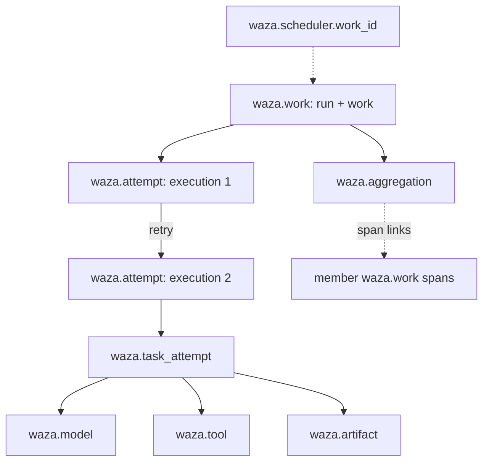

**Available on main; not yet in a release.** `waza runner telemetry` derives vendor-neutral,
OpenTelemetry-shaped traces, metrics and logs from the documents a Waza runner
already publishes. Every signal carries deterministic correlation identifiers,
so a scheduler, a tracing backend and the Lab can point at the same logical
work, attempt, artifact and aggregation without sharing payloads.

This complements [OpenTelemetry trace export](../otel/) for `waza run`: that
integration traces a live eval process, while execution telemetry is derived
after the fact from immutable runner contract documents and is stable across
re-derivation.

## Inputs

Only the terminal envelope is required. Each optional document adds detail and
must describe the same run and work, or the command exits 6.

| Flag | Document | Adds |
|------|----------|------|
| `--terminal` | `waza.runner-terminal` 1.0 | run, work, task/trial attempt identity, outcome |
| `--manifest` | `waza.artifact-manifest` 1.0 | admitted binding, artifact spans, manifest digest |
| `--attempt` | `waza.execution-attempt` 1.0 | execution ID and retry parent |
| `--lineage` | `waza.execution-lineage` 1.0 | every attempt of the logical work |
| `--report` | results JSON (`waza run -o`) | model usage and tool-call spans for the selected run |
| `--aggregate` | `waza.manifest-aggregate` 1.0 | aggregation span linked to member work traces |
| `--scheduler-work-id` | operator value | external scheduler work ID as a resource attribute |

With `--manifest`, the terminal and `--attempt` sidecar must be the exact
artifact bytes the manifest declares. `--lineage` needs `--attempt` or
`--manifest` to select the execution, and its recorded fields for that
execution must agree. A results run must match the terminal observation
(attempts, status, error, verdicts); a report is `unmatched` when the terminal
has no observation or lacks the run, and telemetry never falls back to another
run.

## Correlation



- The **trace ID** is derived from the run and work IDs, so every attempt and
  retry of one logical work shares a trace.
- **Span IDs** are derived from stable keys (execution ID, attempt ID, manifest
  digest, artifact name, model or tool index). Re-deriving never duplicates spans.
  Without an attempt or lineage, the manifest digest keeps separate publications distinct.
- Aggregation spans **link** to the `waza.work` span of each admitted member.

## Payload policy and safeguards

Payloads are excluded by default: no prompts, outputs, tool arguments, tool
results, file contents, headers or credentials. `--payload-policy digest` adds
SHA-256 and byte-length surrogates only; there is no raw-payload mode. Every
attribute key is registered in a fixed catalog with a cardinality class and
allowed placement; unregistered keys, oversized values and excess spans, tool
spans, logs, links and metric series are dropped and counted. Metric series past
the cap are folded into one `otel.metric.overflow=true` series. Drops appear in
the report, as the `waza.telemetry.dropped` metric and as log events. Metrics use
a service-level resource; run, work and scheduler IDs stay on traces and logs, and
each metric point carries a trace exemplar instead of a per-work series. Metrics
are delta sums over the work's observed interval, so successive works add up.
Attribute-count and string-length limits cannot be lowered below their defaults,
so mandatory identifiers are never dropped. Token usage includes distinct grader
sessions under their own model.

## Exporting

```bash
# OTLP/JSON files plus telemetry-report.json in a new directory
waza runner telemetry --terminal terminal.json --manifest manifest.json \
  --lineage lineage.json --report results.json --out-dir telemetry/

# OTLP/HTTP JSON to any collector (posts to /v1/traces, /v1/metrics, /v1/logs)
waza runner telemetry --terminal terminal.json \
  --otlp-endpoint http://localhost:4318 --otlp-header "Authorization=Bearer $TOKEN"
```

The endpoint must be `http` or `https` without credentials, query, fragment
or `@` in its path. Headers are never recorded. Redirects are not followed, and
a `2xx` acknowledgement must be empty or one JSON object of at most 64 KiB. Receiver response bodies are never echoed; export
diagnostics record only the signal, destination, sanitized target, state, HTTP
status and an error code (`output_exists`, `write_error`, `transport_error`,
`timeout`, `http_status`, `partial_success`, `invalid_response`).

The [`waza.execution-telemetry`](/waza/schemas/execution-telemetry-1.0.schema.json)
report is printed to stdout. Exit codes: `0` success, `2` any export failed or
was partially rejected (report still printed), `6` invalid or uncorrelated input.

## Lab

**Execution telemetry correlation** in the [Dashboard Lab](../dashboard-lab/)
reads a pasted report and shows correlation identifiers, attempt and artifact
spans with manifest links, aggregation member links, signal counts, safeguard
drops and export diagnostics. The browser re-validates the schema and the
report's own counts before display.

## Scope

- Telemetry is derived post hoc from published documents; the runner hot path
  does not emit it live.
- OTLP export is HTTP/JSON only; gRPC and protobuf are not supported.
- There is no raw-payload mode.

The full attribute catalog, signal names and troubleshooting table are in
[`docs/EXECUTION_TELEMETRY.md`](https://github.com/microsoft/waza/blob/main/docs/EXECUTION_TELEMETRY.md).
