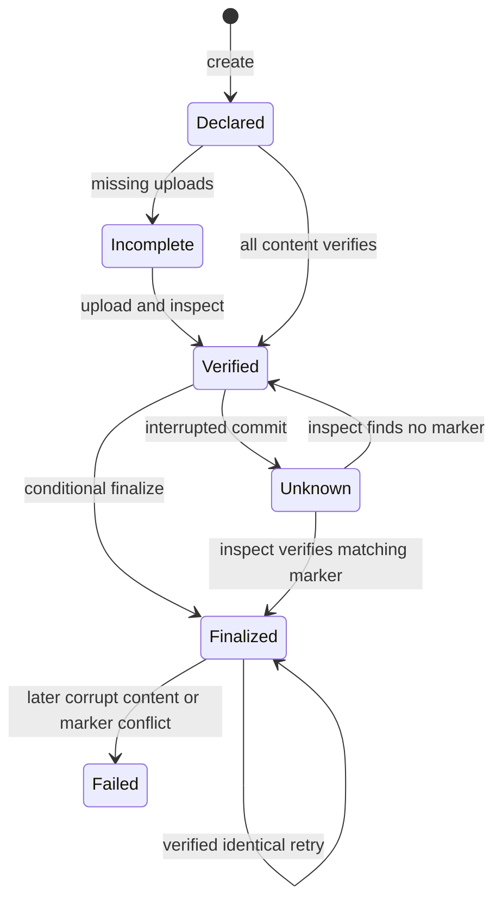

Immutable artifact publication is an **opt-in v0.41 addition**, separate from
ordinary mutable evaluation results. It is currently an **unreleased source
preview**, not available in the published v0.40 artifacts.
Publish a declaration, upload the exact
declared bytes, and finalize only after verification. The store verifies content
and caller-declared context; it does not run an evaluation or attest that it
happened.

## Prepare a declaration

Keep the original dedicated [runner terminal envelope](../runner-terminal/) and
any other artifacts. The terminal must be `application/json` and no larger than
1 MiB. Each artifact is limited to 64 MiB, their declared total to 256 MiB, and
the manifest itself to 1 MiB.

This example starts with the retained mock runner request and produces an actual
terminal file:

```bash
waza runner run < examples/runner/unit.json > terminal.json
```

The example requires Node.js, but no npm packages. It constructs `manifest.json`
from a completed success/evaluation-failure envelope, hashes the original
terminal bytes, and uses only fields in the
[manifest 1.0 schema](../../schemas/artifact-manifest-1.0.schema.json).
Run it where `terminal.json` is saved:

```bash
node --input-type=module <<'JS'
import { createHash } from 'node:crypto';
import { readFileSync, writeFileSync } from 'node:fs';

const bytes = readFileSync('terminal.json');
const terminal = JSON.parse(bytes.toString('utf8'));
if (!['success', 'evaluation_failure'].includes(terminal.outcome) ||
    !terminal.identity || !terminal.selection || !terminal.observation ||
    !Array.isArray(terminal.observation.validations)) {
  throw new Error('Use a complete runner terminal; do not infer missing context');
}
const manifest = {
  kind: 'waza.artifact-manifest',
  schema_version: '1.0',
  binding: {
    identity: terminal.identity,
    selection: terminal.selection,
    execution_mode: terminal.observation.execution_mode,
    grader_ids: terminal.observation.validations.map(v => v.identifier),
  },
  terminal_artifact: 'terminal',
  artifacts: [{
    name: 'terminal',
    sha256: createHash('sha256').update(bytes).digest('hex'),
    size_bytes: bytes.length,
    media_type: 'application/json',
  }],
};
writeFileSync('manifest.json', JSON.stringify(manifest, null, 2) + '\n',
  { flag: 'wx', mode: 0o600 });
JS
```

The script refuses to replace an existing declaration. Preserve it instead of
rerunning into the same filename. It is a declaration builder, not a substitute
for the CLI's strict original-wire validation. An error terminal can be published
with its correct complete declaration, but missing observation fields must not
be inferred using this example.

Add other artifacts to `artifacts` with their actual `sha256`, `size_bytes`, and
`media_type`. Names must be unique ASCII logical names matching
`^[a-zA-Z0-9][a-zA-Z0-9._-]*$`, at most 128 characters; they are not paths.
There may be at most 128 artifacts and 128 unique declared grader IDs.
The terminal name must identify an entry in that array.

## Publish locally

The local root must already exist. Create it in a private, access-controlled
location:

```bash
mkdir -m700 .waza-artifacts
waza artifact create manifest.json --store .waza-artifacts
waza artifact upload manifest.json terminal terminal.json --store .waza-artifacts
```

Creating the declaration before uploading is safe: it does not claim completion.
Upload every declared artifact using `upload manifest.json NAME FILE`.
Keep the terminal's bytes unchanged after hashing, including whitespace,
newlines, and encoding.

Copy the full lowercase 64-character manifest digest returned by `create` into
the shell variable `DIGEST`. Do **not** use the raw file hash of `manifest.json`:
the store addresses a canonical representation.

```bash
waza artifact inspect "$DIGEST" --store .waza-artifacts
waza artifact finalize "$DIGEST" --store .waza-artifacts
waza artifact inspect "$DIGEST" --store .waza-artifacts
```

## Publish to Azure

Use `--azure-container-url` **instead of** `--store` on each command:

```bash
waza artifact create manifest.json \
  --azure-container-url https://account.blob.core.windows.net/container
waza artifact upload manifest.json terminal terminal.json \
  --azure-container-url https://account.blob.core.windows.net/container
waza artifact finalize "$DIGEST" \
  --azure-container-url https://account.blob.core.windows.net/container
waza artifact inspect "$DIGEST" \
  --azure-container-url https://account.blob.core.windows.net/container
```

Create the container and provision access separately. The CLI uses available
default credentials; Go callers supply an explicit credential to the backend.
This path does not run login. Use an HTTPS container URL without embedded
credentials, query/SAS tokens, or fragments.

Local storage uses a no-replace hard link; Azure uses conditional PUT
(`If-None-Match: *`). Both verify existing objects before accepting identical
content, and neither silently overwrites them. A local filesystem without the
required hard-link operation fails rather than falling back to replacement.

## Read receipts, not just completion

Every `inspect` rereads the canonical manifest, original artifact bytes, terminal
envelope, and final marker. Read-only `GET /api/v1/manifests/{digest}` and the
[Dashboard Lab](../dashboard-lab/) inspection panel use this verification path.
For a local dashboard, publish into `.waza-artifacts` **below its
`--results-dir`**. For Azure, select the configured Azure backend. The CLI and
dashboard must point to the same store. The API/panel do not upload, finalize,
or execute.

Use **Find stored manifests** in the Lab to discover persisted declaration
pointers, or `GET /api/v1/manifests`. The catalog is explicitly unverified, capped
at 1,000 pointers, and reports truncation (the local scan also stops at 10,000
directory entries). Select a digest and inspect it separately. A pointer is
not proof that its content is complete, valid, or finalized, and the catalog is
not a complete fleet inventory.

- `publication: "unfinalized"` means no final marker exists. Integrity can still
  be verified when all declared content is present and consistent.
- `publication: "finalized"` means the manifest's matching final marker exists.
  Always also check `integrity` and `diagnostics`: later corruption fails
  verification even if the marker remains.
- `verification: "content-and-declared-context-only"` is the trust boundary.
  Identity, selection, mode, and grader IDs are checked against the terminal,
  but remain caller declarations, not trusted admission or execution attestation.

The final marker is `final-<manifestdigest>`, containing that same digest.
It is **not** an attempt-ownership association. Different manifests may share
the declared v0.40 identity and both finalize; duplicate/attempt-ownership policy
belongs to the separate attempt ledger. A differing existing marker is a typed
conflict, never permission to overwrite.

Verified mock or failed evidence does not become live evidence or a passing
evaluation. Missing billing, scores, transcripts, or provenance remain
unavailable, not zero or inferred success.

## Recover safely



After interruption or a timeout, commitment may be ambiguous. Run `inspect`
against the same digest and backend. If verified but unfinalized, retry
`finalize`; if finalized and verified, keep the existing publication.
If inspection fails, do not assume nothing committed.

| Problem | Safe action |
|---|---|
| Missing object | Create the missing declaration or upload its exact declared bytes, inspect, then retry finalization. |
| Corrupt object or terminal mismatch | Preserve evidence and diagnostics. Correct the declaration/content separately or use a clean store; do not overwrite addressed objects. |
| Publication conflict | Preserve the differing marker and investigate. Do not use it as an attempt-ledger decision. |
| Invalid declaration | Fix schema, original JSON, digest, or bounds. Missing/null/incorrect wire types are not defaulted. |
| Storage error | Check root/container existence, access, credentials, and hard-link support; inspect before retrying an ambiguous commit. |
| `.pending-*` files | Expected retained staging, not completion evidence. There is no automatic cleanup. |

Local `.pending-*` entries are intentionally retained on success and failure to
avoid deleting a competing replacement. Plan for their storage cost. Published
objects share hard links with staging files, so do not edit them. Retention
management requires a separate operator procedure with writers stopped and
ownership established.

Keep the root/container private. Hash verification and rooted access do not
authenticate a hostile filesystem or storage administrator. This is atomic
visibility of individual objects, not a whole-publication transaction,
crash-durability, replication, or cloud retention-policy guarantee.

## v0.41 migration and release notes

This addition does not automatically migrate historical results or change
legacy mutable `ResultStore` behavior. Manifest schema `1.0` is independent of
runner and result versions. Adopt it explicitly with a dedicated store,
original artifact files, and a valid dedicated terminal/context declaration.
Do not synthesize absent evidence to convert a historical result.

The manifest digest uses compact JSON in fixed Go struct-field order, sorted
artifact names and grader IDs, Go escaping of `<`, `>`, `&`, U+2028, and U+2029,
and no trailing newline. Artifact digests instead hash original bytes.
See the [developer contract and recovery details](https://github.com/microsoft/waza/blob/main/docs/IMMUTABLE_ARTIFACTS.md)
for the complete byte profile, schema bounds, and backend limitations.
