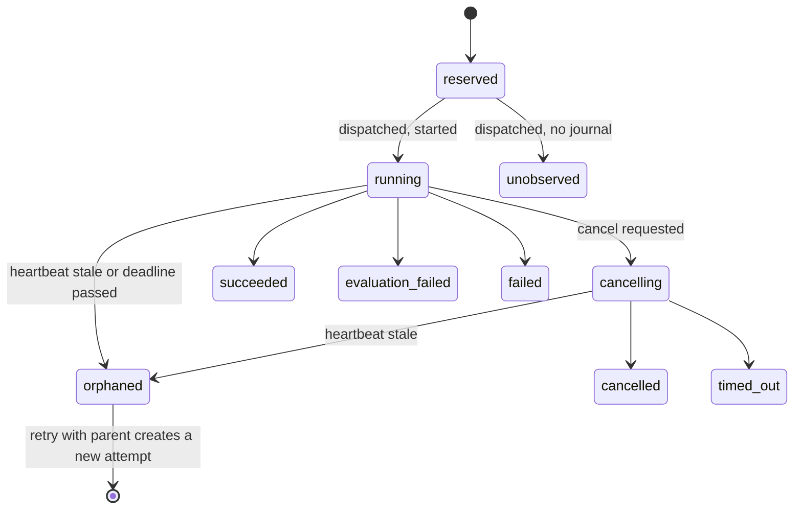
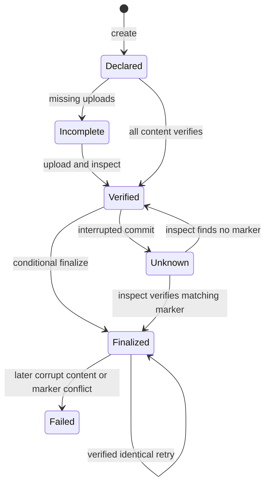

Immutable artifact publication is an **opt-in v0.41 addition**, separate from
ordinary mutable evaluation results. It was **released in v0.41.0** and is not
available in v0.40.x artifacts.
Publish a declaration, upload the exact
declared bytes, and finalize only after verification. The store verifies content
and caller-declared context; it does not run an evaluation or attest that it
happened.

<span id="logical-attempts-embedding-preview"></span>

## Logical attempts

The attempt layer separates logical run/work (`Identity.Run` and
`Identity.Trial`) from a fresh opaque execution ID and the original native
attempt ordinal. A distinct submission reserves before constructing a runtime.
Concurrent duplicates create separate immutable attempts, each manifest-bound
to its exact `execution-attempt.json`; they never silently replace evidence.

Explicit reuse requires the original execution ID and manifest digest, canonical
reservation/completion records, all declared content, and a verified final
marker. It returns the unchanged source failure/success and ordinal with zero
new engine calls. Missing usage remains unavailable; historical usage is not
billed to the new invocation. Unknown publication is not unfinalized evidence.

```mermaid
sequenceDiagram
    participant Caller
    participant Runner
    participant Store
    Caller->>Runner: Distinct captured work
    Runner->>Store: Exclusive fresh reservation
    Runner->>Runner: Execute one admitted unit
    Runner->>Store: Finalize terminal plus original attempt
    Caller->>Runner: Reuse execution ID and manifest digest
    Runner->>Store: Verify original records, artifacts and marker
    Runner-->>Caller: Original terminal; no new execution
```

Parent relationships are explicit `retry` or `branch` declarations within one
logical work item. They form a partial order, not a global schedule. Knowing an
execution ID or reading a record does not grant completion authority.

The v0.41.0 CLI exposes this layer:

```bash
waza runner submit --store .waza-artifacts < submission.json
waza runner lineage --run RUN_ID --work WORK_ID --store .waza-artifacts
```

`runner submit` (and protected `POST /api/v1/submissions`) reserves a distinct
attempt or performs verified reuse. `runner lineage` (and loopback
`GET /api/v1/lineage?run=&work=`) prints parent-ordered attempts, reuse
decisions and diagnostics such as `concurrent_distinct_attempts` (several
parentless writers) and `dispatched_without_completion` (inspect before
retrying). Lineage pages through up to 262,144 ledger records and fails closed
beyond that or when a record is unreadable. Existing `runner run`, native ordinals, manifest v1, and legacy
results are unchanged; historical ownership records are not synthesized.
See the independently versioned
[attempt/decision schema](../../schemas/execution-attempt-1.0.schema.json),
[completion schema](../../schemas/execution-completion-1.0.schema.json),
[submission schema](../../schemas/execution-submission-1.0.schema.json),
[submission-result schema](../../schemas/execution-submission-result-1.0.schema.json), and
[lineage schema](../../schemas/execution-lineage-1.0.schema.json).

### Execution lifecycle and recovery

The owner of each dispatched attempt records a bounded lifecycle journal
([event schema](../../schemas/execution-lifecycle-1.0.schema.json)): `started`
(with deadline and heartbeat interval), periodic `heartbeat`,
`cancel_requested` (reason `caller` or `deadline`), `cancel_acknowledged` or
`forced`, and `finished`. Lineage derives a `lifecycle` object for every
attempt from that journal and the immutable ledger records. Derivation is
read-only; retry eligibility is advisory and Waza owns no retry policy.



| State | Retry eligible | Next action |
|-------|----------------|-------------|
| `running` / `cancelling` / `unobserved` | No | Wait, or stop the owner process |
| `orphaned` | Yes | Confirm the owner is gone, then retry with the orphan as parent |
| `cancelled` / `timed_out` | Yes | Retry with parent; partial work is never resumed |
| `failed` (infrastructure) | Yes | Retry with parent |
| `failed` (input) / `rejected` | No | Fix the input |
| `succeeded` / `evaluation_failed` | No | Inspect or reuse the result |

Each lifecycle also reports `cancellation` (`none`, `requested`,
`acknowledged`, `forced`), `deadline_exceeded`, `partial` and
`allowed_actions`. Recovery examples:

- **Interrupted owner** (Ctrl+C): the owner records the request, joins the
  runtime, records `cancel_acknowledged` and publishes a `cancelled` terminal.
- **Killed owner** (SIGKILL, host loss): heartbeats stop. After
  `--stale-after` (default three heartbeat intervals) lineage reports
  `orphaned` with an `orphaned_attempt` diagnostic. Submit again with
  `"policy":{"mode":"distinct","parent":{"execution_id":"exec-...","relationship":"retry"}}`;
  the orphan's records stay byte-for-byte unchanged.
- **Runtime ignores shutdown**: after the 5s bound the owner force-stops it and
  records `forced`; lineage shows `cancellation: "forced"` and `partial: true`,
  with `deadline_exceeded: false` unless the execution deadline had passed.
  A native runtime whose transport is hard-stopped on cancellation is also
  `forced`, even when shutdown then returns promptly.

Only the attempt's owner writes its journal; each write revalidates the
owner's creator and is bounded to 2s even when storage stalls. Events are
recorded off the execution path, so slow storage never consumes the execution
deadline. A failed or stalled write ends the journal without changing the
outcome. An attempt with duplicate dispatch decisions has no single owning
journal and reports `observation: "unobserved"`.

Attempts recorded before this preview have no journal and report
`observation: "unobserved"`; nothing is rewritten. See
[execution lifecycle semantics](https://github.com/microsoft/waza/blob/main/docs/EXECUTION_LIFECYCLE.md).

<span id="checkpoint-public-source-preview"></span>

### Checkpoint public commands

The checkpoint service supports two whole-unit safe boundaries:
`before-unit` (fresh retry child, after the original worker has stopped) and
`finalized-unit` (verified original-source reuse, zero new engine calls).
Compatibility checks bind the runner revision, independent schema versions and
captured model/tool/policy configuration before runtime construction.

An old before checkpoint is stale if its original dispatch decision exists,
even when completion is missing: the original may have executed before a crash.
Unknown publication, incomplete decision discovery, corrupt state or incompatible
configuration must not silently rerun it. Operators must separately stop/join
the original worker; a checkpoint is not a lease or proof of worker death.
Finalized restore preserves source failures/cancellation and original ordinals.

Fresh checkpoint publication holds the invocation's shared creator gate through
immutable storage and final checks, without scanning unrelated ledger records.
Any dispatch/completion attempt permanently closes that before-dispatch gate,
including failed or unknown provider responses. The gate is not serialized or a
worker lease. Successful publication beyond the 1,000-record discovery bound
does **not** mean it can be resumed: before-unit recovery still rejects truncated
discovery. Mutex waits and blocked providers are not made cancellable by the gate.

No in-flight process, SDK session, partial grader or workspace is restored.
The v0.41.0 CLI exposes capture-approved checkpoint creation and resume.
Protected HTTP create/resume operations are registered and available in the Lab.
Full native-platform acceptance is not claimed. The
[checkpoint schema](../../schemas/execution-checkpoint-1.0.schema.json) and
[checkpoint-result schema](../../schemas/runner-checkpoint-result-1.0.schema.json)
and [checkpoint operation error schema](../../schemas/runner-checkpoint-result-1.1.schema.json)
are independently versioned: `1.0` remains strict for ordinary results, while
`1.1` is reserved for sanitized operational failures.

Build the owning CLI from a clean Git tree with VCS stamping enabled. A dirty,
unstamped, foreign, or unavailable build revision is rejected before store access;
there is no user-supplied revision override. From the repository root, wrap the
existing exact-unit example without changing its request:

```bash
mkdir -m700 .waza-artifacts
jq -n --slurpfile request examples/runner/unit.json \
  '{kind:"waza.execution-submission",schema_version:"1.0",request:$request[0]}' \
  > submission.json
waza runner checkpoint create --store .waza-artifacts \
  < submission.json > checkpoint-result.json
jq '{status,exit_code,before_checkpoint_sha256,finalized_checkpoint_sha256}' \
  checkpoint-result.json
```

Stdout is one protected result; boundary/digest progress goes to stderr. Preserve
the result even on a nonzero exit. Store-open or store-close failures use result
version `1.1`, status `operation_error`, exit code `2`, and a stable `error_code`.
When close fails after execution, the result retains the capture-approved
submission, source and checkpoint references when their linkage is valid, while
keeping the execution's original submission status and exit unchanged. An
admitted source without valid linkage is marked `source_withheld: true`.
The CLI writes underlying causes to operator stderr; server operational logs may
include causes, but submission-parser failures log only the failure stage,
action and guidance, not the parser error or request. Consumers must keep the
levels separate: top-level exit `2`
can coexist with a preserved completed or reused submission's nested exit `0`.
The Lab reader checks schemas and cross-field consistency locally, but does not
perform native canonical-report checks. It labels statuses and exit codes in
report-bearing 1.0 results as unverified claims, not verified outcomes.
To restore the exact finalized source:

```bash
DIGEST="$(jq -er '.finalized_checkpoint_sha256' checkpoint-result.json)"
waza runner checkpoint resume "$DIGEST" --store .waza-artifacts \
  < submission.json > restored-result.json
jq '{status,exit_code,restored_units,remaining_work,submission}' restored-result.json
```

A valid finalized restore reports `reused`, `restored_units: 1`,
`remaining_work: 0`, and zero new submission engine calls. The original terminal
ordinal and outcome remain unchanged, including failed checks or cancellation.
Unavailable progress is `null`, never an invented zero.

### Checkpoint troubleshooting

Check a digest before resuming. The check reads the store only; it never
executes, reserves or repairs work:

```bash
waza runner checkpoint availability "$DIGEST" --store .waza-artifacts \
  < submission.json | jq '{status,exit_code,source,resume_action,diagnostics}'
```

`available` (exit 0) shows the boundary, `created_at`, original execution and
whether resume creates a fresh retry child (before-unit) or reuses the original
terminal (finalized-unit). Otherwise the first diagnostic code says what to do:

| Code | Action |
| --- | --- |
| `checkpoint_not_found` | Check the store flag and copy the digest from the create result or stderr. |
| `checkpoint_corrupt` | Preserve the blob; never edit or resume it. |
| `checkpoint_incompatible` | Use the original clean build or rerun as new work; there is no cross-version resume. |
| `checkpoint_policy_conflict` | Omit the submission policy or match the boundary (retry for before-unit, reuse for finalized-unit). |
| `checkpoint_stale` | The original already dispatched; use the finalized checkpoint or inspect `waza runner lineage`. |
| `checkpoint_*_source_rejected` | Original records could not be verified; preserve them and inspect operator logs. |
| `checkpoint_runtime_rejected` | This environment would not admit the owned runtime a before-unit retry needs (for example `COPILOT_CLI_PATH` is set); clear it and check again. |
| `checkpoint_capture_policy_rejected` | The source holds restricted text and will not be reused; rerun as new work. |
| `checkpoint_storage_*`, `checkpoint_build_unavailable` | Fix storage access or rebuild from a clean tree, then retry the check. |

Partial work inside a unit is never resumed; resume restarts the whole unit.
Availability can change before resume, so resume repeats every check.
See the [full table](https://github.com/microsoft/waza/blob/main/docs/EXECUTION_CHECKPOINTS.md#resume-availability-and-troubleshooting).

The dashboard server accepts the same submission at
`POST /api/v1/checkpoints` and
`POST /api/v1/checkpoints/{digest}/resume`, plus the read-only
`POST /api/v1/checkpoints/{digest}/availability`. Responses use the same protected
result with `X-Waza-Exit-Code`. Operations require a loopback peer and literal
loopback Host, same-origin browser metadata, and `application/json`.
The existing results directory selects `.waza-artifacts`, unless the server has
an active supported Azure storage configuration. Request JSON cannot choose
host paths or credentials. Unsupported active providers fail closed; no raw
checkpoint GET endpoint is available.

In the Lab, open **Runner contract** and **Create or resume an exact-unit
checkpoint**. Supply the same captured submission and, for resume, the original
checkpoint digest. The panel separates new calls from original terminal calls,
preserves failed original outcomes, and shows retry parents or reuse sources
without claiming an evaluation-wide history. **Download checkpoint result JSON**
saves the exact protected response, including explicit zero or unavailable
progress. Edits, new requests, and reload failures clear previous results;
synthetic demo mode cannot dispatch operations. Stopping a browser request does
not establish that its server worker stopped.

For an interrupted **before-unit** source, first stop and join the original
worker, then pass its original `before_checkpoint_sha256` to the same resume
command. Resume creates a distinct retry child only when complete discovery
establishes that no original dispatch or completion exists. A previously
dispatched source is refused, not replayed. Do not select the before reference
from an ordinarily completed execution: it is already stale.

| Result | Operator action |
|---|---|
| Incompatible build or configuration | Preserve the checkpoint and use its compatible original binary and captured configuration; do not override the revision. |
| Corrupt, missing, or unverified source | Preserve records and inspect the configured store; do not repair bytes in place. |
| Stale before-unit source or incomplete discovery | Investigate the original execution. Missing completion does not authorize replay. |
| `source_withheld: true` | Original-source capture admission failed, or a close-error result cannot link the admitted source to its retained submission. Inspect operator diagnostics and preserve the original records. |
| Publication, output, or close failure | Preserve original and partial references. Do not infer completion or receipt from a digest. |

## Prepare a declaration

Keep the original dedicated [runner terminal envelope](../runner-terminal/) and
any other artifacts. The terminal must be `application/json` and no larger than
1 MiB. Each artifact is limited to 64 MiB, their declared total to 256 MiB, and
the manifest itself to 1 MiB.

This example starts with the retained mock runner request and produces an actual
terminal file:

```bash
waza runner run < examples/runner/unit.json > terminal.json
```

The example requires Node.js, but no npm packages. It constructs `manifest.json`
from a completed success/evaluation-failure envelope, hashes the original
terminal bytes, and uses only fields in the
[manifest 1.0 schema](../../schemas/artifact-manifest-1.0.schema.json).
Run it where `terminal.json` is saved:

```bash
node --input-type=module <<'JS'
import { createHash } from 'node:crypto';
import { readFileSync, writeFileSync } from 'node:fs';

const bytes = readFileSync('terminal.json');
const terminal = JSON.parse(bytes.toString('utf8'));
if (!['success', 'evaluation_failure'].includes(terminal.outcome) ||
    !terminal.identity || !terminal.selection || !terminal.observation ||
    !Array.isArray(terminal.observation.validations)) {
  throw new Error('Use a complete runner terminal; do not infer missing context');
}
const manifest = {
  kind: 'waza.artifact-manifest',
  schema_version: '1.0',
  binding: {
    identity: terminal.identity,
    selection: terminal.selection,
    execution_mode: terminal.observation.execution_mode,
    grader_ids: terminal.observation.validations.map(v => v.identifier),
  },
  terminal_artifact: 'terminal',
  artifacts: [{
    name: 'terminal',
    sha256: createHash('sha256').update(bytes).digest('hex'),
    size_bytes: bytes.length,
    media_type: 'application/json',
  }],
};
writeFileSync('manifest.json', JSON.stringify(manifest, null, 2) + '\n',
  { flag: 'wx', mode: 0o600 });
JS
```

The script refuses to replace an existing declaration. Preserve it instead of
rerunning into the same filename. It is a declaration builder, not a substitute
for the CLI's strict original-wire validation. An error terminal can be published
with its correct complete declaration, but missing observation fields must not
be inferred using this example.

Add other artifacts to `artifacts` with their actual `sha256`, `size_bytes`, and
`media_type`. Names must be unique ASCII logical names matching
`^[a-zA-Z0-9][a-zA-Z0-9._-]*$`, at most 128 characters; they are not paths.
There may be at most 128 artifacts and 128 unique declared grader IDs.
The terminal name must identify an entry in that array.

## Publish locally

The local root must already exist. Create it in a private, access-controlled
location:

```bash
mkdir -m700 .waza-artifacts
waza artifact create manifest.json --store .waza-artifacts
waza artifact upload manifest.json terminal terminal.json --store .waza-artifacts
```

Creating the declaration before uploading is safe: it does not claim completion.
Upload every declared artifact using `upload manifest.json NAME FILE`.
Keep the terminal's bytes unchanged after hashing, including whitespace,
newlines, and encoding.

Copy the full lowercase 64-character manifest digest returned by `create` into
the shell variable `DIGEST`. Do **not** use the raw file hash of `manifest.json`:
the store addresses a canonical representation.

```bash
waza artifact inspect "$DIGEST" --store .waza-artifacts
waza artifact finalize "$DIGEST" --store .waza-artifacts
waza artifact inspect "$DIGEST" --store .waza-artifacts
```

## Publish to Azure

Use `--azure-container-url` **instead of** `--store` on each command:

```bash
waza artifact create manifest.json \
  --azure-container-url https://account.blob.core.windows.net/container
waza artifact upload manifest.json terminal terminal.json \
  --azure-container-url https://account.blob.core.windows.net/container
waza artifact finalize "$DIGEST" \
  --azure-container-url https://account.blob.core.windows.net/container
waza artifact inspect "$DIGEST" \
  --azure-container-url https://account.blob.core.windows.net/container
```

Create the container and provision access separately. The CLI uses available
default credentials; Go callers supply an explicit credential to the backend.
This path does not initiate interactive login. Token acquisition may invoke
installed Azure CLI or azd credential helpers; runtime authentication is not
process-free. Pure manifest/schema validation does not open providers or invoke
those helpers. Use an HTTPS container URL without embedded credentials,
query/SAS tokens, or fragments.

Local storage uses a no-replace hard link; Azure uses conditional PUT
(`If-None-Match: *`). Both verify existing objects before accepting identical
content, and neither silently overwrites them. A local filesystem without the
required hard-link operation fails rather than falling back to replacement.

## Read receipts, not just completion

Every `inspect` rereads the canonical manifest, original artifact bytes, terminal
envelope, and final marker. Read-only `GET /api/v1/manifests/{digest}` and the
[Dashboard Lab](../dashboard-lab/) inspection panel use this verification path.
For a local dashboard, publish into `.waza-artifacts` **below its
`--results-dir`**. For Azure, select the configured Azure backend. The CLI and
dashboard must point to the same store. The API/panel do not upload, finalize,
or execute.

Use **Find stored manifests** in the Lab to discover persisted declaration
pointers, or `GET /api/v1/manifests`. The catalog is explicitly unverified, capped
at 1,000 pointers, and reports truncation (the local scan also stops at 10,000
directory entries). Select a digest and inspect it separately. A pointer is
not proof that its content is complete, valid, or finalized, and the catalog is
not a complete fleet inventory.

- `publication: "unknown"` means no usable marker observation is available, or
  finalization may have committed despite its error. Invalid digest, unavailable
  store, unreadable/malformed marker, and mixed missing/read errors do not prove
  marker absence. This required string is an error state, never successful
  inspection; declaration schema and legacy result versions are unchanged.
- `publication: "unfinalized"` means inspection observed no final marker. Integrity can still
  be verified when all declared content is present and consistent.
- `publication: "finalized"` means the manifest's matching final marker exists.
  Always also check `integrity` and `diagnostics`: later corruption fails
  verification even if the marker remains.
- `verification: "content-and-declared-context-only"` is the trust boundary.
  Identity, selection, mode, and grader IDs are checked against the terminal,
  but remain caller declarations, not trusted admission or execution attestation.

The final marker is `final-<manifestdigest>`, containing that same digest.
It is **not** an attempt-ownership association. Different manifests may share
the declared v0.40 identity and both finalize; duplicate/attempt-ownership policy
belongs to the separate attempt ledger. A differing existing marker is a typed
conflict, never permission to overwrite.

Verified mock or failed evidence does not become live evidence or a passing
evaluation. Missing billing, scores, transcripts, or provenance remain
unavailable, not zero or inferred success.

## Recover safely



After interruption or a timeout, commitment may be ambiguous. Run `inspect`
against the same digest and backend. If verified but unfinalized, retry
`finalize`; if finalized and verified, keep the existing publication.
If inspection fails, do not assume nothing committed.
An `unknown` receipt must not be defaulted to unfinalized or accepted as verified
HTTP200 success. Independent content or provider-close failures retain a
publication state that was actually observed; check both fields and diagnostics.

| Problem | Safe action |
|---|---|
| Missing object | Create the missing declaration or upload its exact declared bytes, inspect, then retry finalization. |
| Corrupt object or terminal mismatch | Preserve evidence and diagnostics. Correct the declaration/content separately or use a clean store; do not overwrite addressed objects. |
| Publication conflict | Preserve the differing marker and investigate. Do not use it as an attempt-ledger decision. |
| Invalid declaration | Fix schema, original JSON, digest, or bounds. Missing/null/incorrect wire types are not defaulted. |
| Storage error | Check root/container existence, access, credentials, and hard-link support; inspect before retrying an ambiguous commit. |
| `.pending-*` files | Expected retained staging, not completion evidence. There is no automatic cleanup. |

Local `.pending-*` entries are intentionally retained on success and failure to
avoid deleting a competing replacement. Plan for their storage cost. Published
objects share hard links with staging files, so do not edit them. Retention
management requires a separate operator procedure with writers stopped and
ownership established.

Keep the root/container private. Hash verification and rooted access do not
authenticate a hostile filesystem or storage administrator. This is atomic
visibility of individual objects, not a whole-publication transaction,
crash-durability, replication, or cloud retention-policy guarantee.

## v0.41 migration and release notes

This addition does not automatically migrate historical results or change
legacy mutable `ResultStore` behavior. Manifest schema `1.0` is independent of
runner and result versions. Adopt it explicitly with a dedicated store,
original artifact files, and a valid dedicated terminal/context declaration.
Do not synthesize absent evidence to convert a historical result.

The manifest digest uses compact JSON in fixed Go struct-field order, sorted
artifact names and grader IDs, Go escaping of `<`, `>`, `&`, U+2028, and U+2029,
and no trailing newline. Artifact digests instead hash original bytes.
See the [developer contract and recovery details](https://github.com/microsoft/waza/blob/main/docs/IMMUTABLE_ARTIFACTS.md)
for the complete byte profile, schema bounds, and backend limitations.
