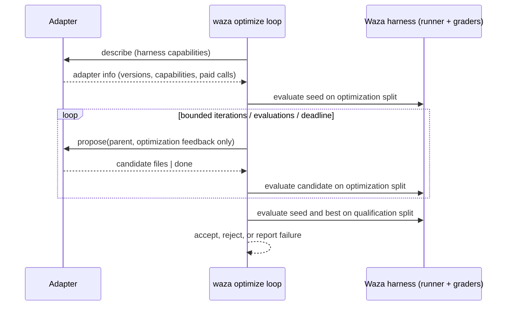

**Released in v0.41.0.** `waza optimize` places an optimizer
adapter in front of the existing evaluation harness. The adapter proposes a
candidate, and Waza evaluates it with the normal runner, graders and result
writer against a pinned suite. Waza then decides whether to keep the candidate.
Proposal, evaluation and acceptance are separate steps. No adapter brings its
own execution or grading.

Existing `waza run`, `waza grade` and result files are unchanged. The
optimizer writes its own `report.json` and evidence files in a separate
output directory.



## Quick start (offline)

The example suite in
[`examples/optimizer`](https://github.com/microsoft/waza/tree/main/examples/optimizer)
uses the mock executor and the scripted fake adapter. It makes no model calls:

```bash
waza optimize run examples/optimizer/eval.yaml \
  --target context-overlay --seed examples/optimizer/seed \
  --optimization-tag optimization --qualification-tag qualification \
  --adapter fake --fake-script examples/optimizer/fake-script.json \
  --output-dir optimize-out
```

The seed scores 0.5 on both splits, and the scripted candidates reach 1.0. The
outcome is `accepted`, and `optimize-out/report.json` records every candidate,
proposal, evaluation and the qualification decision.

## Contract

Version **1.0** of the contract is published as JSON Schemas:

| Schema | Purpose |
|---|---|
| [`optimizer-capabilities-1.0`](https://github.com/microsoft/waza/blob/main/schemas/optimizer-capabilities-1.0.schema.json) | Output of `waza optimize capabilities` |
| [`optimizer-adapter-request-1.0`](https://github.com/microsoft/waza/blob/main/schemas/optimizer-adapter-request-1.0.schema.json) | `describe` and `propose` requests sent to adapters |
| [`optimizer-adapter-response-1.0`](https://github.com/microsoft/waza/blob/main/schemas/optimizer-adapter-response-1.0.schema.json) | Adapter replies |
| [`optimizer-report-1.0`](https://github.com/microsoft/waza/blob/main/schemas/optimizer-report-1.0.schema.json) | `report.json` |

### Capability negotiation

`waza optimize capabilities` prints the contract versions and harness
capabilities. Each adapter declares the contract versions it supports, plus
required and optional capabilities:

| Capability | Meaning |
|---|---|
| `propose.files` | The adapter returns complete candidate file sets |
| `target.skill-directory` | Candidates are a skill directory with `SKILL.md` |
| `target.context-overlay` | Candidates overlay the task context directory |
| `feedback.optimization-split` | Feedback comes only from the optimization split |
| `feedback.task-results` | Feedback includes per-task status and failed-grader messages |
| `budget.iterations`, `budget.evaluations`, `budget.deadline` | Requests report the remaining budget |
| `usage.adapter-reported` | The adapter can report its own provider usage |

Negotiation fails with `unsupported_version` when there is no shared contract
version. It fails with `incompatible_capability` when any of these is true:

- A required capability is unknown to the harness.
- The selected target is not offered.
- The adapter requires the other target.
- A capability is listed as both required and optional.

Unknown optional capabilities are recorded as unavailable and are not an error.

### Candidates

A candidate is a complete set of UTF-8 text files.

- **Identity.** It is identified by a SHA-256 over the target and the sorted
  path/content pairs. The same files always produce the same ID, whatever
  order they arrive in.
- **Lineage.** Each candidate records its parent, origin, adapter, adapter
  version and iteration.
- **Storage.** The seed and every proposed candidate are saved under
  `candidates/<id-prefix>/` with their file digests before they are evaluated.
  If saving fails, the run stops with `infrastructure_failure`.
- **Path policy.** Paths are relative `/`-separated segments of
  `[A-Za-z0-9._-]`. These are rejected with `unsafe_candidate_path`: absolute
  paths, `..` segments, dot-files, `.git`, backslashes, drive letters, Windows
  reserved names, overly long paths and case-fold collisions.
- **Seeds.** Seed directories that contain symlinks are rejected.

There are two targets:

- **`skill-directory`**: the candidate is the skill under test, and must
  include `SKILL.md`, and its frontmatter `name` must still match the suite's
  `skill`. Each evaluation points `skill_directories` at a fresh copy of the
  candidate. A candidate that no longer resolves as the suite's skill is
  recorded as `evaluation_incomplete` and never counts as an improvement.
- **`context-overlay`**: the suite's context directory is copied into a fresh
  workspace, and the candidate files are written over it.

The original fixtures and suite are never modified. Every evaluation gets its
own temporary materialization and a new engine.

### Suite pinning

Before the loop starts, Waza pins the suite. The pin records:

- a digest of the eval directory (spec, tasks, graders, CSV data and mocks)
- a digest of the context directory
- the executor, model, trial count and timeout
- the Waza version
- the exact task IDs in each split

The pin is checked again before and after every evaluation. If anything
changed, the run fails with `suite_changed`. Splits are selected by tag, and
tasks run by exact `TestID`, never by display name or glob.

A suite is rejected with `invalid_suite` in any of these cases:

- It uses hooks, `baseline: true` or a scenario.
- `config.max_attempts` is above 1. The runner keeps only the final attempt,
  so an operational error followed by a passing retry would be lost.
- A task has no ID, or two tasks share an ID.
- A split is empty, or the two splits overlap.
- A task would bypass the candidate: its own `skill_directories` under the
  skill target, or its own `context_dir` or `inputs.context.fixture` under the
  overlay target.
- A task uses `inputs.repos`. The pin cannot cover a repository's contents or
  refs, which can change between evaluations.
- Under the skill target, a task sets a relative `context_dir`. The runner
  resolves it from the working directory, not the suite, so use an absolute
  path inside the suite.
- The suite or context directory contains a symlink, a task file lives outside
  the suite directory, or a path field uses `..` or an absolute path outside
  the pinned directories. The pin can only cover files inside it.
- A diff grader sets `update_snapshots`, at the eval, task or checkpoint
  level, because it could rewrite pinned files.
- A grader reads a file relative to the working directory rather than the
  suite: a relative `schema_file`, `rubric` file, trigger `skill_path` or
  grader `context_dir`, or a diff `snapshot` with no grader `context_dir`.
  Use an absolute path inside the suite, or an inline schema or prompt.
- A program grader runs a script the pin cannot cover: a relative script path
  in `command` or `args`, or an absolute one outside the suite and context
  directories. Interpreters found on `PATH` (for example `python3`) are
  allowed; pass the script as an absolute path inside the suite. Program
  graders must also set a positive `timeout`, because the default comes from
  a `.waza.yaml` the pin does not cover.
- A rubric file is an absolute path outside the suite and context
  directories. Built-in rubric names are allowed.
- Under the skill target, `disabled_skills` would remove the candidate
  (`"*"` or `"skill"`, the candidate directory's name), or a skill with the
  suite's `skill` name can be found from the working directory. The runner
  looks there before the candidate directory, so run `waza optimize` from a
  directory without that skill. The working directory is checked again before
  every evaluation, and a failure there is recorded as an `invalid_suite`
  evaluation.

### Scores and decisions

An evaluation is `scored` only when every selected task ran without errors or
skips, and no grader result recorded evaluation errors. A program grader that
timed out or could not start counts as an evaluation error; one that ran and
exited nonzero is an ordinary failed assertion. Its score is the harness `aggregate_score`, and its pass rate is
passed tasks divided by total tasks. Any other result is
`evaluation_incomplete` and never counts as an improvement.

1. The seed is evaluated on the optimization split.
2. Each new candidate is evaluated on the same split. A candidate replaces
   the incumbent only when its score beats the incumbent's score.
3. When the loop ends:
   - If the best candidate does not beat the seed by more than
     `--min-improvement`, the outcome is `no_improvement` and
     qualification is skipped.
   - Otherwise, the seed and the best candidate are both evaluated on the
     held-out qualification split. The outcome is `accepted` if the
     candidate's held-out score is at least the seed's (no regression), and
     `rejected` if it is lower.
   - If a qualification evaluation cannot be scored, the outcome is
     `not_qualified`.

Every evaluation records its split, candidate ID, state, score, task
feedback, duration, spend and an evidence reference. The evidence reference
is a path plus SHA-256 for the full harness result JSON in `evidence/<split>/`.
If the harness does not return the exact selected tasks, the run fails with
`missing_evidence`.

## Data boundaries

- **Feedback.** Adapters receive the parent candidate files and feedback built
  only from optimization-split evaluations. Qualification task IDs, scores and
  evidence are never sent to adapters.
- **Task detail.** Per-task feedback (status, score and failed-grader messages
  of up to 1000 bytes) is sent only when the adapter negotiates
  `feedback.task-results`.
- **Remaining budget.** `remaining.evaluations` excludes the two evaluations
  reserved for qualification.
- **File permissions.** Evidence and `report.json` are written with mode
  `0600`.

## Budgets, deadlines and spend

| Flag | Default | Effect |
|---|---|---|
| `--max-iterations` | 5 | Maximum `propose` calls. Duplicate candidates use an iteration but no evaluation. |
| `--max-evaluations` | 10 | Total harness evaluations, including the seed and 2 reserved for qualification |
| `--timeout` | none | Deadline for the whole run, including qualification; must not be negative |
| `--adapter-timeout` | 10m | Per-call limit for command adapters |

The report states why the loop ended: `adapter_done`, `iteration_budget`,
`evaluation_budget`, `failure`, `cancelled` or `timeout`.

Spend is reported, never capped. Each evaluation and proposal has a spend
`status`:

- `measured`: usage came from the engine or adapter.
- `unavailable`: no usage was reported, which is never treated as zero.
- `partial`: some parts were measured and some were not, for example an
  evaluation where one agent or grader session reported no usage. Observed
  counters are still reported.

`premium_requests` counts GitHub Copilot premium requests only. When usage
comes from a custom model provider, the report sets `provider` and puts the
provider's request count in `provider_requests` instead. An evaluation whose
sessions used both Copilot and a custom provider reports no request count
and is `partial`. Totals add
`provider_requests` only when every part names the same provider; otherwise
the count is dropped and the total is `partial`. Command adapters report
their own usage with the same fields.

Failed calls still count. An evaluation that fails after the harness produced
an outcome (a suite change, a task mismatch or an engine shutdown error) keeps
its measured spend and, when it can be written, its evidence, but gets no
score. A failed `copilot-reflect` call keeps the usage the engine reported.

The report always sets `hard_spend_cap: false`. Waza cannot enforce provider
billing limits; it can only bound iterations, evaluations and time.

## Failure categories

A failure ends the run with exit code 1. `report.json` names the category:

| Category | Cause |
|---|---|
| `unsupported_version`, `incompatible_capability` | Negotiation failed |
| `invalid_suite`, `invalid_config` | Suite admission or flag validation failed |
| `consent_required` | Paid calls are possible but `--allow-paid-calls` was not given |
| `malformed_proposal` | The adapter returned invalid JSON, unknown fields, a wrong parent, a missing `SKILL.md` or binary content |
| `unsafe_candidate_path` | A candidate path violates the path policy |
| `optimizer_failure` | The adapter errored, crashed, timed out or exceeded the 8 MiB output limit |
| `infrastructure_failure` | Workspace or evidence I/O failed |
| `missing_evidence` | The harness did not return the selected tasks |
| `suite_changed` | The pinned suite changed during the run |
| `evaluation_incomplete` | The seed could not be scored |
| `cancelled`, `timeout` | The run was interrupted or the deadline passed |

Outcomes `accepted`, `no_improvement` and `rejected` exit 0. Outcomes
`not_qualified`, `failed` and `incomplete` exit 1.

## Adapters

### `fake` (offline)

This adapter is deterministic and makes no provider calls. It is used for
contract tests and the walkthrough. `--fake-script` takes a strict JSON file
listing the proposals to return. Without a script it reports `done`
immediately.

### `command` (external process)

This adapter runs an executable you choose. Each call gets one JSON request on
stdin and must write one JSON response to stdout. Adapters can be written in
any language. The
[example checklist adapter](https://github.com/microsoft/waza/blob/main/examples/optimizer/adapters/checklist_adapter.py)
uses only the Python standard library:

```bash
waza optimize run examples/optimizer/eval.yaml \
  --target context-overlay --seed examples/optimizer/seed \
  --optimization-tag optimization --qualification-tag qualification \
  --adapter command --adapter-command python3 \
  --adapter-arg examples/optimizer/adapters/checklist_adapter.py \
  --allow-paid-calls --output-dir optimize-command
```

How the process is run:

- The command is started directly from argv, without a shell.
- It runs in a fresh, empty temporary directory. Any `--adapter-arg` that
  names an existing relative path is converted to an absolute path first.
- It receives only this environment: `PATH`, `HOME`, `USERPROFILE`,
  `SYSTEMROOT`, `TMPDIR`, `TEMP`, `TMP`, `LANG` and `LC_ALL`. Pass any other
  variable, such as a provider API key, by name with `--adapter-env NAME`.
- Responses are validated against the response schema for the operation
  before decoding. Unknown fields, missing or `null` values, negative usage
  counters and trailing data are rejected with `malformed_proposal`, and an
  unsupported `contract_version` with `unsupported_version`. Stdout is limited
  to 8 MiB.
- On timeout or cancellation, Waza kills the adapter's whole process tree
  (a process group on Unix, `taskkill /T` on Windows), so child processes
  cannot keep making calls.

Waza cannot know what an external command calls, so this adapter **always
requires `--allow-paid-calls`**.

### `copilot-reflect` (reference, paid)

This adapter is a GEPA-style reflective rewrite. The Copilot SDK asks a model
to revise the incumbent's files, given the optimization-split failures.

- The model runs with every tool denied, no skills, an ephemeral session and
  ambient discovery disabled, so it sees no host instructions, retrieval or
  memory, only the candidate and the optimization feedback.
- It replies with full-file blocks, or `<<<WAZA-DONE>>>` when it has nothing
  to change.
- Its usage is reported as measured adapter spend.

Requirements:

- The Copilot CLI must already be signed in. Waza starts no login.
- It requires `--allow-paid-calls`.
- `--reflect-model` is required when the eval model is `mock`.

Opt-in walkthrough. The evaluations themselves still use the free mock
executor:

```bash
waza optimize run examples/optimizer/eval.yaml \
  --target context-overlay --seed examples/optimizer/seed \
  --optimization-tag optimization --qualification-tag qualification \
  --adapter copilot-reflect --reflect-model claude-haiku-4.5 \
  --allow-paid-calls --max-iterations 2 --output-dir optimize-reflect
```

In a recorded run (November 12, 2026), the first proposal raised the
optimization score from 0.5 to 1.0. The second call returned
`<<<WAZA-DONE>>>`, and held-out qualification went from 0.5 to 1.0
(`accepted`). Adapter spend was measured at 0.66 premium requests; evaluation
spend was `unavailable` because the mock executor reports no usage. Model
output varies, so results are not guaranteed.

### Consent

Paid calls need `--allow-paid-calls` in these cases:

- The adapter is `command` or `copilot-reflect`.
- The eval executor is not `mock`.
- An adapter's `describe` reply sets `paid_calls: true`.

Consent is checked before the adapter is described, and again after.
Without consent the run stops with `consent_required` before any proposal or
evaluation.

## Optimizer feasibility

Waza does not install or bundle any of these optimizers. This table records
how each could reach the contract, based on each project's own documentation
and license, as checked November 12, 2026. It is not a promise to integrate
all of them.

| Project | License | Adapter pattern | Fit with this contract |
|---|---|---|---|
| [DSPy](https://github.com/stanfordnlp/dspy) | MIT | Optimizers such as `dspy.GEPA(metric=..., auto=...)` call `.compile(student, trainset, valset)` and own their loop | Feasible as a `command` adapter that runs one reflective step per `propose`, or by wrapping Waza evaluation as the DSPy metric. DSPy optimizes DSPy programs, so skill files need a text-to-program bridge. |
| [ax-llm/ax](https://github.com/ax-llm/ax) | Apache-2.0 | Optimizers implement `compile(program, examples, metricFn)` in TypeScript | Feasible as a Node `command` adapter. The metric would come from Waza feedback, not ax's own grading. |
| [GEPA](https://github.com/gepa-ai/gepa) | MIT | `GEPAAdapter` exposes `evaluate` and `make_reflective_dataset`, and GEPA proposes text updates | Closest match. `copilot-reflect` follows the same reflect-and-rewrite pattern. A Python `command` adapter can call GEPA's proposer with Waza feedback. |
| [SkillOpt](https://github.com/microsoft/SkillOpt) | MIT | Runs its own optimization loop and writes `best_skill.md` | Usable as a seed or proposal source for `skill-directory`. Wrapping its whole loop would bypass Waza's evaluation boundary, so only single proposal steps fit. |
| [Sensei](https://github.com/spboyer/sensei) | MIT | Scores skills against frontmatter and token rules and suggests fixes | Its suggestions can feed a `command` adapter. Its scores are not Waza evaluation scores. |
| WikiSkill ([arXiv:2608.27454](https://arxiv.org/abs/2608.27454)) | Paper; community reimplementations vary (for example MIT) | Research method, no maintained reference package | Not integrated. Would need a verified implementation with a clear license first. |

## Lab

`report.json` and the evidence files are separate optimizer artifacts. They
are not part of the run result contract that Lab reads. Lab therefore does not
show optimizer lineage and does not control a live optimizer. Each evidence file
is the standard Waza result JSON for one evaluation.
