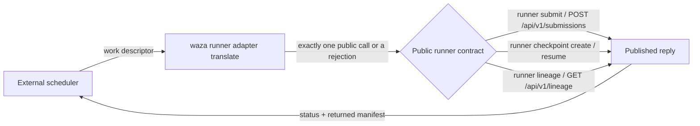

**Unreleased (v0.42.0).** Waza ships a portable adapter for external schedulers, queues and job systems.
It only translates. It does not schedule anything. An external work descriptor
becomes **exactly one** call to the existing
[public runner contract](../runner-contract/). That call's published reply then
maps to an adapter status and its returned manifest. Waza has no queue,
placement, priority, fleet, lease or retry logic. Those decisions stay with the
external scheduler.

Released schemas:

- [`adapter-work-descriptor-1.0`](../../schemas/adapter-work-descriptor-1.0.schema.json)
- [`adapter-translation-1.0`](../../schemas/adapter-translation-1.0.schema.json)
- [`adapter-result-1.0`](../../schemas/adapter-result-1.0.schema.json)



## Descriptor

```json
{
  "kind": "waza.adapter-work-descriptor",
  "schema_version": "1.0",
  "work_id": "example-queue/item-0001",
  "operation": "submit",
  "request": { "...": "complete runner-request 1.0, forwarded byte-for-byte" }
}
```

| `operation` | Public call | HTTP route | Fields |
|-------------|-------------|------------|--------|
| `submit` | `runner submit` | `POST /api/v1/submissions` | `request`, optional `policy` |
| `checkpoint` | `runner checkpoint create` | `POST /api/v1/checkpoints` | `request`, optional `policy` |
| `resume` | `runner checkpoint resume` | `POST /api/v1/checkpoints/{checkpoint_sha256}/resume` | `request`, `checkpoint_sha256`, optional `policy` |
| `status` | `runner lineage --run --work` | `GET /api/v1/lineage?run=&work=` | `logical` only |

`request` and `policy` are copied as their original bytes. Nothing is
re-encoded, and no default is filled in. If you omit `policy`, it stays
omitted, and the public contract applies its own `distinct` rule. `work_id` is
an opaque correlation ID that is only echoed back. It never selects, derives or
deduplicates work.

### Rejected input (exit 6, never dispatched)

The adapter refuses input that it cannot translate without loss or guessing:

| Code | Cause |
|------|-------|
| `descriptor_field_unsupported` | Unknown fields such as `queue`, `priority`, `placement`, `retry` or `lease`. Translating them would silently drop scheduler intent. |
| `descriptor_ambiguous` | Fields that do not belong to the operation (for example `logical` with `submit`), duplicate keys, trailing data, or a negotiation-only request. |
| `descriptor_incomplete` | A field the operation requires is missing. |
| `descriptor_invalid` / `request_invalid` | Schema violations, including in the embedded runner request. |
| `descriptor_too_large` / `descriptor_unavailable` | The input is too large or cannot be read. |

## Commands

```bash
# Offline: no store, no engine, no call. Emits adapter-translation 1.0.
waza runner adapter translate < descriptor.json

# Exactly one public call. Emits adapter-result 1.0 with the returned manifest.
waza runner adapter dispatch --store ./store < descriptor.json
waza runner adapter dispatch --azure-container-url https://ACCOUNT.blob.core.windows.net/CONTAINER < descriptor.json
waza runner adapter dispatch --endpoint http://127.0.0.1:3000 < descriptor.json
```

`dispatch` forwards the store flags verbatim to the public subcommand that this
same `waza` binary runs (or to `--waza PATH`). With `--endpoint`, it uses the
public HTTP route and reads the `X-Waza-Exit-Code` header. Combining
`--endpoint` with store flags is rejected.

## Status and returned manifest

| Adapter `status` | Public reply | Exit |
|------------------|--------------|------|
| `terminal` | `completed` or `reused` (submission or checkpoint result) | Public exit code |
| `observed` | Lineage observed | 0 |
| `operation_error` | Published `submission_error`, `checkpoint_error` or `operation_error` | Public exit code |
| `rejected` | Descriptor refused with no call made, or the public reply was `rejected` | 6 or public exit code |
| `contract_error` | Transport failure, or a reply that does not match its published schema or exit code | 2 |

A `terminal` result carries `execution_id`, `logical`, `manifest_digest`,
`outcome` and `engine_calls`, plus the complete public reply under `result`. If
a terminal reply is missing any of these, the result is a `contract_error`
rather than a guess.

## Safe retry, resume and aggregation

Retries go through the public submission policy and are never automatic. The
adapter calls the contract once per descriptor.

- **Idempotent retry**: a scheduler that re-delivers the same work sends
  `policy: {"mode": "reuse", "source": {"execution_id", "manifest_digest"}}`.
  The reply is the same manifest with `engine_calls: 0`.
- **New attempt**: `policy: {"mode": "distinct", "parent": ...}` with a new
  `selection.attempt`. The new attempt shares the parent's `logical` identity.
- **Resume**: `operation: "checkpoint"` returns a `checkpoint_sha256`. A later
  `operation: "resume"` sends it with a request for a different attempt. A
  finalized checkpoint returns the original terminal with `engine_calls: 0`.
- **Aggregate**: `waza aggregate` reads the returned manifests independently.
  The adapter is not involved.

`cmd/waza/cmd_runner_adapter_test.go` runs this whole sequence through the
public CLI commands only.

## Container entrypoint

The [reference container](../runner-container/) already has
`/waza` as its entrypoint, so any scheduler that can run a container with stdin
can use it:

```bash
docker run --rm -i --network=none --read-only \
  --mount type=bind,source="$PWD/store",target=/store \
  IMAGE runner adapter dispatch --store /store < descriptor.json
```

`examples/runner/container/test.mjs` runs `translate` and `dispatch` against the
built image, including a refused descriptor that carries a scheduler field.

## Provenance hook

`adapter-result.provenance.state` is one of `not_applicable` (no call made),
`not_configured` (the default), `verified`, `failed` or `unavailable`.
`runneradapter.ProvenanceVerifier` is an optional hook for a verifier, such as
the execution provenance work in #769. The CLI does not configure one, so the
adapter makes no provenance claim.

## Translation-only guarantee

`internal/runneradapter/architecture_test.go` fails the build if the adapter:

- imports orchestration, execution, storage, checkpoint, manifest or web
  packages
- starts goroutines
- imports `time`, `math/rand` or `os/signal`
- has more than one contract call site, or calls the contract inside a loop

## Lab

**External adapter dispatch** in the Lab **Runner contract** panel translates a
descriptor offline (`POST /api/v1/adapter/translate`). It shows the
diagnostics or the exact public call, dispatches that call once through the
public HTTP route, and shows the status and returned manifest.
